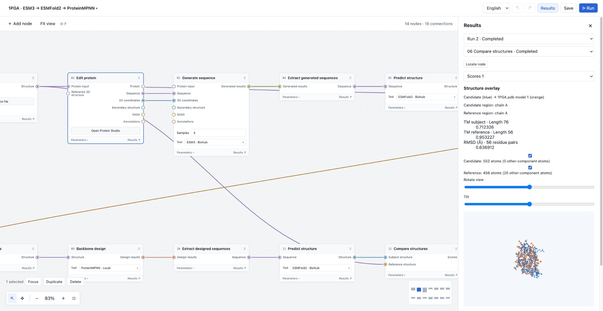
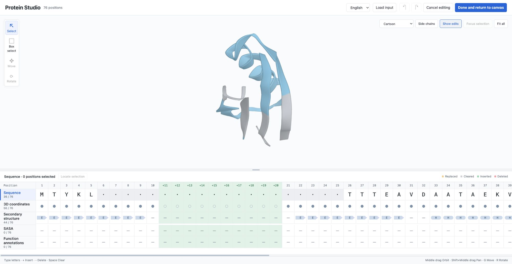
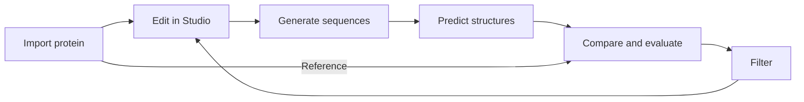

# Protein Workbench

[中文](README.md) · **English**

Build protein design and analysis workflows on a node canvas. Import sequences or 3D structures, edit them in Protein Studio, run generation and folding tools, then compare, evaluate and filter candidates for the next design round.



Connect data, editors and computation nodes. Choose the steps, branches, tools and references that fit your research. The screenshot shows a configured 1PGA workflow.



Protein Studio brings the 3D view together with sequence, 3D coordinates, secondary structure, SASA and function annotations. Each track supports its own selection and edits.

## Features

| Feature | What you can do |
|---|---|
| **Node canvas** | Place nodes, connect ports and branch workflows. Use subflows for per-item processing and repeated rounds. |
| **Protein Studio** | Edit five tracks directly, insert or delete residue positions, clear values, and view or transform existing coordinates. Track edits, undo changes and restore deleted positions. |
| **Generation and folding** | Complete or generate proteins with ESM3, design sequences against a backbone with ProteinMPNN, and predict structures with ESMFold2 or SimpleFold. |
| **Comparison and evaluation** | Superpose candidates and references, calculate metrics such as TM-score, evaluate solubility and sequence–backbone compatibility, and compute ESMC representations. |
| **Filtering and iteration** | Select candidates using existing metrics, sorting and count limits, then pass the results to downstream nodes or another design round. |
| **Module extensions** | Install nodes, tool implementations, editors and result viewers. Choose local tools or Biohub services where supported. |

Save and duplicate projects, inspect past results, export ZIP files and reuse results across projects. Switch between Chinese and English while keeping your editing state.

## A typical workflow



For example, import a PDB or mmCIF file, change sequence length and conditions in Studio, generate candidates with ESM3, fold them with ESMFold2, then compare and filter the structures before starting another design round with ProteinMPNN.

## Quick start

You need **Python 3.12, uv, Node.js 22.15+ and npm**. Run these macOS / Linux commands from the repository root.

```bash
git clone https://github.com/natsusorahoshinochan-max/modules-ESM.git
cd modules-ESM
uv sync --locked
npm ci --prefix webui
```

Start the backend:

```bash
PROTEIN_WORKBENCH_DATA_ROOT="$HOME/.local/share/protein-workbench" \
  .venv/bin/protein-workbench-server --host 127.0.0.1 --port 8000
```

In a second terminal, start the frontend from the same repository:

```bash
npm --prefix webui run dev -- --host 127.0.0.1 --port 5173 --strictPort
```

Open **[http://127.0.0.1:5173](http://127.0.0.1:5173)**.

1. The app opens a **structure prediction example** with a sequence input.
2. Follow [First use and tool setup](docs/getting-started.en.md) to install computation dependencies, choose Biohub or a local tool, and configure its module.
3. Click **Save** in the top bar to create your own project from the example.
4. Click **Run**, then open **Results** from a node or the top bar.

You can start editing and viewing data before configuring model inference. Computation requires the relevant dependencies, service credentials or local weights. Use the language selector in the top bar to change the interface language.

## Extend the workbench

A module can provide nodes, tool implementations, dedicated editors and result viewers through the public host interfaces. Official and external modules use the same extension contract.

Start with the [module authoring guide](docs/module-authoring.md), the [Python module example](examples/external_module/) or the [TypeScript UI example](examples/typescript_module/).

## Documentation and development

| Entry | Contents |
|---|---|
| [First use and tool setup](docs/getting-started.en.md) | Biohub, local tools, project saving and results |
| [Protein Studio](modules/sequence_edit/FORMAT.md) | Editing, five tracks and input/output formats |
| [Feature and format index](docs/getting-started.en.md#features-and-data-formats) | Generation, prediction, comparison, evaluation and filtering |
| [Glossary](GLOSSARY.md) · [Requirements](docs/requirements.md) · [Architecture](docs/architecture.md) | Concepts, behavior and responsibilities |
| [Development conventions](AGENTS.md) · [Validation](docs/studio-validation.md) | Development and current test entry points |

Build the frontend with `npm --prefix webui run build`. To build Python distributions, run `uv sync --locked --extra dev`, then `.venv/bin/python -m build --no-isolation`. Outputs are written to `webui/dist/` and `dist/`. See [local model validation](docs/local-models.md) for real inference checks. Some detailed development documents are maintained in Chinese.
