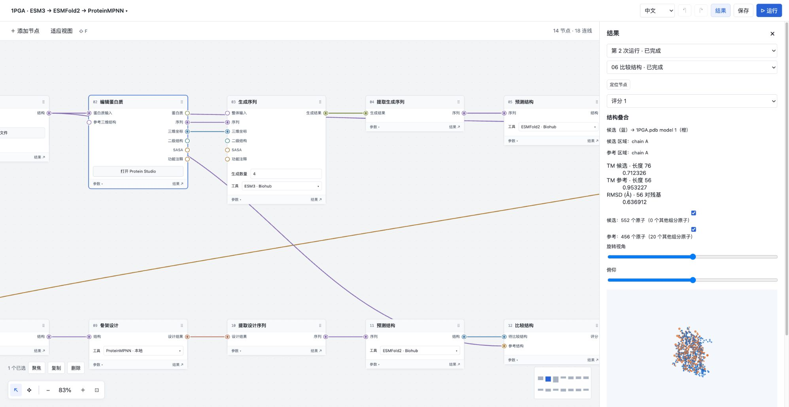
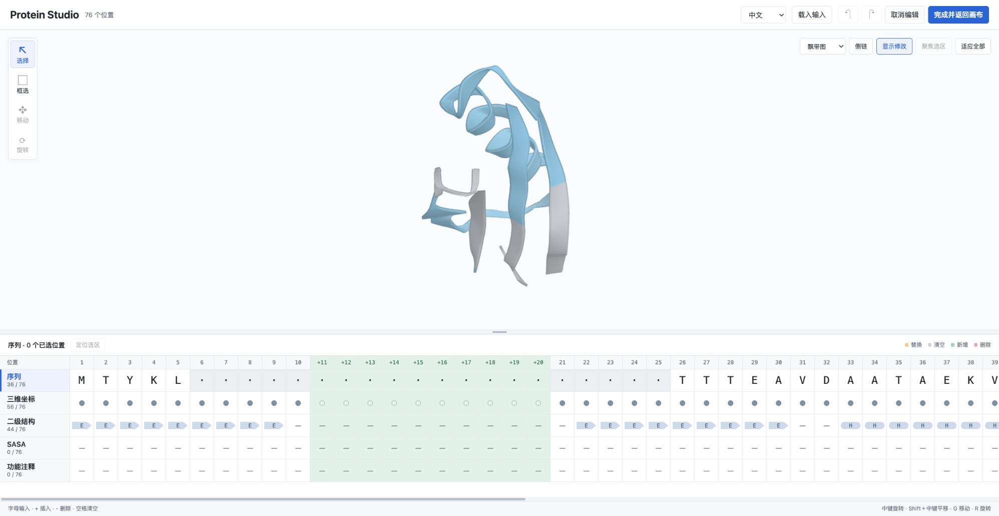
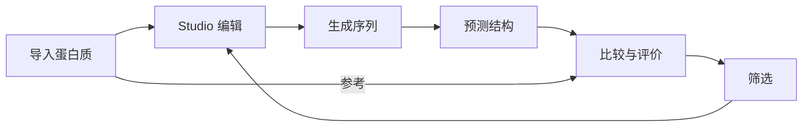

# Protein Workbench

**中文** · [English](README.en.md)

用节点画布搭建蛋白质设计与分析流程。导入序列或三维结构，在 Protein Studio 中编辑，调用模型生成与折叠，再通过比较、评价和筛选推进下一轮设计。



在画布中连接数据、编辑器和计算节点，按自己的研究任务调整步骤、分支、工具与参考对象。图中展示的是已搭建的 1PGA 工作流。



Protein Studio 将三维视图与序列、三维坐标、二级结构、SASA、功能注释放在同一工作区，各轨道可以独立选择和编辑。

## 主要功能

| 功能 | 可以做什么 |
|---|---|
| **画布编排** | 拖放节点、连接端口、组织分支，用子流程进行逐项处理和多轮迭代。 |
| **Protein Studio** | 直接编辑五条轨道，插入、删除或清空残基位置，查看和调整已有三维坐标；保留修改标记，支持撤销和恢复。 |
| **生成与折叠** | 使用 ESM3 补全或生成蛋白质，使用 ProteinMPNN 进行骨架条件设计，通过 ESMFold2 或 SimpleFold 预测结构。 |
| **比较与评价** | 叠合候选与参考结构、计算 TM-score 等指标，评价可溶性和序列与骨架适配性；使用 ESMC 计算表征。 |
| **筛选与迭代** | 按已有指标设置条件、排序和数量上限，把选中结果交给后续节点或下一轮设计。 |
| **模块扩展** | 安装新的节点、工具实现、编辑器和结果查看器，在适用节点选择本地工具或 Biohub 服务。 |

支持项目保存与复制、历史结果查看、ZIP 导出和跨项目采用。界面可随时切换中文或英文，保留当前编辑状态。

## 一个典型流程



例如：从 PDB 或 mmCIF 导入蛋白质，在 Studio 修改序列长度与条件，用 ESM3 生成候选，再经 ESMFold2 折叠、结构比较和筛选，随后使用 ProteinMPNN 开始下一轮设计。

## 快速开始

需要 **Python 3.12、uv、Node.js 22.15+ 和 npm**。以下命令适用于 macOS / Linux，在仓库根目录执行。

```bash
git clone https://github.com/natsusorahoshinochan-max/modules-ESM.git
cd modules-ESM
uv sync --locked
npm ci --prefix webui
```

启动后端：

```bash
PROTEIN_WORKBENCH_DATA_ROOT="$HOME/.local/share/protein-workbench" \
  .venv/bin/protein-workbench-server --host 127.0.0.1 --port 8000
```

另开终端，在同一仓库启动前端：

```bash
npm --prefix webui run dev -- --host 127.0.0.1 --port 5173 --strictPort
```

打开 **[http://127.0.0.1:5173](http://127.0.0.1:5173)**。

1. 应用默认打开一个带序列输入的**结构预测教学示例**。
2. 按[首次使用与工具配置](docs/getting-started.md)安装计算依赖，选择 Biohub 或本地工具并填写模块设置。
3. 点击顶栏的**保存**，将教学示例保存为自己的项目。
4. 点击**运行**，从节点或顶栏的**结果**查看输出。

编辑与查看可先行使用；模型计算需要对应的依赖、服务凭据或本地权重。界面右上角可切换语言。

## 扩展工作台

模块可以提供节点、工具实现、专用编辑器和结果查看器，通过公开接口接入载体。官方模块与外部模块使用同一套接入约定。

从[模块作者指南](docs/module-authoring.md)开始，或参考 [Python 模块样例](examples/external_module/)与 [TypeScript 界面样例](examples/typescript_module/)。

## 文档与开发

| 入口 | 内容 |
|---|---|
| [首次使用与工具配置](docs/getting-started.md) | Biohub、本地工具、保存项目及查看结果 |
| [Protein Studio](modules/sequence_edit/FORMAT.md) | 编辑操作、五条轨道与输入输出 |
| [功能与数据格式索引](docs/getting-started.md#功能与数据格式) | 生成、预测、比较、评价、筛选等模块说明 |
| [术语](GLOSSARY.md) · [需求](docs/requirements.md) · [架构](docs/architecture.md) | 项目概念、行为与职责 |
| [开发约定](AGENTS.md) · [验证入口](docs/studio-validation.md) | 开发与当前测试方式 |

前端构建使用 `npm --prefix webui run build`。Python 打包先执行 `uv sync --locked --extra dev`，再运行 `.venv/bin/python -m build --no-isolation`；产物分别位于 `webui/dist/` 与 `dist/`。真实模型验证见[本地模型与验证](docs/local-models.md)。
