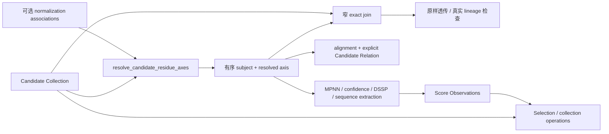

# Candidate–Residue Axis 精确关联：有序科学值与删除型改造设计

- 日期：2026-09-21
- 状态：已实现并验收；见[验收记录](2026-09-21-exact-resolved-axis-acceptance.md)。
- 决策来源：用户明确接受破坏性 Port 替换、引用作为科学主体/父身份，以及有序 axis 主导的方案。
- 词汇：`CONTEXT.md`；历史 ADR 仅解释背景。
- 范围：Candidate-associated Resolved Structure Residue Axis 的生产、运输、消费与必需的身份准入调整。

## 1. 科学契约

1. 允许替换现有 Port 和开发期结果格式，按整体 implementation 净减少选择，不建立兼容路径。
2. 已准入的完整 Candidate Data Reference 足以确立科学主体与父 Candidate 身份；它不包含完整 Candidate 的 lineage/metadata，不能代替完整值进行原样透传。
3. resolver 输出按其输入 Candidate Collection 的顺序排列的 `subject + residue_axis`。普通消费者不再同时接收同一批结构 Candidates。
4. 真正读取 Candidate 父代信息或原样输出 Candidate 的消费者保留完整 Candidate 输入，使用一个小型精确关联 interface。

以下保持现有科学规则，不借重构另行扩张：非空 axis population、每个 population 内 Candidate ID 唯一、完整三元引用匹配、各 Method 的 cardinality、显式 Candidate Relation 顺序、Prediction Residue Axis 与 Resolved Structure Residue Axis 的区分。

## 2. 数据流与 module 分工



- `structure_transform` module 拥有 resolved axis 的产生、名义值合同、顺序与证据投影。
- `datatypes` 保留 Provider-independent scientific values；不放 `AdmittedPort` 或执行编排。
- `core` 通过已有 candidate-data/scientific-axis projections 理解身份，不 import extension module。
- 各 Method module 拥有自身 scientific restrictions；Provider adapter 继续只翻译其输入/输出。
- 新消费 seam 是一个完整科学 population；不是 `Any + capabilities`，不增加 registry、通用 join policy、全局缓存或新运行框架。

## 3. 有序值的完整 interface

### 3.1 形状与名字

保留已有 Python 名称、Port Type ID 和字段，避免纯改名扩大改动：

```python
@dataclass(frozen=True, slots=True)
class CandidateResolvedResidueAxisAssociation:
    subject: CandidateDataReference
    residue_axis: ResolvedStructureResidueAxis

@dataclass(frozen=True, slots=True)
class CandidateResolvedResidueAxisAssociations:
    entries: tuple[CandidateResolvedResidueAxisAssociation, ...]
```

Port Type：`structure_transform.candidate_resolved_residue_axis_associations`。

constructor 只冻结 tuples，保持 entries 顺序，不执行 nominal validation。codec 保留同一顺序；没有旧排序 parser 或兼容格式。

每个 entry 只存一份 subject 与一份 axis。不增加 `Candidate`、`parent_ids`、metadata、collection_id、平行 subject 列表或额外 PDB 字段。axis 中已有的 structure 是这个 entry 唯一的结构 payload。

### 3.2 不变量与唯一 owner

| 不变量 | 唯一负责处 |
|---|---|
| entries 非空；一个 population 内 Candidate ID 唯一 | 此名义 Port admission |
| subject 是 `protein.structure` 的完整 Candidate Data Reference | 此名义 Port admission；已闭合 reference 的字符/摘要语法不在消费者重验 |
| axis structure 的 canonical content digest 等于 subject digest | 此名义 Port admission |
| axis 的 layout、segments、coordinates、mask、component dispositions、normalization 科学一致 | 已有 resolved-axis admission；聚合复用该 owner |
| entries 顺序等于 resolver 输入的 Candidate Collection 顺序 | resolver producer；codec 保留该顺序 |
| projected Candidate references 与 entries 对应；axis evidence 的 source/layout/digest 来自同一 entry | 此 Port 的现有 projection implementation |
| Method 的单例、sequence/layout、CA 坐标等条件 | 相应 Method implementation |
| relation 的 membership、完整覆盖、顺序及 cardinality | 消费该 relation 的 Method module |

每个 population 仍禁止相同 Candidate ID 的两个 data versions；不把“关联键为三元组”误解为此次放宽该限制。不同 Candidate IDs 可以对应内容相同、scalar axis digest 相同的结构，二者仍是不同 subject。

### 3.3 三种身份不合并

1. `subject.content_digest`：`protein.structure` canonical bytes 的 digest。
2. `axis_reference.axis_content_digest`：独立 scalar `ResolvedStructureResidueAxis` 的 codec digest。
3. population content digest：有序 collection 的 canonical bytes digest。

改变 entries 顺序改变第 3 项，前两项各自不变。ProteinMPNN parent slot 从 entries 顺序产生；使用相同源顺序、seed、结构和参数时，保留每个 parent 的有效调用 seed 与输出顺序。由于 Node 输入集合和 Result Identity 改变，不承诺旧 Candidate ID、Run ID、Cache key 或旧字节产物相同。

### 3.4 普通消费者如何读取

不新增“已关联行”公共 transport 或每个 scalar 都带一遍 evidence 的字段。需要 evidence 时，直接读取同一个 admitted value 的 owner-defined projection：

```python
port = call.inputs["structure_residue_axes"]
associations = cast(CandidateResolvedResidueAxisAssociations, port.value)

for parent_slot, (entry, axis_reference) in enumerate(
    zip(associations.entries, port.scientific_axes, strict=True)
):
    # subject = entry.subject
    # axis = entry.residue_axis
    # axis_reference 直接来自 admission，不再次 hash、parse 或 validate。
    ...
```

此 zip 是单个 nominal value 与其自身投影的已定义关系，不是两个独立科学集合的位置猜测。该 interface 只针对一个 scalar collection Port；不把多值 Port flatten 的偶然次序升级为科学规则。

不需要 evidence 的 design/extraction 直接遍历 entries。single-axis projection 只检查 entries 数量为一，返回已有 axis；不再要求第二个 Candidate Port。

## 4. 真实完整 Candidate 消费者的窄 interface

`modules/structure_transform/candidate_axes.py` 提供唯一共享入口：

```python
@dataclass(frozen=True, slots=True)
class CandidateWithResolvedResidueAxis:
    candidate: Candidate
    residue_axis: ResolvedStructureResidueAxis
    axis_reference: ResidueAxisReference


def join_candidate_residue_axes(
    candidates: AdmittedPort,
    residue_axes: AdmittedPort,
) -> Mapping[CandidateDataReference, CandidateWithResolvedResidueAxis]:
    ...
```

约定：

- 两个参数是各自已经 admitted 的 scalar collection records；不再验 nominal types、digest、内部 projection closure。
- 跨输入唯一关系要求：完整 Candidate Data Reference 的集合相等。拒绝缺失、额外或旧 digest，失败为 `ValueError`，不 repair、不截断、不 fallback。
- 以 candidate_id 在同一个可信 Candidate record 内定位完整 reference；跨 Port 一律用完整 reference。
- 返回不可变 mapping，迭代顺序来自完整 Candidate Collection；保留其筛选透传行为。axis entries 可以是另一顺序，关联不靠位置，两个顺序不必相等。
- 对 reference 与 axis 建局部索引，O(n) 时间与空间；复用输入对象，不重新读取 PDB、算 hash、做 admission。
- `one()`、`allow_extra`、`coverage`、`order`、任意 associated-value 类型参数均不加入 interface。单例要求由对应 Method 明确写出。

此处 Candidate Collection 顺序用于其真实透传工作；普通 axis-only Method 的顺序由 axis collection 拥有。顺序 owner 不交给全局 flag。

## 5. Node Type 的消费职责

| Node Type | 当前关键输入与规则 |
|---|---|
| `structure_transform.resolve_candidate_residue_axes` | structure_candidates + optional normalization；输出有序 |
| `structure_transform.extract_sequence_candidates` | residue_axes；按 entries 顺序生成 child，parent 为 entry.subject.candidate_id |
| `structure_transform.project_single_residue_axis` | residue_axes，恰好一项 |
| `proteinmpnn.design` | structure_residue_axes + optional sequence/constraints；按 entries 产生 parent slot |
| `proteinmpnn.score` | structure_residue_axes 单例 + sequence_candidates 单例；保留 sequence.parent_ids 与结构 subject 的关系 |
| `folding.simplefold_confidence` | structure_residue_axes；第一项 Provider 调用前完成全 population 的 CA 条件检查 |
| `structure_annotation.dssp_compute` | residue_axes 单例 |
| `structure_annotation.secondary_structure_agreement` | subject_residue_axes 单例 + references + expected + observed；保留 track/reference/layout 新关系 |
| `structure_comparison.align_pairs` | subject_residue_axes + reference_residue_axes + relation；relation 顺序决定 alignment 输出 |
| `structure_comparison.evaluate_inserted_loop` | subjects 为完整 Candidate 透传源；subject_residue_axes 经共享 join；references/counterparts 仍有真实范围与配对用途 |
| `structure_comparison.classify_three_way_consistency` | input_residue_axes 单例给 source identity；sequence_parents、esmfold2_structures、simplefold_structures 保留真实 lineage；两组 prediction axes 经共享 join |

`rmsd` / `tm_score` 等只消费已有 alignment evidence 的 Nodes 不为配合本次设计额外引入 axes。它们现有 relation、subjects/references 的范围声明也不顺手重写。

三向一致性仍明确验证：sequence 的 parent 是 input axis.subject；ESMFold2/SimpleFold Candidate 的 parent 是同一 sequence Candidate。不能用“有一个 pairing”替代这个真实 lineage 事实。

## 6. core 身份与科学范围分工

### 6.1 父身份与 Score subject

`candidate_identity.py` 分清三种事实，使用现有 admitted inputs，不新增持久化模型：

- 输入完整 Candidate values：仅用于原样透传的完整值匹配。
- 输入完整 Candidate Data References：用于精确主体 membership 和新 child 的父身份。
- Binding 声明的 subject/reference Port：由 Observation Admission 限制本次 Metric 的科学 population。

新 child 父检查接受已准入输入引用的 Candidate ID，或同一 operation 中可解析的新输出父 Candidate；未知父、cycle 仍失败。父身份字段仍是现有 Candidate ID，不趁此次改成另一 lineage wire schema。

Fresh Score 的主体由 nominal admission 与 Produced Observation admission 分工核验：前者负责值本身及 pairwise context.subject 与 score.subject 一致，后者按声明 source Port 核验 subject/reference、Metric/Method/Context、数量及 axis reference。Score Collection identity 由身份编排构造，不额外要求完整 Candidate 输入。未声明输出、声明范围外 subject、same-operation 尚未准入输出的 subject 仍不能通过。

Propagation 的来源闭合由 `require_exact_propagated_subject` 拥有；Produced Observation 的 propagation 分支不重复核验主体。Candidate Relation 保留其既有传播来源规则。

父身份 membership 来自输入已准入完整引用；只在实际解析某个 parent ID 时要求它对应唯一完整 reference。多个 inputs 中相同 reference 可重复出现；同 ID 对应不同 digest 时不得 dictionary last-wins。Fresh Score 使用其声明 Port 内的完整引用，不因为另一个 Port 同 ID 的不同数据版本而被无关地拒绝。

完整值透传继续使用实际完整 Candidate 输入。只在请求复用该 identity 时检查来源与输出完整 data/lineage/metadata 相同；同 ID 有相互冲突的完整值不能任选一个。只有引用、没有完整值时，不能把新构造的对象当作原输入 Candidate 保留旧身份：拒绝这种透传身份复用；新生成的 Candidate 应使用 producer-local identity，再正常赋予新身份。

### 6.2 Produced Observation 的来源声明

Catalog builder 不再要求 subject Port 的 nominal ID 一定是 `candidate.collection`；要求 exact registered Port Type 拥有现有、配对完整的 `candidate_data_projection` 和 runtime projection。继续验证 subject grain/source role、Metric、Method、axis source、multiplicity 等合同。

关键含义：这是“该声明明确选择的 Port 所投影的完整 Candidate population”，不是从任意 value 的字段猜 subject。例如 alignment evidence 的 projection 含两侧 Candidate references；若将其声明成 subject source，含义就是整个投影 population，不能偷偷只取 `.subject`。SimpleFold 与 SS agreement 的 subject source 分别使用各自 axes Port。

不添加 supports_subject 标志、adapter registry、按 Python 类型的分派或 `core → modules` import。reference source 仍使用声明的 Candidate Collection。

Builder 要求 `subject_direction == "input"`，不允许同 operation 输出作为 fresh subject。

运行时 Observation Admission 继续检查：Score 属于**声明 Port 的完整 population**、对应 Metric/Method/Context、规定数量和 axis reference。全体输入中“认识这个 Candidate”并不等于允许任意 Metric 为它产出 Observation。声明来源内的 Candidate ID 唯一性规则继续存在；多值 evidence 投影若重复同一个 reference，不能靠全局去重偷偷变成另一个 subject population。

### 6.3 声明联动

- SimpleFold confidence：subject_port 为 `structure_residue_axes`，axis_port 同值。
- SS agreement：subject_port 为 `subject_residue_axes`；reference_port 继续 `references`。
- ProteinMPNN score：subject_port 仍是 `sequence_candidates`；结构 axis Port 不改名。
- selection candidate_input 继续要求 `candidate.collection`；不把 axis carrier 伪装成完整 Candidate population 的可透传值。

## 7. Selection、结果阅读与不引入的额外能力

Selection 继续从原始 Candidate 分支取完整值，从 score 分支取精确 Observation：

```text
结构 Candidates ───────────────→ Selection.candidates
      └→ resolve → confidence → Selection.scores
```

编译时 Observation capability 记录真实 axis subject_source；不伪装成原先 Candidate 输出。objective 匹配使用 Metric/Method/Context/partition，不要求 candidate_input 与 subject_source 为同一个 Port。运行期按完整 Candidate Data Reference 选择。

WebUI 分别选择 Candidate 来源与 Score 来源，`selectionSources` 按实际名义 Port 列出完整 Candidate 输出；axis carrier 不提供完整 Candidate 的 Selection 来源。

若用户要先筛选或重新排序，再执行对顺序敏感的 Method：先操作 Candidate Collection，再接 resolver。此次不提供 axis subset/reorder Node，不提供“从 axis 重建完整 Candidate”Node，也不引入跨请求 axis cache。resolver 的重复工作若成为真实需求，另行证明再设计；不预建机制。

Results 的原 Candidate 页面仍来自原始 Candidate outputs；其 sequence evidence 由完整引用关联 axis，不从 PDB/parent 猜。`published-results.ts` 消费 entries/subject/residue_axis 字段。科学存储格式的读取仍按现有 core ResultBrowser 与前端职责分工，没有新增 public 科学投影。

## 8. 失败位置、随机性与 evidence

| 场景 | 负责处与结果 |
|---|---|
| 原始结构/axis 不闭合、subject digest 不对应、重复 ID、空 axes | 名义 Port admission 失败 |
| axis-only Node 缺少整个必需 Port | 现有 Workflow/Run required-input 语义；不增加新校验 |
| 完整 Candidate + axes 的两个合法输入范围不等 | 共享 join 在科学计算前失败 |
| DSSP 多项、scoring 多 parent、SimpleFold 无 CA | 对应 Method 条件检查失败 |
| Relation 含范围外 subject、遗漏关系、错误 cardinality | relation 消费 Method 失败 |
| 来自 input reference 的 child parent | identity normalization 接受；新 child 仍获新身份 |
| 只有引用却试图原样透传完整 Candidate | 不获透传资格，不冒用旧身份 |
| 存储加载或 Provider 实际执行失败 | 既有真实错误语义；不加修复、fallback、retry |

不改变 Node Execution Attempt / Operation Attempt / Engine Invocation 的区分。精确关联或明确的 population 预检查应在首次科学引擎调用前完成；不把其他目前逐 parent 的 Method 检查强行改成全局预检，以免悄悄改变失败证据语义。

Cache restore 重建有序值及其投影，不重新执行科学或 JSON 准入；消费者信任已发布值，存储完整性检查保留。编码、恢复和准入的完整分工见[单次准入规格](2026-09-21-single-admission-i-json-design.md)。

Prediction Confidence Fact / Prediction Key / Prediction Residue Axis 保持独立，不能由输出 PDB 的 resolved axis 替代。Normalization key/materialization 的现有生产流程保留，下游使用 axis 已记录的 normalization provenance。

## 9. 行为验收边界

| 契约 | 必需用例 |
|---|---|
| 有序 nominal value | 输入 B,A，roundtrip 仍 B,A；交换 entries 只改变 population digest，不改变 scalar axis/reference identity |
| Admission | empty、duplicate Candidate ID、同 ID 不同 digest、错误结构 digest；错误在 owner 拒绝 |
| 身份分离 | 两个不同 subjects 可共享相同结构/axis；两个主体都保留，不能按 axis digest 去重 |
| 同值投影可信 | 消费者直接使用 admission 给出的 axis_reference；不重新 hash/parse/validate |
| 真实双输入 join | 独立合法输入的 missing、extra、stale digest 分别拒绝；顺序不同仍关联正确；不向 join 输入伪造 broken AdmittedPort 要求它二次校验 |
| Parent | 仅 axes 输入的新 child 可引用 admitted subject；未知父与 cycle 仍拒绝；仅在所用 parent ID 对应不同内容时拒绝歧义 |
| Pass-through | 完整 Candidate A 与另一 Port 的同 ID/不同 digest 引用并存时，透传 A 使用其自身 record 的引用；不能 last-wins，也不重算 hash |
| Score | 仅 axes 输入可产出合法 subject Score；全局已知但不在声明 source Port 的 subject 仍拒绝；错误 Method/Context/axis 保持拒绝 |
| Projection 范围 | alignment 等含多个角色的 projection 不得被暗中当成只有一个 subject；按 Binding 明确声明的完整 population 验证 |
| ProteinMPNN | B,A parent order、派生 seed、child parent/sample order；score 单例及 sequence.parent_ids/layout |
| SimpleFold / DSSP / SS agreement | CA 全体预检、单例要求、SS8 present-pair、subject/reference 与 layout 精确关系 |
| Comparison | relation 顺序、many-to-one reference、axis evidence digest；inserted-loop 原样透传、three-way 真正 lineage |
| Selection | 原 Candidate 分支 + axes 评分分支能编译、执行、选择；旧 digest 不冒充新内容 |
| Cache / restart | 新版值的命中与重启保留 entries 顺序和 scalar identity；不依赖旧开发包兼容 |
| Current examples / WebUI | 7 个例子连线合法、bundled result 可读、结果序列证据关联不变、Selection 来源可编辑 |

验收结果、真实 Provider 证据、示例资源重生成和删除统计统一保存在[验收记录](2026-09-21-exact-resolved-axis-acceptance.md)。本规格定义当前科学合同，不保留已完成的迁移步骤或旧接口。
