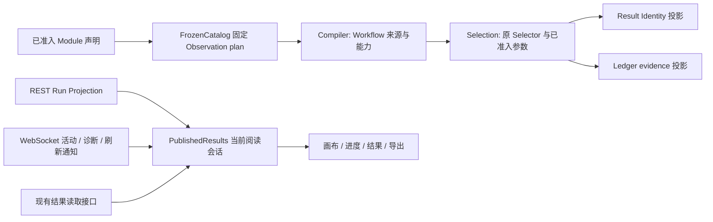

# Catalog、Selection 与 Run 阅读：09-21 阶段架构

状态：04 / 12 / 07 已实现并完成远端验收，原实施基线为 `2b83d8e3`，该阶段证据见[验收记录](2026-09-21-catalog-selection-run-acceptance.md)。后续 04 / 05 / 06 改造也已完成实施与完整验收；最终接口和职责以[结构优化设计](2026-09-22-architecture-04-05-06-design.md)为准。下文 04 / 12 / 07 记录原阶段的实现边界，不作为后续改造接口的定义。

沿用[科学单次准入与 I-JSON 分工](2026-09-21-single-admission-i-json-design.md)。ADR 仅作历史背景。职责集中通过删除重复解析、包装和状态实现，不增加兼容路径、registry、验证凭据、缓存框架或状态机。

## 04：FrozenCatalog 拥有固定 Observation 事实

`FrozenCatalog` 初始化时，为每个已准入 Binding 构建现有 `ProducedObservationPlan`，保存不可变 Binding→plan 映射。`produced_observation_plan(binding_id)` 直接读取该启动产物。纯转换位于 `core/catalog/_observation.py`；Compiler 与测试不再拥有另一套解析器。

| 事实 | 唯一 owner |
|---|---|
| Binding 默认 Method、output port、partition、exact Metric | FrozenCatalog |
| intrinsic/calibration/pairwise Context profile | FrozenCatalog |
| grain、role、multiplicity、source direction/port | FrozenCatalog |
| Metric shape/range/null/finite/binary32/axis/evidence 要求 | FrozenCatalog |
| propagation mode、ports、filter、absent-input policy | FrozenCatalog |
| Port 实际连接的上游 Node、动态 Method、DAG capability 传播 | Compiler |
| 实际 Observation 的 Method、subject、axis、evidence 与声明的关系 | runtime admission |

Builder 先完成 stable-ID 与跨声明关系准入；Catalog 构建只投影这些事实，不重复验证。Compiler 将同一 plan 交给 `_ExecutionPlanNodeRuntime.produced_observation_plan`；编辑 capability 推导同样读取该 plan，再附加 Workflow 来源关系。

plan 的 `metric_facts` 是不可变 mapping。没有 lazy resolve、更新或失效机制。该运行时投影不进入 Catalog descriptor 或科学 identity。

保留 Builder 的 Port 存在/类型、subject 来源、Context schema、axis/method/pairing 与 propagation 声明关系检查。运行期仍检查实际 Method、完整 Candidate Data Reference、source population、mask、shape、range、binary32 和 evidence。`method_port` 的实际 Method 不能用 Catalog 默认 Method 替代；缺失 optional input 与不完整编辑图的处理仍归 Compiler。

## 12：Selection 直接消费已有事实

`ObservationSelector` 贯穿 Workflow、Plan、OperationContext 与 runtime。Compiler 直接传递消费 Node 选中的 selectors。`ResolvedUtilityTransform.parameters` 使用参数 owner 返回的 `AdmittedParameterValues`，不再复制、冻结或 JSON 准入。

`UtilityParameterFacts`、`ResolvedObservationSelector`、`ObservationSelectorProvenance` 及其搬运函数已删除。Ledger 直接从 Selector 显式投影，不引入替代包装。

`ResolvedSelectionObjective` 继续存在：它拥有 Utility callable、已补默认值参数、declared/effective weights，确实增加了事实。权重按每个消费 Node 的 objective 子集归一化，不能上移 Catalog。

| 内容 | Ledger evidence | Result Identity |
|---|---|---|
| objective/selector ID | 本次 Workflow 名称 | 排除 |
| 来源 | Node ID + output port | 消费者 input port |
| Metric/Method/Context/partition | 保留 | 保留 |
| Utility 参数、declared/effective weights | 保留 | 保留 |
| callable | 不持久化 | 不参与 |

IdentityFacts 与独立 canonical projector 保留；持久化 `ContextSelectorEvidence` 不以运行时对象替代。`candidate_input` 与 `score_collection_input` 仍有来源语义，本轮未删除这些字段。

capability、消费连线、exact subject/digest、Utility 新输出 finite/非 bool/[0,1] 检查各自保留。排序、tie、missing/duplicate、out-of-scope 与 pairwise normalization 不变。重命名 locator 不改变科学 identity；新 Run evidence 使用本次 locator，不沿 Cache 复用旧名称。

## 07：PublishedResults 唯一拥有 Run 阅读会话

`webui/src/published-results.ts` 中现有 `PublishedResults` 拥有当前 Session：Run projection、结果与分页、socket、已接收 cursor、replay/连接状态、active attempt 关联和 diagnostics。接口为 `openRun`、`refresh`、`reconnect`、`ensureCandidates`、`subscribe`、`getSnapshot`；`openRun` 可接已有 start receipt cursor。

只保存当前阅读会话，切换 Run 时退休旧 Session。历史 Run 从头 replay 取得诊断。Session 身份和 refresh revision 阻止旧 Run 或较早请求覆盖当前结果；同 Run 重开复用已读分页，不重复 socket。

| 数据 | 写入来源与显示时序 |
|---|---|
| 持久 Run status、scope、node dispositions、输出 | REST 是唯一来源 |
| 当前 attempt/node、diagnostics、连接与 replay | WebSocket |
| 节点完成、Run 正式终态 | 事件触发的下一次 REST 刷新后显示 |
| 画布节点状态、总数和完成数 | 从 snapshot 与活动节点纯派生 |
| 结果读取 phase/error | 独立于 Run status |

`run_started`、live `node_disposition`、`replay_complete`、live `run_terminal` 触发刷新。replay 期间不逐事件请求；结束后刷新一次。历史 started 不覆盖 REST 已终结的 disposition。terminal 到达标记正常流结束并安排最终刷新，不再写另一份 Run status。

REST `ledger_cursor` 与 WS 已接收 cursor 是不同事实；重连使用后者，避免漏掉尚未消费的诊断。断线不代表 Run failed；最终读取失败保留 partial results 并允许重试。

App 保留 Workflow 编辑、scope preview、commit/start/cancel、操作错误、science comparison 与 Project `latest_run_id` 同步。App 不再保存 RunProgress 镜像或跨 Run 阅读字典。start receipt 至首个 REST 返回之间，已有会话表示正在读取的 Run，防止重复启动；不增加启动状态机。

## 05：已完成的阅读边界改造

本轮原始基线中的 ResultBrowser 位于 core，负责 Candidate page/detail；前端解释已发布 Score/axis/alignment 等 wire。该划分现由后续 04 / 05 / 06 改造替换：public 组合科学 owner 的阅读投影，PublishedResults 统一会话、读取、关联及导出准备。

05 已完成 public 阅读投影、PublishedResults 会话与导出准备的消费者迁移。最终接口及验证证据见[04 / 05 / 06 结构优化设计](2026-09-22-architecture-04-05-06-design.md)和[完整验收记录](2026-09-24-architecture-04-05-06-acceptance.md)。

评价目标是明确职责、让同一科学事实只有一个 owner、形成清晰的 seam，并消除重复解释和编排。合理新增代码可以换取更深的 module 和更好的 locality；净行数减少不再是进入设计或验收的门槛，仅移动文件不构成结构收益。实现保留 canonical 下载正文、科学 identity、原始值查看和精确引用关联的语义，不能通过重复校验、兼容路径或无实际消费者的抽象换取表面统一。下方历史验收只认证原始基线；后续改造由上述 09-24 验收记录认证。

## 验收与持续约束

验收覆盖共享 immutable plan、动态 Method、传播与缺失输入、Selection identity/evidence 区分、参数不可变性、Run 切换与请求乱序、replay、terminal 刷新、重连 cursor、分页与 ensure-all。科学 descriptor、bytes/digest 与身份 Golden 保持一致。

十三项非 Provider 检查、十九档正式 Campaign、六条真实 UI 旅程和三项安装 smoke 全部通过。生产净减少 127 行，有效代码减少 110 行、819 tokens。完整记录见[验收文档](2026-09-21-catalog-selection-run-acceptance.md)。后续验证遵守[远端批量执行规则](backend-verification.md#execution-policy)。
