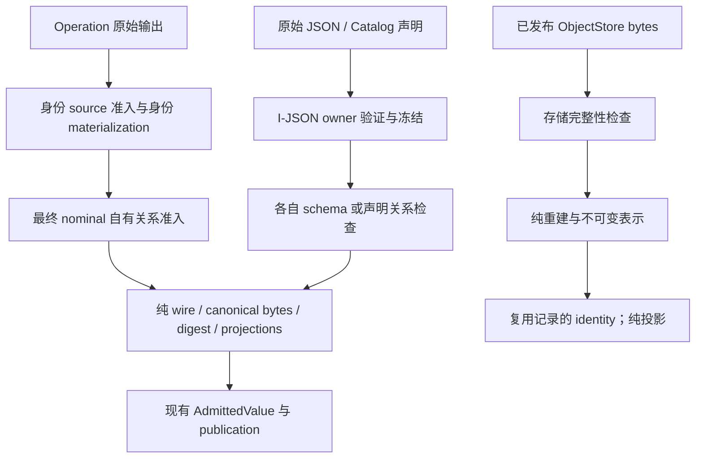

# 科学值单次准入与 I-JSON 单一 owner：完整设计

状态：已实施并通过全部远端验收。分析基线：`68666d8f`（2026-09-21）。结果见[实施与验收记录](2026-09-21-single-admission-i-json-acceptance.md)。

范围：架构报告候选 01「科学值只准入一次」与 02「I-JSON 规则与冻结只有一个 owner」。本文以当前实现、CONTEXT 与用户确认的选择为依据；历史 ADR 不构成约束。此前精确关联改造及简单修复已经提交。

## 1. 已确认的方向

用户已确认：

1. 改变 encode/from_wire/content_digest 的隐式准入语义；采用显式准入与纯编码，整批迁移调用者与测试。
2. 原始 I-JSON 在所属入口准入；后续信任，不新增品牌类型、trusted 参数、证明包装或缓存。
3. datatype constructor 的科学检查迁到对应 nominal owner；constructor 只负责不可变表示转换，不增加绕过 constructor 的恢复机制。
4. 公共 JSON 入口采用项目严格规则：拒绝负零及非法 Unicode 对象键。
5. 声明了 identity materializer 的 fresh 输出必须提供既有 OutputIdentityIntent；删除 raw 完整值绕过 source 准入的旁路。已发布恢复不受影响。

目标是删除同一准入链中的重复判定，使编码、摘要、投影、恢复不再隐含科学准入。不是宣称任意 Python 对象在整个进程生命周期只被访问一次。不同 envelope 的序列化、不同输入之间的新关系、存储字节完整性各有真实职责。

本次不实现新科学运输格式；有序 axis、scalar axis identity、Candidate identity、Prediction Key、lineage、Metric/Method/Context 的含义保持不变。对过去误接受的负零/非法键明确拒绝，不做静默修复。

## 2. 证据：当前重复发生在哪里

| 链 | 已确认事实 | 定位 |
|---|---|---|
| fresh axis association | association validator 验 axis/PDB；structure content_digest 再验 PDB；axis projection 的 content_digest 再验整条 axis/PDB | `modules/structure_transform/_candidate_association_codecs.py:143,198`；`_resolved_axis_codec.py:177` |
| canonical 编码 | encode 先 validate；content_digest 调 encode | `core/catalog/port_contract.py:512,568` |
| Cache restore | restore 跳过外层验证，但 nested from_wire 与 scientific-axis projection 仍触发科学检查 | `core/execution/output_admission/port_values.py:145`；`_resolved_axis_codec.py:401` |
| Prediction axis | folding 显式验 layout；PredictionResidueAxis constructor 再验 layout/sequence；nested decoder 再调用子 codec 准入 | `modules/folding/_output_construction.py:89`；`datatypes/prediction.py:102`；`modules/structure_prediction/port_types.py:170` |
| Prompt | recipe 验完整 Prompt，runtime output admission 又验；Preview 的 digest 也隐式验 | `modules/prompt_authoring/recipe.py:976`；`modules/prompt_authoring/authoring.py:176` |
| I-JSON | 两套整数/浮点/Unicode/键规则，两套冻结算法 | `datatypes/i_json.py:20`；`core/catalog/canonical.py:18,64` |
| Catalog descriptor | 为检查而 canonicalize，丢弃 bytes，再冻结 | `core/catalog/port_contract.py:191,350` |
| 参数 | 默认值与 submitted values thaw 后，schema 检查，再整体 freeze | `core/parameters/contract.py:589`；`core/parameters/model.py:71` |
| 其他冻结/摘要 | Workflow 自有 freeze/thaw；declaration 逐叶编码后丢弃；Prediction 自有 RFC8785/hash | `core/workflow/document.py:31`；`core/catalog/declarations.py:56`；`datatypes/prediction.py:26` |
| public | schema 入口通过 RFC8785 编码检查 JSON，负零被编码成 0；不是项目严格 I-JSON admission | `protein_workbench_public/protocol.py:313` |

对一条正常 fresh resolved-axis association entry，当前上述链至少调用两次完整 axis validator、三次 PDB validator。这是静态调用链结论，不是性能测量。

## 3. 方案比较与取舍

| 方案 | interface 与收益 | 代价 | 结论 |
|---|---|---|---|
| 局部删法 | 保留 encode 隐式准入，仅令 digest 纯编码；caller 改动小 | nested decode、constructor、source/aggregate 重验仍存在，准入时机仍隐藏 | 不采用，未满足已确认目标 |
| 显式准入、纯 codec | 使用现有 nominal validators、AdmittedValue、identity source facts；科学 owner、表示转换职责固定 | 必须审计每个直接调用者和 constructor 独占检查 | 采用 |
| 一次 prepare 返回 wire/digest/projections | 嵌套 owner 直接组合子准备结果，可复用序列化结果 | 替换 runtime callbacks，新增准备结果和编排；未证明整体净减 | 不采用 |
| I-JSON 私有品牌容器 | 通过新类型跳过已准入子树检查 | 新容器、字段迁移和状态概念；现有 FrozenList 不能复用为凭据 | 不采用 |

选定方案的 depth 来自 caller 只需要知道何处完成准入；locality 来自每项规则只有一个 owner；leverage 来自 runtime、Preview、Catalog、恢复共享纯 codec，而不是增加通用验证框架。

依赖均主要为 in-process 计算；JSON parser/RFC8785 是现有库依赖，不需要为其增加 Adapter。ObjectStore 已有真实存储 Adapter，保留原 seam。

## 4. 目标职责图



恢复从 H/I 返回现有 AdmittedPort，不经过 B/C。新外部文件不能因“能解码”就走恢复入口。

## 5. 候选 01：Port interface

保留已有 nominal contract 与 runtime callbacks，固定各方法的语义；不引入一套并存的 legacy 方法。

| 方法 | 目标职责 | 明确不做 |
|---|---|---|
| `validate(value)` | 判定该 nominal owner 的科学不变量；嵌套 source 的职责见下一节 | 不编码，不做外部 Method/source population 推断 |
| `to_wire(value)` | 值到既有 wire 表示 | 不科学准入 |
| `from_wire(wire)` | wire 到 runtime 表示；正常 constructor | 不调用科学 validator |
| `encode(value)` | 既有 nominal envelope + 纯 canonical 编码 | 不调用 validate |
| `content_digest(value)` | 对上述 bytes 作 SHA-256 | 不调用 validate，不改变 envelope |
| `restore(bytes)` | 读取已发布 envelope，复用同一 from_wire | 不重新 nominal admission，不校验科学内容 |
| `decode(bytes)` | 若保留用于 Contract Test Kit：canonical/envelope conformance 与表示重建 | 不作为暗藏科学准入的捷径 |

当前没有查到生产路径使用 decode 接收任意外部 Port bytes；因此不新增 Import module。Contract Test Kit 显式分别验证 codec conformance 与完整科学准入。restore 的数行 envelope 拆解可以保留，不为删除方法名机械引入新 helper；科学重建实现必须只剩一个。

`from_wire` 保留必要的 tagged representation 分派、字段到参数的转换、SASA/坐标 int→float 等既定 runtime 类型恢复。不能把这些转换混同于科学准入，也不能顺手改变 `$tuple/$map/$dataclass`。

## 6. 候选 01：fresh 身份前后分工，禁止漏验

**不能只删除 encode 中的 validate。** 当前 CandidateCollection validator 不递归准入 candidate.data；其数据目前通过身份编码获得准入。必须显式迁移这个职责。

所有普通 fresh 输出在 `_admit_fresh_port` 内、纯 encode 前显式执行最终 nominal 自有规则。identity normalization 不替代此步骤；axis、Prompt、Score 都必须实际经过它。

### 6.1 Runtime Candidate 与 identity intents

1. 现有 `_FreshOutputIdentityEncoder.encode_value` 的首次 source 处理，显式调用该 source Port 的 validator，然后纯 encode，保存既有 bytes/digest。
2. 现有 operation-scoped source 复用保留：命中已有 source facts 时不重复验证或编码；不扩展成全局 memo 或验证 registry。
3. `_normalize_candidate_outputs` 继续负责新身份、parent resolution、透传来源、metadata identity intents。
4. 最终 Candidate/CandidateCollection nominal owner 负责最终 ID、item_type、parent_ids、集合 lineage/唯一性、metadata I-JSON；不重新准入已由 source owner 完成的 data。
5. 现有 `_FreshValueProjections.candidate_data` 传递真实 source 结果；它不是新增 trusted flag。projection 消费这些已闭合事实，不再求摘要来触发准入。
6. 透传继续使用完整 Candidate 自身 record 的引用；不重算 source identity。刚修复的同 ID/不同引用、reference-only 旧 ID 拒绝用例必须保留。

未经过 runtime identity normalization 的完整 Candidate 初次准入（Contract Test Kit、直接 owner fixture）必须显式完成 **data source 准入 + Candidate 自有关系准入**，再调用纯编码/投影。将此编排放在现有 output admission 所属 module 内供这些入口复用，不散布在测试调用处，不让 nominal encode 或 projection 暗自补验。它覆盖单个 Candidate 和 CandidateCollection，保留已有 ID/metadata；只复用 source encoder 与最终 validator，**不调用身份 normalization 给已有值换身份**。

这项编排应复用现有 `_candidate_values`、source Port 映射、identity encoder 和 `_FreshValueProjections`；不得再增加 Prepared/Validated 科学对象。不能通过简单递归 CandidateCollection 整树再验 data 来“补漏”。

### 6.2 普通科学 aggregate

没有先行 identity source 准入的原始 axis association，其 nominal owner 完成：

- 每个 axis 的结构、layout、sequence、坐标、mask、segment、normalization/disposition 科学约束；
- 纯 structure digest 与 subject 完整引用对应；
- Candidate ID 唯一、population 非空；
- 顺序由 entries 保存。

随后 scalar-axis identity projection 仅作纯序列化/hash。完整 axis validator 不会因 projection 被第二次调用。

独立已准入输入参与新 aggregate 时，仅新增的跨输入关系属于新检查；Method 不得在输入侧重跑完整 scalar validator。新 raw output 是否另有新增内容应由该输出的真实 owner 判定，不通过容器类型猜测“可信”。

### 6.3 Prediction、normalization identity 与 Prompt

凡 Port 已声明 output identity materializer，`_resolve_identity_intents` 的 fresh 路径必须接收 OutputIdentityIntent；非 intent raw 输出明确失败，不再默许绕过 source 准入。当前两类实际合同为 confidence facts 与 candidate normalization facts；现有生产者已分别调用 `confidence_output_identity_intent` 和 `candidate_normalization_output_identity_intent`。不增加固定类型 allowlist，使用已有合同声明。

- Confidence intent 的 prediction-axis source 完整准入一次；materialization 后的 confidence validator 只检查 confidence 自有 numeric range/shape/key/Method/集合关系，不再递归准入 axis。当前 `_validate_confidence_facts` 只查 collection 类型，必须接收从 constructors 迁出的完整自有规则。
- normalization intent 的 structure/normalizations source 各自在 source owner 准入；最终 facts 只检查新形成的 identity/集合关系，不重验 normalization source。
- 直接 owner/CTK 完整值测试显式先准入嵌套 axis/normalizations 再验 final facts，保留既有 identity；它不是另一条允许生产者绕过 intent 的 fresh 路径。
- Cache/结果读取继续恢复完整已发布值，不要求重建 intent。


- Prediction source/layout/sequence、coordinate vector/finite、confidence 范围与 shape 从 constructors 移到相应 source/axis/confidence validators。
- 移动而非删除 sequence residue_ids 与 layout 的 exact equality、pLDDT/PTM/PAE 范围/维度约束。
- Prompt recipe 只求值。runtime 在 output admission 完成完整 Prompt 检查；Preview 在其完整发布点显式调用同一 Prompt owner 后生成 projection/digest。
- assemble 的独立 track layout 相等检查保留；它是新关系。
- constructor 中独有的 Prompt track 长度、FunctionAnnotation interval/order 必须迁入 validator，不能因已有 validator 同名就假定覆盖。
- 不加 recipe `validate=False`；同一纯求值结果分别进入 runtime 或 Preview 的真实准入 seam。

## 7. Constructor 的逐项迁移规则

constructor 只建立不可变表示：tuple/FrozenList、结构化字段复制和已定义的表示转换。科学条件转到名义 owner。

表示转换不得抹掉待判定的错误：当前 NamedAtomCoordinates/ConfidenceFact 先检查再 float 转换，迁移后只能对 exact int 作既定 int→float 恢复，不能先把 bool 或字符串数值强制变成合法 float。非法原值必须保留到 owner 拒绝；不得靠 coercion 改变首次准入的值域。

| 类型组 | 必须搬走并保留的条件 | owner |
|---|---|---|
| ProteinSequence | residue_ids 与 sequence 长度相等 | sequence validator |
| ProteinPrompt / FunctionAnnotationTrack | track 长度、annotation 身份/区间/顺序 | Prompt / annotation Port validator |
| PredictionResidueAxis | source 类型/角色、layout、alphabet、sequence-layout 对应 | prediction axis validator |
| ConfidenceFact 等 | confidence numeric range、shape、axis 对应 | confidence nominal owner 与 observation admission 各自已有职责 |
| 坐标对象 | finite、vector 长度、atom/residue 关系 | 对应 axis/structure validator |
| Candidate metadata / Score value | I-JSON 域 | Candidate / Score nominal owner |
| ResidueTrack | 长度、layout 与具体元素科学语义；元素不可变表示仍由 constructor 建立 | 各具体 track nominal owner |
| PairwiseObservationContext | evidence 字段成组完整性与 participant 自包含关系 | Score/context nominal owner |
| ConfidenceFactCollection | 非空、唯一 Prediction Key 与集合自有关系 | confidence facts validator |
| Exact references | identifier、digest、contract kind、自包含角色关系 | 引用所属科学/contract owner；嵌套 root 负责调用共享检查 |

迁移须清点全部生产 datatype/extension constructors，建立“原条件→新 owner→调用入口→行为测试”的表。移除一个条件前，必须找到新 owner 的实际调用链。不可用 `object.__new__`、restore-specific constructor 或 validator bypass 达到恢复零重验。

## 8. 候选 02：一个 module，区分验证与不可变表示

owner 放在 `datatypes/i_json.py`，只依赖 stdlib 与既有 rfc8785。core、modules、public 向它依赖，datatypes 不依赖 core。

不能继续把“freeze”同时当成“已验证”的证明：constructor 和已发布恢复都需要纯表示转换。最终 interface：

```python
validate_i_json(value, *, path="$") -> None  # 唯一域规则遍历
freeze_i_json(value) -> object               # 纯不可变复制，不验证
thaw_i_json(value) -> object                 # 纯 wire 投影，不验证
admit_i_json(value, *, path="$") -> object   # validate + freeze 的组合入口
canonical_json_bytes(value) -> bytes         # 纯 RFC8785 编码
canonical_sha256(value) -> str               # 只 hash 上述 bytes
```

这里是一个 validator、一个 freezer，而不是 checked/unchecked 两套 freezer。`admit_i_json` 不复制递归逻辑，它隐藏首次准入与保存不可变值的顺序。`i_json_values_equal` 保留原类型敏感比较职责。

原 `freeze_i_json` 的验证语义整批迁移到 `admit_i_json` 或明确 nominal validator；旧同义入口不保留。修改命名时同步所有 imports 与测试。

两条真实路径：

- 原始 JSON 声明/参数入口：admit_i_json，一次保存不可变值；下游 schema 只检查自身约束。
- scientific runtime 值：constructor 纯 freeze，nominal owner 对对应 JSON 字段 validate 一次；Cache 重建只 freeze，不再 nominal admission。

对已准入 JSON 组成的新 descriptor，已知字段与字面量由 constructor/投影的固定实现建立；不把完整树重新送进 admit_i_json。需复制容器时只 freeze；需 bytes 时只 encode。不得通过 `isinstance(FrozenList/MappingProxyType)` 推断是否已准入。

冻结是不可变快照转换，不等于验证；单次准入不承诺零复制或全图仅遍历一次。不为省一次不可变复制引入新品牌容器。

## 9. I-JSON 规则的唯一位置

| 规则 | 决定 |
|---|---|
| None / missing | None 保持 JSON null；has_default/REST_BODY_ABSENT 等独立存在性语义不改 |
| bool | 先于 int 分类；不得把 True 当整数 1 |
| integer | 保留 ±9,007,199,254,740,991 的安全整数域；领域非负/更窄范围仍归领域 |
| float | 拒绝 NaN、±Infinity、-0.0；允许合法有限数，不按整数域限制所有浮点 |
| Unicode | key/value 都验证合法 Unicode scalar；不做 NFC/NFD 或文本修复 |
| key | 统一为字符串；常规内置 JSON 数据，不支持任意对象键 |
| arrays | I-JSON 输入允许 list/tuple，冻结后保持 JSON-array 语义 |
| scientific tuple | 科学 codec 的普通 tuple 仍是 `$tuple`；不得通用 thaw 整个科学对象 |
| equality | i_json_values_equal 的 bool/int/float 区分不改；不将 schema const/enum/uniqueItems 顺带改为另一种等价关系 |

JSON syntax parsing 仍负责重复键检测：解析后重复键事实已丢失，这不是可删除的值域重验。RFC8785 为编码而执行的必要数值序列化不另造 replacement writer；删除的是项目自行重复遍历的 domain checks。

## 10. I-JSON 所有权迁移表

| 当前位置 | 目标 |
|---|---|
| core/catalog/canonical.py | 移走编码/hash，删除 _validate、_freeze、重复常量；迁完 imports 后删除文件，不留 alias |
| BehaviorReference | 直接 admit_i_json(parameters)，不先编码并丢弃 bytes |
| Port descriptor | 由已准入 BehaviorReferences 与固定字段投影构造，纯 freeze；实际需要身份时纯 encode |
| Workflow document | 删除私有 freeze/thaw 副本，使用纯共享表示转换；原始 Workflow 入口负责 JSON 准入 |
| 参数 | 保留 immutable defaults，submitted values 在其初次入口准入；schema 接受 Mapping/sequence，删 thaw→schema→freeze 往返 |
| declarations | 保留 ContractIdentity 模板分派；JSON 叶子规则用同一 owner，删逐叶 RFC 编码；不能将未解析 ContractIdentity 当 JSON |
| Candidate / Score constructors | 仅纯 freeze；对应 nominal owner validate JSON 字段 |
| datatypes/prediction.py | 删除本地 canonical hash 实现，共享纯 canonical_sha256；Prediction Key 自身角色/slot 约束保留 |
| public validate_schema | 拆清值域首次准入与 schema-only 部分，删除为验证而丢弃 RFC bytes 的流程 |
| HTTP parser | 保留语法/重复键；通用数值域交 I-JSON owner，不在 parser、protocol、Workflow 三处重验 |
| ledger/environment | 按字段实际域迁移；Path、credential handle、dataclass track element 不是 JSON，不能强制整树 JSON 化 |

### 10.1 唯一入口与直接 Python 路径

- HTTP parser 只处理 JSON 语法与重复键。protocol 请求入口准入整个 JSON 一次，随后 schema-only 检查。Workflow 重建与 `admit_values` 只做表示/参数 schema，不再次 admit_i_json。
- 绕过 public 的直接 Python/fixture 原始 Workflow/参数必须显式经过原始 JSON admission，再进入相同 compiler/参数 schema interface；不能让 compile 或纯 constructor 隐式补验。这个入口使用共享 admit_i_json，不另写递归 validator。
- Catalog/YAML declaration admission 负责 `ParameterDeclaration.value_contract/default` 的 JSON 规则，和 HTTP submitted values 是不同真实来源；ParameterDeclaration、AdmittedParameterValues constructor 都只冻结。
- declaration/template walker 的初次准入负责 ContractIdentity 分派与 JSON 叶子规则；已准入 CatalogContract/result_identity_contract 的投影冻结不再验证叶子。纯 freezer 不嵌入 validator。
- BehaviorReference 的 parameters 初次准入后，descriptor 用纯投影；不要把该 descriptor 再当原始声明准入。

错误翻译在 Catalog/Port/Protocol 各自对外 seam；I-JSON module 不导入这些异常类型。保留错误路径；不要求逐字保留历史错误文案。

HTTP/协议的新严格规则仅改变原来误接受的负零/非法键输入。合法 payload wire、Content Identity 不应变化。Response 由已准入事实与固定投影构造，不因复用 schema-only interface 再做完整通用 JSON admission。

## 11. 内容身份与 durable 语义

以下各自独立，不因统一 codec 而合并：

- structure canonical envelope/digest；
- scalar resolved/prediction axis envelope/digest；
- ordered association population envelope/digest；
- Candidate identity、Prediction Key、Result Identity 的既有组成字段；
- metadata 与 evidence/provenance 的既有分工。

保留 ObjectStore content-addressed 读取的完整性检查、原子 publication、写失败、缺失对象错误。Cache 的“可信”来自已发布且完整性通过的对象，不来自函数名或 Python frozen 属性。

codec 的语义分工改变不自动要求变更公开科学 contract ID；wire/科学条件不变的 descriptor 不应机械 churn。实际 validator descriptor 若涉及已确认的公共 I-JSON 收紧，应同步当前协议/合同描述，不维护旧格式兼容。

## 12. 删除清单与不引入项

确定删除：

- encode/from_wire/content_digest 隐式科学准入链；
- nested decoder 内完整 scientific validators；
- constructor 中迁移完成的科学检查；
- Prompt recipe 内重复完整 validator；
- canonical 的第二套 JSON validator/freezer 和 Prediction hash 副本；
- Workflow 纯 JSON freeze/thaw 副本、参数 thaw/refreeze 往返；
- 为检查而编码并丢弃 bytes 的 Catalog/Protocol 路径；
- 上述浅实现的镜像测试，替换为 owning interface 的行为测试。

不引入：Prepared/Validated carrier、验证状态机、trusted 参数、brand 容器、全局/跨请求缓存、泛型 visitor framework、兼容 alias、第三种科学 identity。

不承诺未实测净删除行数或速度收益。验收时统计所有新文件，不能只用 tracked diff 漏算新增实现。

## 13. 实施顺序（一个替换批次）

1. 固定当前合法 bytes/digest 向量与科学不变量清单；清点 runtime/test 的直接 codec、JSON 调用者。
2. 在 datatypes.i_json 建立唯一 validator、纯 freeze/thaw、纯 canonical/hash；完成 Unicode key 与负零规则。迁移 direct imports。
3. 迁移 constructor 科学条件到对应 nominal/source owner，同时改 constructor 的 JSON 调用为纯 freeze。
4. 明确 Candidate/identity source 首次准入与最终关系检查；补齐未经过 normalization 的直接完整 Candidate 准入编排。
5. 原子改变 Port codec 语义、nested decoders、fresh admission 与 Preview 发布点；检查 projection 全部纯化。
6. 收敛 Catalog/Workflow/parameters/public/declaration 的 JSON 入口；公共负零、Unicode key 用例随协议变更一起落地。
7. 删除旧 helpers/imports/镜像测试；核对所有保留调用的 owner 及错误归属。
8. 远端验证、真实相关 Provider acceptance、必要的开发期结果包重生成，记录真实删除量。

这些是同一工作批次内的顺序，不允许留下半迁移状态作为交付版本。实施已由后续执行计划明确授权。

## 14. 验证矩阵与完成标准

| 面 | 必须证明 |
|---|---|
| fresh axis | 非法 PDB/axis、subject digest 错配、空/重复 ID 在 owner 拒绝；axis/PDB 在该准入链各验一次 |
| projection / codec | encode、digest、scientific projections 不调用 scientific validator；合法 bytes/digest 向量不变 |
| Candidate | 非法子数据在 source 准入被拒绝；透传不重算 hash；同 ID 冲突、reference-only 旧 ID 拒绝仍成立 |
| direct complete Candidate | 不走 identity normalization 的 owner/CTK 路径也不会漏掉 data source 检查 |
| materialized outputs | confidence/normalization fresh raw 旁路拒绝；intent source 恰好准入一次，restore 不要求 intent |
| constructor 迁移 | bool/字符串坐标、错误 track 长度、残缺 pairwise evidence 仍拒绝；纯表示不吞掉错误 |
| Prediction | layout/sequence identity、confidence 范围/shape、Prediction Key 保留；构造/解码不二次检查 |
| Prompt | absent/all-null、长度、SASA float、annotation intervals；Preview/runtime 同科学结果，各发布点检查一次 |
| independent inputs | assemble layout 不等、join 引用集合不等、Score 声明范围不符仍拒绝 |
| I-JSON | scalar、整数上下界、有限数/负零、key/value Unicode、数组/tuple、bool/int/float 相等语义 |
| freeze | 修改原始 dict/list 不改变快照；纯 freeze 不被当作准入证据 |
| public | HTTP 重复键、1e400、NaN、负零、非法 Unicode key 拒绝；missing 与 null 分离 |
| restore | 真实 ResultStore 恢复相同科学值/顺序/identity；不执行 nominal/JSON 再准入 |
| durable failure | 损坏对象/缺失对象/写失败仍失败；不跳过完整性检查 |
| timing | Readiness、Operation Attempt、Engine Invocation 的原有 Method 失败时序保持 |

使用少量完整调用链计数测试证明消除重验，不给每个私有 helper 写同形调用测试。科学行为仍用真实 owner fixtures 和既有 acceptance 验证，不用 malformed AdmittedPort 要求消费者防御。

实施后按仓库要求在远端执行 focused tests、`verification.backend routine`、`verification.backend deterministic-acceptance`。本次影响公共协议和 Preview，还需 public integration 与 WebUI README 的验证入口；涉及相应科学 output/source owner 的真实 Provider 档位必须重跑，不能用此前绿色记录覆盖新改动。

完成标准：上述每条新值路径有唯一、可定位的首次科学/JSON准入；编码、摘要、投影、恢复不承担重复准入；没有漏掉 constructor 独占条件或 Candidate 子数据；科学身份向量不变；已确认的公共严格规则生效；旧实现同步删除。

## 15. 本轮证据边界

设计阶段完成代码静态调用链分析、五个独立子任务的事实核对/方案比较和用户五项决定确认。实施记录与远端验收结果另行记录；本文的测试清单是验收要求，不等于通过记录。

## 16. 实施条件迁移表

以下逐组列出移出的条件、唯一科学 owner、实际入口和保留的行为测试。constructor 只保留不可变表示；表中的 validator 由首次准入调用，纯 codec 和恢复不调用。

| 原条件 | 科学 owner | 实际入口 | 行为测试文件 |
|---|---|---|---|
| ProteinSequence 的 sequence/residue_ids 长度一致 | `validate_protein_sequence` | sequence Port；Candidate data source；Prediction axis source | `test_port_types_v2.py`、`test_output_admission.py`、`test_structure_prediction_v2.py` |
| ProteinPrompt 各 track 长度、layout 与元素；annotation 区间/顺序 | `validate_protein_prompt`，复用 annotation/element owner | fresh Prompt Port；Preview 和保存 Prompt 发布 | `test_residue_elements_v2.py`、`test_residue_track_closure_v2.py`、`test_prompt_authoring_document_v2.py` |
| FunctionAnnotationTrack 的 layout、annotation 身份和区间 | conditioning annotations nominal validator | conditioning annotations Port | `test_residue_track_closure_v2.py` |
| ResidueTrack 长度/layout；CandidateResidueTrack 类型及完整 subject | conditioning/observed track nominal validator | residue_data 与 structure_annotation Ports | `test_residue_elements_v2.py`、`test_structure_annotation_v2.py` |
| NamedAtomCoordinates atom name、三维向量、数值类型/有限性 | `validate_coordinate_elements` | coordinate track 与 Prompt owner | `test_residue_elements_v2.py` |
| CandidateDataReference identifier/type/digest | `validate_candidate_data_reference` | 引用所属 nominal owner；public reference admission | `test_candidate_reference.py`、`test_pairwise_scoring_v2.py` |
| ExactContractReference / ExactPortValueReference / ResidueAxisReference kind、identity、digest及角色 | `validate_exact_*` / `validate_residue_axis_reference` | Score、Prediction、comparison 等引用所属 nominal owner | `test_scoring_v2.py`、`test_structure_prediction_v2.py` |
| Candidate metadata I-JSON、parent、集合 lineage/唯一性 | Candidate/CandidateCollection nominal owner | source 编排之后的 final admission；直接完整 Candidate admission | `test_candidate_lineage_invariants_v2.py`、`test_output_admission.py` |
| Pairwise participant/context、evidence 成组完整性、CandidateRelation 唯一 subject | Score/Relation nominal owner，复用 `validate_pairwise_evidence` | fresh Score/Relation admission | `test_pairwise_scoring_v2.py`、`test_scoring_v2.py` |
| Score value I-JSON、相同 observation identity 的冲突 | ScoreCollection nominal owner | fresh Score admission；merge 后发布 | `test_scoring_v2.py`、`test_collection_ops_v2.py` |
| PredictionResidueAxis source角色、layout、sequence alphabet及精确 identity 对齐 | `_validate_prediction_residue_axis` | confidence intent 的 axis source；独立 axis Port | `test_structure_prediction_v2.py`、`test_output_admission.py` |
| ConfidenceFact key/digest、pLDDT/PTM/PAE 范围、mask/shape | `_validate_confidence_fact` | materialized confidence final admission | `test_structure_prediction_v2.py`、`test_simplefold_confidence_v2.py` |
| ConfidenceFactCollection Method、非空、唯一 key | `_validate_confidence_facts` | materialized confidence final admission | `test_structure_prediction_v2.py`、`test_output_admission.py` |
| Normalization facts key/digest/唯一性及集合条件 | normalization facts nominal owner | normalization intent final admission；source 另验 normalizations | `test_structure_transform_candidate_axis_v2.py`、`test_output_admission.py` |
| I-JSON 数值、负零、Unicode key/value、对象键 | `datatypes.i_json.validate_i_json` | protocol、declaration、直接 Python 原始 JSON；Candidate/Score 字段 owner | `test_i_json.py`、`test_parameter_contract.py`、`test_public_protocol_v2.py` |

仍保留的新关系：assemble 的 layout 相等、精确引用集合相等、association subject/structure digest 对应、输出 Score 与 Method/Metric/axis 契约对应。它们不是 source 的重复准入。
