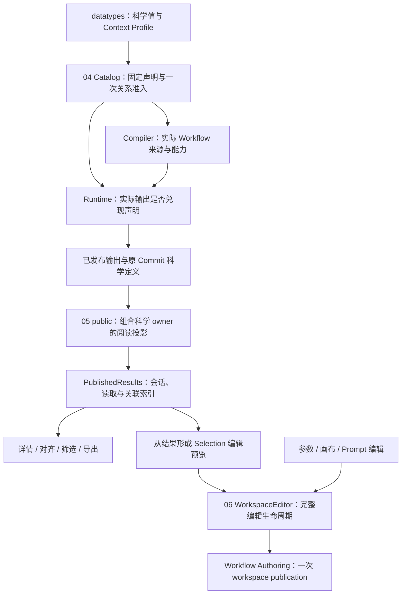

# 04 / 05 / 06：科学事实、结果阅读与完整编辑的结构设计

状态：生产改造、当前消费者迁移及完整远端验收已完成；结果见[固定快照验收记录](2026-09-24-architecture-04-05-06-acceptance.md)。分析基线：`f0ce2713`。

本稿比较三套并行设计后给出一套推荐组合。评价目标是明确 owner、缩小调用者必须掌握的 interface、集中科学知识与错误处理；净代码量是辅助指标。允许为真实职责增加类型、协议和实现，不以新增行数否决结构改善。旧 05 暂缓结论、旧六类投影方案与 ADR 均不约束本设计。

## 1. 已确定的约束

| 决定 | 本稿如何落实 |
| --- | --- |
| 用户允许删除独立 Derived Run 路径 | 记录为后续范围收敛的授权；本轮设计范围为 04/05/06，不把 Run 删除混入实施。 |
| canonical Workflow 是用户教程示例，应随正常启动安装其 Project | 保留该产品入口；撤回将其移出生产启动的建议。安装内部重复仍可另行收敛。 |
| 同一次编辑的流程与布局一起生效 | 06 以一条 workspace record 作为二者共同成为当前工作的时点。 |
| 普通布局修改不生成科学 Draft | 通过提交的变化部分区分，不深比较整个 Workflow，不让 UI 进入科学 identity。 |
| 简洁、只校验一次、信任已准入值 | 校验归 contract owner；codec、索引、投影与私有 publication 不重验相同事实。 |
| 没有历史兼容义务 | 同步修改现有生产者、消费者、协议、测试和文档，删除被替代路径，不保留 aliases 或双协议。 |

科学语义继续遵循当前合同：完整 Candidate Data Reference、Method、Metric、Context、单位、轴、masking、随机性、lineage、provenance 和 evidence 不因表示整理而变化。技术方案可以修改；科学含义不得从现实现的偶然形状推断。

## 2. 三个 module 的分工



- 04 表达固定科学合同，不管理 Run 或 UI。
- 05 阅读已发布事实，不执行科学推断，不保存 Workflow。
- 06 编辑未来 Workflow，不解释旧 Run 的科学关联；从结果保存 Selection 先形成预览，再交给 06。
- `core` 不依赖 `modules/*`；具体扩展科学 owner 的组合放在 `protein_workbench_public`。
- module 的 implementation 可以分文件；不为一个 owner 拆出多个需要互相同步的 store。

## 3. 并行方案比较

### A：最小消费 interface

04 共用现有字段形状，保留 Catalog build/plan 两个自然入口。05 把详情与导出整个交给 PublishedResults。06 用 `edit`、真实长编辑 session 和 `flush` 隐藏保存生命周期。

优点是 callers 少学顺序；不足是 04 仍让声明作者填写没有选择空间的字段，05 仍让前端掌握科学 wire，导出 archive 编码也可能塞进会话 owner。

### B：按科学 owner 与实际 adapter 分工

04 使用 typed Context 与成组 Port 来源。05 在 public 组合现有科学 owner 的阅读投影，前端管理 Session 与关联。06 配套调整持久化 interface，让完整编辑只发布一次。

优点是科学表示、transport 与交互职责清楚；代价是新增有限阅读 DTO，并修改当前协议。若扩大成任意 projector registry、requested-fields 语言或通用 transaction 框架，就偏离本设计。

### C：最常见调用直接表达意图

04 进一步把当前固定的 subject 声明收窄为 `subject_input`。05 提供详情读取与 `prepareExport`，格式编码保持纯函数。06 为 Workflow、UI、Prompt 等分别提供编辑方法。

优点是 Binding 作者、结果视图和编辑 handler 的用法直接；不足是 06 专有 `applyPrompt` 容易继续保留第三条写入策略。

**推荐组合：04 采用 C 的声明形状和 B 的分工；05 采用 B 的科学阅读与 C 的消费 interface；06 采用 A 的编辑/session interface 和 B 的一次发布。** 不以方法数最少为目标，也不通过 command bus 隐藏真实差异。

## 4. 04：一套固定 Observation 合同

### 4.1 改造前结构与目标

改造前，`ProducedObservationDefinition` 与 `ResolvedProducedObservation` 保存同形事实；`core/catalog/_observation.py` 逐字段搬运，没有增加 Workflow 关系。`ContractIdentity` 与 `ExactContractReference` 也都只有 kind/id。

只删除 translator 还不够。推荐同时收窄声明 interface，使类型本身表达完整的科学意图。

```python
@dataclass(frozen=True, slots=True)
class ObservationPortSource:
    direction: Literal["input", "output"]
    port: str

@dataclass(frozen=True, slots=True)
class ProducedObservation:
    output_port: str
    output_partition: str
    metric: ExactContractReference
    context_profile: ObservationContextProfile
    subject_input: str
    guaranteed_multiplicity: Literal["one", "one_or_more", "zero_or_more"]
    reference_source: ObservationPortSource | None = None
    pairing_source: ObservationPortSource | None = None
    axis_source: ObservationPortSource | None = None
    method_source: ObservationPortSource | None = None
```

这些是建议的 Python interface 形状，不是新增 public 科学格式。

当前 Produced Observation 合同描述以一个 Candidate 为主体、从声明的已准入输入 Port 的完整 Candidate population 产生的 Score。`subject_input` 的 descriptor 显式还原当前四字段：`subject_grain="candidate"`、`source_role="subject"`、`subject_direction="input"`、原 `subject_port`。

其中 input subject 的依据是[精确轴规格](2026-09-21-exact-resolved-axis-design.md)；candidate subject 与现领域定义一致，source role 是当前支持的声明合同。这里没有宣称所有未来 Observation 都只能如此，也不把 Metric 的 per-residue/vector/matrix value granularity 改成 candidate scalar。其他 `CandidateDataProjection.source_role` 保持自己的含义。

可选来源以一个对象出现或整体缺席，消除 direction/port 只填一半的状态。reference、pairing、axis、method 的来源方向仍保留 input/output，不能沿 subject 的限制一起收窄。

### 4.2 类型与 owner

| 内容 | 位置与责任 |
| --- | --- |
| 实际 Observation Context、Context Profile 与纯 profile 提取 | `datatypes/observation.py`；provider-independent 科学值，不依赖 Catalog/public。 |
| `ProducedObservation`、Port 来源、Propagation 声明及 typed filter | `core/catalog/observation.py`；只依赖科学值，不能 import Builder/model/scoring runtime。 |
| Catalog 声明聚合与显式 descriptor 投影 | `core/catalog/declarations.py`；Binding 作者使用同一 Observation 类型。 |
| immutable startup plan、真正派生的 Metric facts | 现有 `core/scoring/observation_plan.py`；plan 直接引用已准入 declaration，不再复制 row。 |
| 合同存在性、种类、Metric/Context 相容、Port/axis/Method/propagation 关系 | Catalog Builder，一次准入。 |
| 实际 Node source、动态 Method、DAG capability 传播 | Compiler，新增的是具体 Workflow 关系。 |
| 实际 Method/subject/value/axis/evidence 是否符合合同 | output admission；实际值与声明关系是新的检查对象。 |

Context Profile 是实际 Context 的固定科学条件部分。Pairwise Profile 包含角色、pairing mode、normalization；它不包含某一次 Observation 的具体 Candidate 对、axis/evidence digest、实际 normalization length。两者不能合成一个载荷或互相替代。

`ObservationPropagationDefinition` 与同形 plan 也合一；filter 使用 typed reference/profile。`ProducedObservationPlan.metric_facts` 与 `ResolvedMetricFacts` 保留：数值范围、finite/null、binary32、axis/alignment 要求确实是派生出的运行事实，不是同形搬运。

### 4.3 调用与准入

```python
observation = ProducedObservation(
    output_port="scores",
    output_partition="intrinsic",
    metric=ExactContractReference("metric", metric_id),
    context_profile=IntrinsicContextProfile(),
    subject_input="candidates",
    guaranteed_multiplicity="one",
)

catalog = build_frozen_catalog(registrations, ...)
plan = catalog.produced_observation_plan(binding_id)
# plan.observations 直接引用准入后的同一份固定声明。
```

构造对象不等于已经准入；不添加“已准入”品牌、继承树或第二种容器。Builder 负责一次科学关系检查与所需 I-JSON 规则；typed constructor、plan 和 descriptor 不重复 admission。错误继续为现有 Catalog build 错误。

配套统一 `ContractIdentity` 与既有 `ExactContractReference`，直接删除前者并更新所有当前调用方。`Exact` 仍表示稳定合同身份，不表示该 record 自带准入证明或不存在的 digest/version。Builder 必须继续收集 dependency、拒绝 dangling/cyclic contract references；不能先把引用拍平成 dict 而绕过这些关系。

### 4.4 科学身份与实际收益

显式 descriptor adapter 保持现有科学字段和值，包括固定 subject 字段与拆开的来源字段。Python 类名、类型位置与构造 interface 可改变；本项不要求改变科学 descriptor、canonical value bytes 或 Result Identity。公开描述 schema 同步表达当前受支持的 subject 合同，消除“schema 看似支持、Builder 实际拒绝”的配置面。

删除同形 row/propagation 容器和转换；新增科学字段只修改一份声明及真正消费行为。测试从私有转换函数转向 Catalog interface、descriptor identity 和 compile-to-runtime 合同。这里增加类型表达是为了减少 caller 必须记住的不变量。

## 5. 05：科学阅读、会话读取、显示各归其主

### 5.1 选定方向与 canonical 的位置

推荐有限 public 阅读投影，并深化既有 PublishedResults。增加明确的阅读 DTO 是可接受的结构成本：科学 owner 解释自己的值，浏览器不再解释 tagged dataclass 或 extension 内部结构。

本轮不修改 canonical 编码。替代方案“全部 Port owner 使用语言无关 canonical 字段”本身合理，但改变了内容身份合同，还需要同步重建跨值引用、Candidate/Result/Cache identity、codec descriptor 与开发 artifacts；它也不能自动解决 Session、详情共享、parent 索引和 late axis。将其独立设计，不作为本项前置条件。

### 5.2 后端阅读 interface

在 `protein_workbench_public` 建立具体的 `PublishedResultReader` 组合 module，使用既有 core 已发布输出定位/读取和 nominal owner 的纯科学投影。

```python
class PublishedResultReader:
    def page(self, project_id, run_id, location, *, offset, limit): ...
    def structure(self, project_id, run_id, location, *, item_index): ...
    def value(self, project_id, run_id, location) -> PublishedResultValue: ...
```

上面是接口分工草图；实现须补齐现有项目使用的强类型及公开错误，不接受任意字段查询。`location` 是 Node/Port/value index，不代替科学引用。

| 阅读内容 | 投影 owner 与返回事实 |
| --- | --- |
| Candidate page | 复用内置 codec 的局部恢复与 manifest 精确引用；页面提供 metadata、parents、已发布 sequence/结构标记，不含 PDB。 |
| Candidate structure | 同一路局部恢复，返回原始 PDB；删除重复 summary。sequence Candidate 不发这次请求。 |
| Score evidence | 内置 Score 科学 owner：完整 subject、Metric、Method、Context、value、residue axis、partition；额外给出同一个科学 profile 投影。 |
| Candidate sequence evidence | structure-transform owner：完整 subject reference 与该已发布 axis 的 sequence；public 外层记录其输出来源。这是阅读事实，不声称可恢复整条 axis。 |
| Alignment evidence | structure-comparison owner：完整普通字段 evidence，包含 policy、correspondence、segment map、axis digests、transform、统计值、Method；导出不得只剩 viewer 使用的几个字段。 |
| 独立 sequence / structure | 各 nominal owner 提供原 sequence、可空的 residue IDs 或原 PDB；保留 PublishedOutputs 当前专门展示，不退化成 RawValue。 |
| 已发布 Prompt | Prompt nominal owner 提供有序 residue identities、实际轨道的 absent/present 与每项 Mask、named-atom 坐标、SS8/SASA 和完整 Function tuples；这是原值阅读，不运行编辑 Preview recipe。 |
| 独立 Resolved Axis 的 layout | structure-transform owner 提供已发布 layout 的有序 residue IDs 与 segment chain IDs；用于现有参数候选读取，不从 PDB 重建。 |

科学 projector 返回 provider-independent 科学字段，不依赖 public DTO、HTTP 或前端类型；public module 只添加输出定位/元数据和协议 envelope。能够复用现有完整 alignment 字段投影的地方直接复用，不再复制一份逐字段算法。

`value` 返回上述当前已有消费者需要的闭合 union，既覆盖结果证据，也覆盖 PublishedOutputs 与参数候选的现有专门展示。它们共用一个按 exact location 读取的入口，不新增 Catalog presentation registry、visitor、requested-fields 语言或每种科学类型一条路由。具体 nominal Port 到阅读种类的组合由 public 拥有；前端可以知道自己消费哪种结果，不能重新解释该类型的内部 canonical wire。

Score 的 profile 是附加阅读事实，不替换完整 Context，不混入原 Observation identity。导出 observations 保留原科学字段及来源；Score 自身的 `residue_axis` 不能随 Candidate sequence 投影一起裁减。完整 alignment 直接复用 owner 的 `alignment_evidence_to_wire` 全部结果，不按窄 TS 使用类型挑字段重建。

科学 owner 可以直接从自己已发布的 wire 提取阅读事实，无须先恢复用不到的 PDB/大对象；这不授予 public 解释内部字段路径的职责。JSON 解析可能仍覆盖整个值，不把这种投影宣称为磁盘局部读取。

读取信任发布链；恢复与投影不重新 nominal admission、hash 或计算科学值。Result Store 的现有完整性读取继续有自己的职责。请求定位、类型不适用、越界使用明确的当前错误；没有自动降级、重试或 guessed schema。

现有任意 extension 的 canonical Typed Output 下载保留原始正文及 metadata/header 合同。Raw Value 展示仍存在，未知专门阅读类型不被丢弃。专门阅读 interface 与通用原值出口是两个真实用途，不是新旧兼容双路径。

### 5.3 core/public 的依赖收口

Candidate 页面/结构的协议投影跟随 public 阅读组合归 public；内置 Candidate slice 恢复留在 nominal codec owner。删除 core 中只为 public 输出形状服务的 `ResultBrowser` facade；不把 public facade 又包在原 facade 之上。

依赖方向为 `public → core 已发布读取 + 科学 owners`，不是 `core → modules`。这里迁移位置的价值来自消除 core 对页面形状的职责、统一真正的 public 科学阅读；单独移动文件不算完成。

### 5.4 前端消费 interface

```typescript
class PublishedResults {
  // 保留已有 Run 生命周期与读取观察口。
  openRun(run: RunReference | undefined, eventCursor?: string): void
  getSnapshot(): ResultSnapshot
  subscribe(listener: () => void): () => void
  refresh(): Promise<void>
  reconnect(): void

  ensureCandidates(request: CandidateRequest):
    Promise<ResultSnapshot | undefined>

  structure(key: CandidateViewKey):
    Promise<string | null | undefined>

  value(location: ResultLocation):
    Promise<PublishedResultValue | undefined>

  rawValue(location: ResultLocation):
    Promise<CanonicalTypedValue | undefined>

  prepareExport(keys: readonly CandidateViewKey[]):
    Promise<CandidateExportMaterial | undefined>
}
```

`undefined` 沿用会话退休后的结束语义；`null` 表示该 Candidate 没有结构；真实读取失败报告错误，不将失败转成“没有结构”。viewer 卸载保护是显示生命周期，不是重复科学校验。

```typescript
// CandidateView 来自当前 snapshot；不缓存拼好 sequence 的详情副本。
const pdb = await results.structure(focusedKey)

const material = await results.prepareExport(checkedKeys)
if (material) {
  const files = candidateExportFiles(material, scienceStatus)
  downloadZip(files)
}
```

Session 保存 raw Candidate 页面、已发布证据、原 Commit 定义和不可变 PDB。PDB 的 pending/完成结果按本 Session 的输出位置与 item index 复用；与科学关联使用的 Candidate Reference key 分开。切 Run 退休旧 Session，A→B→A 不接受第一次 A 的迟到结果。

PublishedOutputs 的“加载此值”与“展开原值”分别跨 `value`/`rawValue` 读取；保留按需行为及未知 extension 的原值展示。原值仅供字面查看/精确下载，不被 React 重新解成科学视图。参数候选消费已发布 layout 时共享同 Session 的 `value`；Project Input 检查、Workflow 科学一致性比较和 prospective Prompt Preview 仍归 authoring。其唯一的 `publishedFields` 消费者也必须一并迁移，不能遗漏后仍宣称已消除前端科学解包。

纯 `ResultIndex` 在同一快照内集中组织：

- Candidate Reference 三字段 → 全部输出 occurrences；
- parent ID → 全部精确数据版本与来源；
- 观察组 → subject → 原 Observation 列表，显式保留 missing/unique/ambiguous；
- 完整 subject → 当前已发布 sequence 与 alignment evidence。

展示 Observation group 包含输出位置；Selection 的科学匹配在自己的来源上下文中工作。只共享科学 profile 和完整引用，不把 sourceKey/locationKey/occurrence key 合成一个万能键。

一次索引同时供选项、临时过滤、详情、parent 显示与导出使用，取代独立的分组/查找循环。临时筛选与排序仍为显示计算；不为了统一几行比较而加入后端每次交互请求。

### 5.5 分页、后到证据与导出

1. 首屏仍按需分页。父索引未补齐时只表达“当前已加载 matches / 尚未完整”，不能宣称 unresolved。获取一个 PDB 不暗中读取全部 Candidate。
2. 需要确定父引用状态、搜索/筛选/排序全集时按现产品动作补齐。导出及 Selection 编辑补齐全部已发布集合。
3. 原始 Candidate 和 axis facts 分开保存；snapshot 从当前事实派生 sequence。后到 axis 更新已聚焦、勾选与详情，不从 PDB、parent 或序号猜序列。
4. `prepareExport` 捕获点击时的 checked keys，补齐后从返回的同一 snapshot 重新取得所有内容。操作期间已纳入 Session 的新来源进入完整性判断；不等待未来发布或轮询未来结果。
5. 共享不可变结构读取完成后，将该 snapshot 的候选、观察、完整 alignment、parent 状态和原 Commit 科学定义组成导出材料。读取期间切 Run 则结束旧操作；不从随后另一个 snapshot 拼接部分字段。
6. 纯 formatter 生成 FASTA/CSV/manifest/PDB；Blob、ZIP 下载行为留在浏览器 adapter。原 PDB 不应用 viewer 的 row-vector transform。

当前导出不包含完整 Resolved Axis 值，只包含其 sequence 事实与来源；轴原值仍可 canonical 下载。Alignment 原来携带的完整字段必须继续进入导出，不能按当前窄 TS 使用类型截断。

## 6. 06：一个编辑 owner，一次完整发布

### 6.1 状态按含义划分

| 状态 | owner |
| --- | --- |
| 最近确认保存的 exact workspace | WorkspaceEditor，从 publication receipt 更新。 |
| 当前希望保存的 Workflow/UI 与未保存修改 | WorkspaceEditor；明确与已保存 Draft 区分。 |
| Project copy、version origin/return、队列、保存失败、history | WorkspaceEditor。 |
| 完整 prospective Workflow 和未确认 Prompt/Selection/Input 编辑 | 真实长编辑 session；取消不改变当前工作。 |
| 参数 raw 字符串、measured、拖拽过程、selection/hover/临时连接 | ReactFlow/编辑器 adapter，不冒充科学 Draft。 |
| immutable Draft/UI 内容及当前 head | 后端 Workflow Authoring。 |

删除同一已接受事实的 state/ref 多处同步；保留真实的 desired/acknowledged 区别。一个 module 可以管理这些不同状态，不能宣称它们都能合为一个对象。

### 6.2 前端 interface

以下摘录编辑相关接口；完整接口由 `webui/src/workspace-editor.ts` 定义。无活动会话或异步操作期间会话已退休时，相关异步操作可能返回 `undefined`，调用方不得将其视为保存成功回执。有活动会话但没有待发布内容时，`flush` 返回已有 acknowledged workspace。

```typescript
type WorkspaceChange =
  | { workflow: Workflow; ui_state?: JsonObject }
  | { workflow?: never; ui_state: JsonObject }

type WorkspaceEditSession = {
  readonly base: EditableWorkspace
  readonly submitted: boolean
  versionContext(): PromptVersionContext | undefined
  writableProject(): Promise<WorkspaceProject>
  commit(change: {
    workflow: Workflow
    updateUi?: (currentUi: JsonObject) => JsonObject
  }): Promise<ProjectWorkspace | undefined>
}

class WorkspaceEditor {
  open(project: WorkspaceProject, workspace: ProjectWorkspace, version?: WorkflowVersionView): void
  getSnapshot(): WorkspaceEditorSnapshot
  subscribe(listener: () => void): () => void

  edit(update: (current: EditableWorkspace) => WorkspaceChange):
    Promise<ProjectWorkspace | undefined>
  beginEdit(): Promise<WorkspaceEditSession | undefined>
  undo(): Promise<ProjectWorkspace | undefined>
  flush(): Promise<ProjectWorkspace | undefined>
  retry(): Promise<ProjectWorkspace | undefined>
}
```

`edit` 的 callback 是纯编辑，不接收 client、保存队列或 generation。字段是否提交表达变化；至少改变一部分。不扫描/hash 整个 Workflow 来判断 UI-only。

```typescript
await editor.edit(current => ({
  workflow: insertOrdinaryNode(current.workflow, nodeId, typeId, bindingId, catalog),
  ui_state: withNodePosition(current.ui_state, nodeId, position),
}))

await editor.edit(current => ({
  ui_state: withViewport(current.ui_state, viewport),
}))
```

已有 parameter、Binding、Selection、paste 等纯编辑算法可以保留具体名称，返回一次编辑所需的 Workflow/UI。不要为每种编辑添加一条持久化路径。graph edit 的新节点位置、Binding parameter memory 与科学改变在同一次 edit 中确定；handler 不再执行 save → install → persist，也不接收 `current` 标志自行安装结果。

### 6.3 后端 interface 与发布顺序

推荐保留两个真实起点的明确入口，不为“只有一个方法”加入复杂模式组合：

```python
def save_workspace(
    project_id: str,
    *,
    workflow: WorkflowDocument | None = None,
    ui_state: Mapping[str, IJsonValue] | None = None,
    expected_draft_revision: int | None = None,
) -> ProjectWorkspace: ...

# 现有命名版本首次修改，保留完整 Workflow/UI 与 return point。
def fork_version(
    project_id: str,
    *,
    version_id: str,
    return_workspace_revision: int,
    workflow: WorkflowDocument,
    ui_state: Mapping[str, IJsonValue],
) -> ProjectWorkspace: ...
```

两入口共用私有内容追加和一次 workspace publication implementation。`save_workspace` 替换普通 Draft/UI 两个公开写入路径；`fork_version` 保留其版本起点语义，不要求普通调用者传版本参数。Draft/Commit 的读取与科学 Commit admission 继续存在。

1. operation owner 读取一次 head，完成 Project/write policy、提交 Workflow scope、requested resource 和需要的 expected revision 检查。
2. 追加本次提交的 immutable Draft/UI 内容，未提交部分沿用 head；普通 UI-only 不追加 Draft。
3. 最后只追加一条 workspace record，绑定确切 revisions，二者在这一时点一起成为当前工作。
4. 返回该 exact head 与已写入内容，不 GET latest 或回读新记录。
5. 按现合同 touch Project metadata 一次。

旧命名版本第一次编辑继续 fresh Draft/UI + 单次 publication，保留其原 version 与打开时 return point。普通 layout-only 与第一次版本 fork 是不同起点，不顺手改变现版本行为。

### 6.4 失败与明确重试

“一起生效”指 workspace 可见性，不承诺所有文件和 Project metadata 跨目录事务。

- 最终 workspace record 写入前失败：旧 head 仍当前；孤立内容不成为当前，后续 revision 不复用已占用编号。
- 发布后 metadata 或响应失败：已发布 head 不回滚；不能把任何错误都宣称为“完全未保存”。
- 前端保留 desired edit，错误阻止导航、命名版本、Commit/Run 等依赖保存的操作；明确 retry 之外不自动重试或跳过失败继续写。
- 若明确 retry 前需要确定上次 publication 是否已生效，由 owner 读取一次当前 workspace 收据再作选择。普通编辑可重新发表同一 desired 内容；长会话遇到已变化 baseline 时报告冲突并保留 proposal，不自动合并或伪造成功。
- 不新增幂等 token、保存凭据、transaction log、恢复 worker 或回滚框架来包装这一局部合同。

Project copy 的发布仍由既有 staging owner 承担；它与 workspace 内容发布不是一个假想的跨存储事务。

### 6.5 长编辑与 Prompt 写回

`beginEdit` 是为真实的 Prompt、Selection、Input 长对话提供的 seam，不是通用 transaction 抽象。

一个 ReactFlow adapter 先提交或阻止活跃 raw 输入，成功后 owner flush 已接纳编辑，再捕获编辑会话身份、本地科学编辑 revision 和已保存 Draft revision。无效 raw 输入保留并阻止转换，不变成猜测默认值。打开 Prompt/Selection/Input 的各 handler 不自行 blur、计数或等待。这一准备动作也用于导航和依赖保存的操作；它不在普通 edit 内递归调用 flush。

对话用同一完整 prospective Workflow 预览；只有 commit 才进入普通编辑发布。长会话不提交打开时的完整 UI 副本；没有 UI 操作就省略 `updateUi`，有新增位置等明确操作则把该纯操作作用于 owner 当前 desired UI。这是执行用户提出的布局操作，不是自动合并旧 opaque JSON，也不需要额外 UI revision 检查。

```typescript
const edit = await editor.beginEdit()
// 保留本会话完整 prospective Workflow、UI 和未确认输入。
// Prompt open/preview 继续由科学 owner 求值。

await edit.commit({
  workflow: replacePromptDocument(
    prospectiveWorkflow, nodeId, confirmedPreview.normalized_document,
  ),
  updateUi: ui => withNodePositions(ui, addedNodePositions),
})
```

保留现有 Preview 确认流程与 diagnostics；只写已经确认的 normalized document，不重新 preview、规范化或 hash。提交该会话的完整 Workflow，不把旧 document patch 到另一个最新 Workflow。

删除 Prompt 专有 apply 的 route/request/result/codec 与后端参数替换后再 save/fork 的转发链；Prompt open/preview 及所有科学 recipe 保留。普通参数、Selection 与 Prompt 从此共用同一写入 owner。若 UI 保留语义名 `applyPrompt`，它只能是纯编辑组合，不能拥有另一条持久化路径。

并发检查各自针对不同事实：

- WorkspaceEditor 的 session/local revision 判定防止迟到编辑覆盖后续尚未保存的本地科学意图；raw 参数编辑的进行状态由 adapter 向同一 owner 提交阻止覆盖的事实，不能每个 handler 自建计数。
- 后端只比较一次 captured expected Draft revision，防止覆盖已变化的持久化基线。普通 UI-only 变化不伪装成科学冲突；当前 viewport、折叠等不会被长会话顺带携带的旧完整 UI 覆盖。
- 冲突保留对话原 proposal；不重预览、合并或自动 retry。已退休 session 的迟到成功不能覆盖新 Project，包括 A→B→A。

教程只读打开不触发复制；首次实际编辑或确需发布 Input 时，WorkspaceEditor 负责创建个人副本并转换 Project scope。复制自身不算另一次用户编辑，owner 使用新副本真实 Draft revision，不能把原教程 revision 发送到副本。真实后续科学编辑仍使旧长会话失效。

Input 导入通过本 session 的 `writableProject()` 取得确定的写入 Project。它只负责当前编辑的 Project 准备与 scope 转换，Input 上传/检查/发布仍由现有 Input owner 执行，不被搬进 WorkspaceEditor。`base` 的科学基线保持不变，其 Project scope 由 owner 同步映射；caller 不持有旧 revision，也不自行改 copy/fork 状态。

scope 转换同时覆盖 Workflow ID、Input publication 的目标 Project 和后续 Preview；不能只换 expected revision 而继续向教程发布 Input。取消长会话不保存 prospective graph/document；已发布的 immutable Input 按既有合同保留，不随取消删除。

长会话 commit 在 owner 内一次完成本地基线检查与 proposal 接纳，形成 pending edit 后才开始异步 copy/持久化。失败保留该 pending edit，由 `WorkspaceEditor.retry` 处理，不再调用原 session.commit，不重复增加 history 或与自己的 local revision 冲突。后续编辑以已接纳 desired 内容为基线；保存失败暂停写队列，不跳过失败项继续发送。若上次 publication 是否成功无法确认，沿既定持久化基线规则处理，不将未确认写入宣称成功。

旧版 preview 继续使用该 version ID 的科学基线；version origin、精确 UI 和 return point 由同一个编辑 session 持有。确认时直接调用一次 fork，不能先 fork 再 apply。

## 7. 文件与替换范围

| 方向 | 主要落点 | 删除或替换 |
| --- | --- | --- |
| 04 | `datatypes/observation.py`；`core/catalog/observation.py`、declarations、builder、model；scoring plan/admission；compiler；各 Module Package | `ContractIdentity`、`ResolvedProducedObservation`、同形 propagation plan、固定 row/profile 翻译、成对字段的半缺失检查。 |
| 05 科学阅读 | `protein_workbench_public` 阅读组合/协议/routes；builtin sequence/structure/Score 与 Prompt owner；structure-transform/comparison pure projectors | core 中 public 专用 ResultBrowser facade、Detail 重复 summary、全部现有专门视图的科学 wire 解包。 |
| 05 会话 | `published-results.ts`、纯 result index/export formatter、ResultsWorkbench/AlignmentComparison/PublishedOutputs、parameter choices、Selection 消费 | 三路独立详情读取、重复 Score/parent 索引、export 自行协调 client/run/index/definitions。 |
| 06 | `project-workspace.ts`/WorkspaceEditor；ReactFlow adapter；App；Workflow authoring/routes/protocol；Prompt authoring/client | 两条普通写入协议、App 两份保存策略、handler 三步保存、Prompt 专有 apply 持久化链。 |

独立的开发历史材料保持历史属性；当前规格、示例和所有实际调用者与新 interface 同步。协议/schema 的删除与替换不是额外兼容层。

## 8. 验证与实施次序

### 验证目标

| 方向 | 通过 interface 验证的行为 |
| --- | --- |
| 04 | Catalog 错误声明一次拒绝；descriptor/identity 不变；typed profile/propagation；动态 Method 不退回默认；optional input；compiler/runtime 共用固定事实。 |
| 05 后端 | evidence 的完整科学字段；精确引用；原 PDB；独立 sequence/structure/Prompt 展示与 axis layout；Prompt absent/Mask/named atoms；分页/越界；canonical bytes 与任意 extension 出口不变；完整 alignment 导出字段不丢失。 |
| 05 前端 | 详情/对齐/导出共用读取；activity 不重读不可变内容；A→B→A；late axis；部分 parent 索引；重复/缺失 Observation；同一完成 snapshot 导出。 |
| 06 后端 | 两内容一发布；普通 UI-only 无 Draft；失败前后可见 head；revision 不复用；fresh fork/return；一次 expected revision；scope/write policy。 |
| 06 前端 | parameter/Binding/node/Selection/Prompt 同一保存路径；raw/measured 保留；copy scope；长会话冲突；乱序 ack；失败保留编辑；明确 retry；导航/Run 等待 flush。 |

删除只证明旧转发、旧类名或 setter 顺序的测试；保留真正的科学与产品行为，不叠加两套 owner 测试。使用现有 public client 测试 adapter 和临时文件存储，不为测试新建万能 repository。mock 不替代真实 Provider acceptance。

### 实施批次

1. **04** 统一类型、来源表达与引用；同批迁移全部声明/编译/执行消费者，保持 descriptor identity。
2. **05** 发布阅读协议与纯 projector，并同步切换所有前端读取、索引和导出；旧 facade/解包/详情链在本批删除。其 Context Profile 可直接复用 04。
3. **06** 在同批实现前后端 publication、WorkspaceEditor 与所有编辑入口，包括 Prompt 专有 apply 的删除；不能把仅移出 App 当作完成。
4. 05 与 06 的唯一写入交接为“结果生成 Selection 预览 → workspace edit session”。在两者完成后验证这一完整旅程。

实现与静态审查结束后，使用固定远端快照独立收集 focused、七个现有后端非真实 Provider 档位、WebUI typecheck、真实旅程独立类型检查、lint、普通 E2E 和 build，完成整批诊断再集中修复。全部通过且无 blocked 项后，使用同一源码及构建产物执行完整十九档正式 Campaign、真实 WebUI 旅程和安装 smoke。非真实 Provider 批量验证和真实验收均每 30 分钟统一轮询一次，中间静默等待，不查询日志、进程或状态；仅限制外部轮询，不改变测试内部必要轮询；保留 Campaign 既有失败停止语义。失败后修改源码须重新通过非真实 Provider 整批验证，不能拼接不同版本的结果。遵循[后端执行规则](backend-verification.md#execution-policy)及[WebUI 验证入口](../webui/README.md)，不在本机运行 tests/typecheck/build/browser/Provider。

本轮完整验收已完成；源码 digest、构建产物、整批检查和真实验收证据见[最终验收记录](2026-09-24-architecture-04-05-06-acceptance.md)。本任务后续按用户最新指令取消上述静默等待约定，其他阶段准入与固定快照规则保持不变。

## 9. 完成标准

完成后，Binding 作者不再重复声明固定字段或区分两套 Observation row；结果视图不再直接读取详情、恢复科学 wire 或各建一套关联；编辑 handler 不再协调复制、fork、save/install/persist。

科学 owner 仍清楚，三个消费 interface 承担实际行为。即使为此新增部分实现和协议类型，也符合本轮结构目标；若只是移文件、改类名或让 caller 换一组同样复杂的参数，则不算完成。
