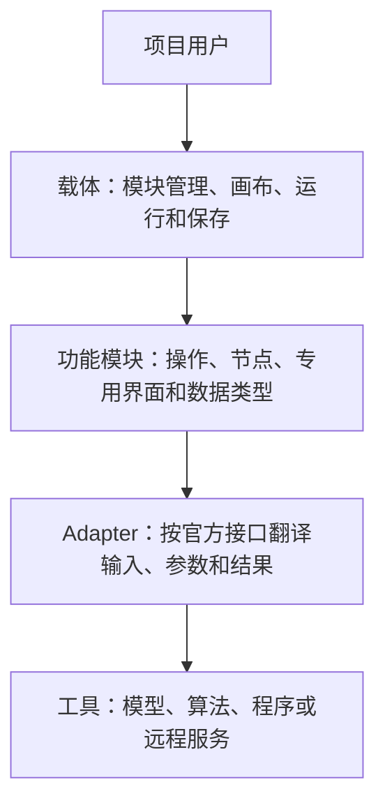

# 架构与共用数据

更新日期：2026-10-16

本文件说明载体、模块及共用数据的职责，并记录当前后端实现约定。目标行为以[当前有效决策](documentation-governance-decisions.md)为准；“当前实现”只表示源码可核对的结构，不表示运行验收通过。未解决差异见[治理问题清单](2026-10-15-documentation-governance-issues.md)，术语见 [GLOSSARY](../GLOSSARY.md)。

## 载体、模块与工具

模块按用户任务划分，同一工具可以供多个模块复用，一个模块也可以提供多个节点。项目用户决定连线和处理范围；模块开发者维护内部数据转换、对象及位置对应。载体处理通用运行与管理，不额外加入某个工具的限制。

官方和外部模块使用同一接入规范，包括自定义数据、React 专用界面和同一数据的多个查看器。载体在没有启用功能模块时仍须启动并管理项目及模块。安装包、启停、卸载通过公共模块管理接口及应用内入口提供；应用内模块设置按 Binding 声明保存凭据、路径和服务地址，运行中禁止更改。具体能力和差距见[模块能力](module-capabilities.md)，配置见 [Provider 配置](provider-configuration.md)。

### 代码职责

| 代码位置 | 职责边界 |
|---|---|
| `core/` | Catalog、Workflow、Project、计划执行、结果保存与必要运行记录。工具专用处理由模块负责。 |
| `datatypes/` | Provider-independent 的共用数据表示，不承接运行编排或把所有功能收进一个通用对象。 |
| `modules/<package>/` | 仓库内功能及工具接入的当前源码。目录名、包数量不定义最终产品模块划分，也不要求外部模块进入仓库。 |
| `protein_workbench_public/` | 当前 REST/WebSocket 协议、服务与公共投影。专用数据解释属于数据或模块 owner，公共层只组合协议。 |
| `webui/` | React 应用、画布、编辑与展示。模块专用界面应按公共接入规范加载。 |
| `repositories/` | 固定上游源码；项目维护的 SoluProt-next Provider 是明确例外。 |

当前后端通过 [ModulePackageRegistration](../core/catalog/declarations.py) 和 [Catalog builder](../core/catalog/builder.py)构建唯一目录，每个稳定契约 ID 对应一项当前注册。[bootstrap](../protein_workbench_public/bootstrap.py)从安装清单装配启用的包，默认清单附带官方包；空清单不安装科学教学项目。已有教学资源只在所需节点与 Binding 存在时安装。清单由[模块注册入口](../protein_workbench_public/module_registry.py)读取，[模块管理器](../protein_workbench_public/module_management.py)提供公共安装、启停、卸载及随附包恢复操作。变更在无活动 Run 时构建替代服务，持久保存清单后切换服务；项目与结果目录独立保留。外部 wheel 安装至数据目录，遵守同一注册与 UI 资源声明，无需修改仓库源码。Prompt 编辑器、单值查看器与 Run 面板通过模块 UI 声明加载。模块注册结果读取、只读 action 和工具条件投影；公共协议传递这些声明与数据，不按蛋白类型选择专用实现。节点结果入口依据已发布的 Port 和值导航，专用展示由模块负责，详见[模块 UI 契约](module-ui.md)。

`FrozenCatalog` 保持一个已构建目录不可变；运行使用已编译计划，不重新扫描目录。它不决定用户安装界面的实现方式，也不要求把可变插件管理状态写进一个正在执行的计划。

## Ports 与操作

当前 Port 兼容性要求同一个稳定名义 Port Type ID。值的 Python 形状相同，不代表含义相同；条件轨道、观测轨道、绝对 SASA 与其他量不能仅因形状一致而直接连线。需要改变含义时由明确的操作转换。

Node Definition 说明操作及跨 Binding 参数；Binding 关联 Method 和实现，并承接路线参数及运行前提。Method 描述实际算法或模型变体；凭据、模型位置、部署形式和设备不是评价量定义。对已提供功能，适用且影响结果的官方参数须允许配置，不因当前实现将其固定就写成永久 Method 限制。

通用操作接收已准入的值与规范参数，通过声明获得所需投影，不查询 Catalog 或导入具体 Provider。Adapter 负责官方工具参数和表示的翻译。Biohub 的响应按官方契约信任，不增加猜测、修复、替代端点或假设性坏响应检查。

Binding 可通过 `ParameterDependencyDeclaration` 从规范节点与 Binding 参数声明实际依赖的契约和输入槽。载体用现有 `FrozenCatalog.resolve_contract_closure` 冻结递归定义，将其纳入 Commit 与节点结果身份，并把同次解析得到的只读定义映射传给 `OperationContext.resolved_definitions`。参数含义和活跃依赖由模块解释；载体不读取筛选规则，也不向操作提供整个 Catalog。Binding 的 factory、Adapter 与参数依赖行为声明参与结果身份；Availability、Readiness 和环境字段声明分别承担运行条件职责。

## 残基身份与轨道

当前共用表示见 [residue.py](../datatypes/residue.py) 和[元素规则](../modules/residue_data/elements.py)。

- `ResidueLayout` 保存有序、唯一的 `residue_ids`；长度和链顺序派生，同一链在轴中连续。保持真实编号与对应，不按链长重新生成一套身份。
- `ResidueTrack` 自带一个 layout，每个身份恰有一个可空值。按身份重新索引，不隐式补齐、截断或按列表位置拼接不同轴。
- `CandidateResidueTrack` 额外携带明确主体；条件数据不为满足这个形状而虚构 Candidate。
- 共享表示不解释 `None` 的业务含义。条件轨道中它表示未指定，观测轨道中表示不可获得；具体名义类型和操作负责使用规则。
- 整轨缺席与存在一条全部为 null 的轨道不同，构造、编解码和工具翻译保持区别。

当前非空元素约定：序列为单字符代码，命名原子坐标为原子名到有限三维坐标的对应，SS8 为 `H/B/E/G/I/T/S/C`，absolute SASA 为有限非负浮点数，单位 Ų，无额外上界。坐标不以某个工具的原子词表限制共用值。元素 owner 对非法值报告名称和从零开始的位置；不接收 Layout 或 Candidate 来重复验证整个轨道。

当前元素层接受 `ACDEFGHIKLMNPQRSTVWYBXZJUO`，这只说明共用值的实现范围，不保证每个工具或操作支持全部代码。工具适用性按官方输入要求处理；完整的操作范围说明仍有缺口，不能由共享字母表替代。

来源正规化由实际 owner 承担：当前 Prompt 输入的 SS8 `-` 转为 `C`，DSSP `P` 转为 `C`、`_` 转为逐残基 null。元素验证本身不改写值；SASA wire 的整数到浮点表示转换由名义 codec 处理。

## ProteinPrompt 与条件编辑

[ProteinPrompt](../datatypes/prompt.py)只保存一次 layout。sequence 和 coordinates 必须存在，允许全 null；secondary_structure 和 sasa 可以整轨缺席；function annotations 是同一 layout 上的区间集合。它是当前条件编辑和相关工具接入的值，不是所有模块必须使用的统一输入。

功能标注用 label 与起止残基身份定位同一链上的有序区间，按 layout 位置及 label 规范排序。不同标注可以重叠、嵌套或使用相同区间的不同 label；完全相同的 label 与端点不得重复。不自动裁剪、合并或去重标注。

当前 `prompt_authoring.author` 用一个普通节点的 `document` 表达来源、目标成员、插删、轨道条件、随机操作、区域合并与坐标变换。Preview 和运行共享 recipe 求值，编辑与预览不生成隐藏的运行子图。局部采用、随机插入后的编辑以及确认与手动保存的区别见 [Prompt 编辑](prompt-editing.md)。

当前 `decompose` 保持原身份轴和值，`assemble` 要求所有已提供轨道有完全相同的 layout，且无需平行 layout 输入。`residue_data.materialize_sequence` 只接受完整、单链序列条件，保留输入身份，产生序列与根 Candidate；它不从其他轨道猜补序列。观测轨道转条件是显式操作，保留 layout 和值并移除观测主体。Prompt 的序列 mask 不等于工具的设计区域参数。

## Candidate、对应关系与评价

跨 Port 的精确关联使用完整 `CandidateDataReference`：Candidate ID、数据类型、内容摘要。集合位置不建立对象对应；相同结构内容也不自动合并不同主体。

生成来源记录数据实际由哪些输入与计算产生。评价关系记录这次使用的主体和参考对象，按用户连线与明确关系决定，两者分别维护。当前 ProteinMPNN 评分使用独立的评分请求，接收一个序列与一个选定骨架，以 pairwise 评价记录双方引用及显式位置对应，不改写生成父项。参数与工具约束见[模块能力](module-capabilities.md#proteinmpnn-设计与评价)。

完整引用足以确定主体和新子项的父身份，但不包含原值、完整 lineage 或 metadata。原样透传旧 Candidate 必须有完整原值并保持其内容和元信息；仅有引用时，不为新构造值冒用旧身份。新输出由身份 owner 赋予实际产生身份；父身份要求来自实际输入或同次合法新输出。歧义、未知父项与循环按实际边界失败，不任取最后一个匹配。

Score Observation 保留 Metric、Method、Context、主体、区域及来源。自然产生的分数随结果保留，追加评价和区域统计不混成重新预测。Context Profile 只表达固定条件，不能替代具体对象、区域和归一化信息。跨工具结果不能仅因显示名称相同就合并为同一个量。

当前筛选从完整 Candidate 分支取值，从评价分支取精确 Observation。目标按 Metric、Method、Context 及 partition 匹配，不要求两个分支来自同一 Port。Utility Transform 是显式的无量纲转换，权重不直接混用不同单位的原始分数。缺少必需分数默认停止对应筛选，没有新增自动补算、补值或跳过候选的政策。

## 结构解释、区域与预测置信度

当前 [ProteinStructure](../datatypes/structure.py)以 `text` 和 `format` 表示 PDB 或 mmCIF 原文。[存储 codec](../core/catalog/_port_value_codec.py)采用互斥的 `pdb_string` / `mmcif_string` 格式分支；PDB 分支编码字节保持不变，不另设旧格式回退。工具所需转换由 Adapter 处理。结构导出节点与模块结果 action 提供 PDB/mmCIF 格式选择，转换由蛋白导入导出模块负责；导出路径的核对范围见[结果说明](results.md#导出)。多构象及非蛋白组分的用户操作见[模块能力](module-capabilities.md)，不能从蛋白残基轴的范围推导界面应丢弃配体、水或核酸。

当前[结构残基轴](../modules/structure_transform/residue_axis.py)解释明确的结构、残基身份、片段拓扑、命名原子、mask、组分处理及修饰残基转换。实际处理有明确的 owner 和来源，不按 HETATM 标签或列表序号猜对应。

[Candidate–axis 关联](../modules/structure_transform/candidate_axes.py)将每个完整结构引用与 axis 放在同一有序 entry。resolver 保持输入 Candidate 顺序，名义值 owner 检查主体、结构内容及轴的一致性。当前轴集合非空且每个 Candidate ID 唯一。主体内容摘要、单个 axis 摘要和有序集合摘要分别表达身份；改变集合顺序不改写单项身份。

普通 axis 消费者使用该已准入关联及其 owner-defined projection，不同时索取一份只用于再次匹配的结构列表。确实需要完整 Candidate 透传或检查真实生成来源的操作使用窄的 exact join：两个已准入输入的完整引用集合相等，顺序可以不同；缺失、多余或旧内容引用在该跨输入边界失败。Method 的单例、坐标和关系数量要求仍由实际 Method 负责。

结构比较、明确片段提取与已有指标统计使用同一链、作者编号和插入码位置表达，可选择不连续残基。比较只创建内部只读位置视图；提取才产生新结构；统计直接读取原观察及其轴。实际参数、缺值、归一化和下游类型边界见[模块能力](module-capabilities.md#不连续区域比较提取与已有指标统计)。

预测残基轴来自实际预测输入，不从输出 PDB 反推。预测结构与置信度事实通过 Prediction Key 和内容身份关联，之后物化为 Candidate-associated 评价；独立结构评价不冒充重新折叠。当前共享[折叠输出构造](../modules/folding/_output_construction.py)维护 parent/sample 顺序、真实父项、预测轴及匹配置信度。折叠操作可在明确运行失败时提交已完成请求的输出，节点保持失败；ESM3 生成也保留已完成样本及联合生成中已完成的序列。失败处理见[执行](execution.md#批内失败与主动继续)。

统计含义由具体方法明确：当前[整体 pLDDT 均值](../modules/structure_prediction/implementation.py)使用非空值，[专用区域方法](../modules/structure_comparison/inserted_loop.py)要求范围内值全部存在。两者不能用一个含糊的“平均值”概述替代，也不因规则不同直接认定错误。区域、缺值和有效数量说明按实际方法保留，不另设统一默认。

## 单次准入与表示

值由拥有其契约的边界验证一次。消费者信任已准入的单个值；两个合法输入之间新建立的关系，由消费该关系的操作检查。跨输入关系检查不是重复验证单值。

| 边界 | 当前职责 |
|---|---|
| 名义 Port owner | 完整值的类型、layout、长度、主体及本类型语义，聚合复用元素或子值 owner。 |
| 科学操作 / Adapter | 实际跨输入对应、所调用工具的适用输入和参数约束。 |
| 构造器与 codec | 不可变表示、规范 wire 转换、编码与恢复，不重新执行已完成的值准入。 |
| 公共请求入口 | 当前协议语法、请求字段及本次操作契约。 |
| 持久存储 | 内容对象读取完整性、必要引用、原子写入和写失败。 |

Canonical source 输出的身份编排先准入源值，再编码构造身份；同值向下游投影时复用已有事实。Confidence / normalization 的 fresh identity intent 由当前声明入口处理；从已发布成果恢复则不重新构造 fresh intent。输出身份和 Observation 关系由[输出准入](../core/execution/output_admission/admission.py)及其声明 owner 负责，不额外建立一套证据模型。

[I-JSON](../datatypes/i_json.py)将 `validate_i_json`、纯 `freeze_i_json`、准入并冻结的 `admit_i_json` 与 RFC 8785 编码分开。原始 JSON 入口验证一次，不可变复制不代表已经准入。当前值域保留有限数、安全整数、Unicode、负零及类型敏感相等规则；HTTP 解析保留重复键拒绝，missing 与 null 分开。已验证响应由公共类型构造后直接序列化，不对整棵输出反复跑协议 validator。

恢复已发布值及缓存重放保留内容完整性，不重新检查 Prompt、残基轴或 Candidate 的全部业务规则。存储损坏、缺失对象及真实写失败仍失败；信任已准入值不等于忽略数据丢失。

## 领域说明与已知边界

- 模块安装、缺失节点保全、教学实例与手动保存见[工作区](workspace.md)；凭据和运行路径见[Provider 配置](provider-configuration.md)。
- React 编辑器、多个值查看器及 Run 面板使用[模块 UI 契约](module-ui.md)，结果读取、采用和导出见[结果](results.md)。
- ProteinMPNN 设计与独立评价、ESMC 数值输出、区域操作和工具适用范围见[模块能力](module-capabilities.md)。
- 未核实的输入限制、残基身份歧义及未确认的附加输出范围保留在[问题清单](2026-10-15-documentation-governance-issues.md)，不从现有实现推定新需求。
