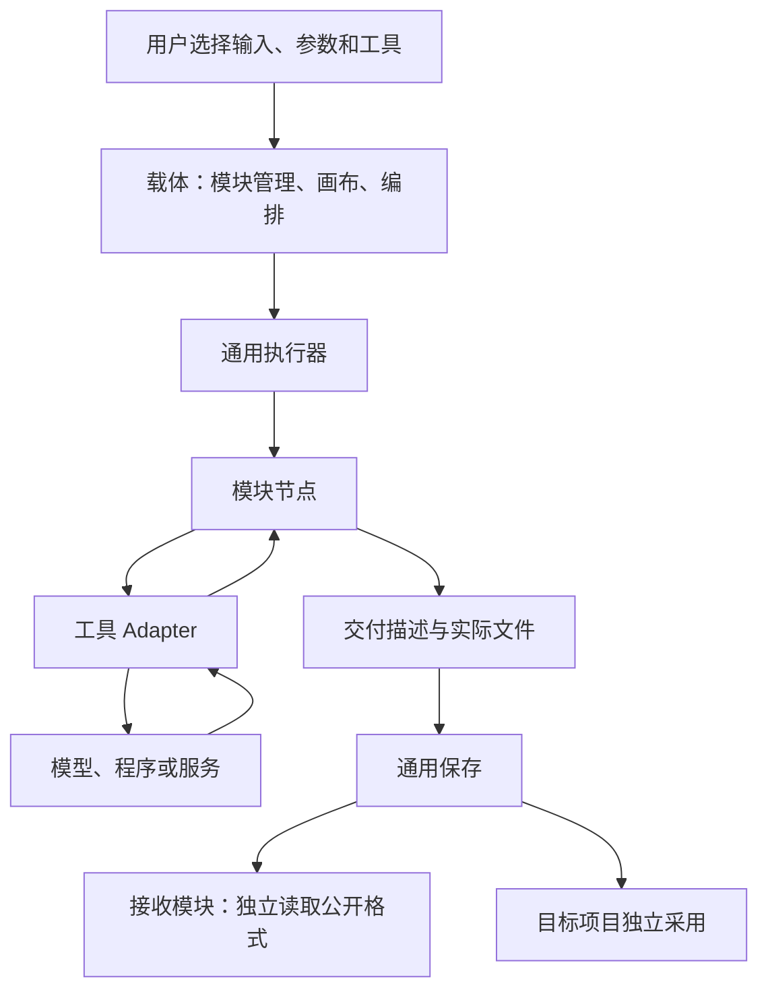
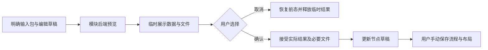
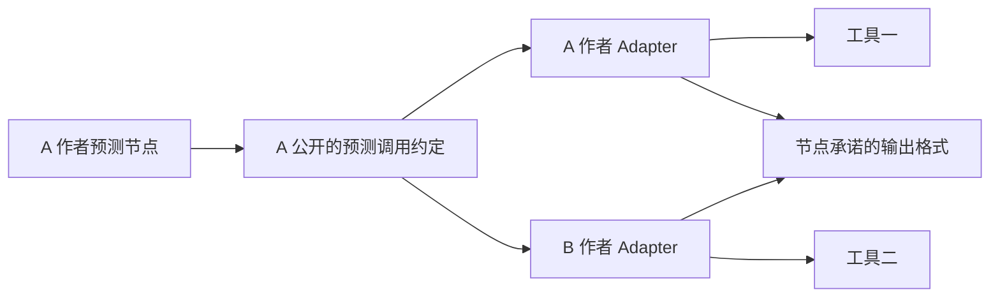
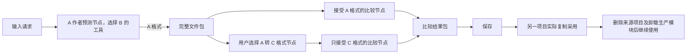

# Protein Workbench 目标架构

状态：已接受。接口示意随实际调用落实，现行模块接入步骤见 [module-authoring.md](module-authoring.md)，行为范围以 [requirements.md](requirements.md) 为准。

## 职责与依赖

载体提供通用模块接入、操作执行及文件保存接口。功能模块拥有科学格式、数据对应、算法、工具调用和专用界面。科学实现按任务集中在所属模块中，自愿复用其他模块公开能力时声明安装依赖。

后端负责运行状态、项目锁定和节点调度。



公开入口只包含通用记录和调用约定，不导入载体内部实现。载体实现这些约定；外部模块不导入载体数据库、调度器或注册目录的私有代码。跨模块复用从所属模块的公开入口导入，不另建强制共同科学层。

序列与条件编辑、结构处理拆成两个可安装模块。结构处理公开实际需要的结构读取、真实位置与原子坐标对应，以及查看和选择能力。编辑模块选择复用这些实现时声明单向安装依赖；结构处理不反向依赖编辑模块。公开格式的独立消费者无需安装生产模块。

序列增删、条件重排、局部采用、预览确认、取消与撤销由编辑模块完整管理；不要求同时修改来源结构。编辑器读取明确交付的输入，不按上游节点类型递归重算或沿来源历史补数据。完整结构及其组分不以编辑条件对象替代。

预测置信度及生成时自然产生的分数随相应结果交付，独立评价追加新评价。分析与筛选读取已有结果，不为模块划分重新计算，也不依赖载体中的全局分数注册器。

## 模块接入

模块描述包含身份、节点声明、执行入口、工具实现、界面入口和必要安装依赖及环境配置。注册只核对重复身份、声明结构和入口存在性，不注册全局科学 schema、codec、评价定义或身份加工回调。

Python 公开接口包括模块声明、节点执行与交付记录、模块交互调用、包内只读文件访问和运行时能力。具体类型、字段和名称随真实调用落实。

节点声明包括端口、参数和可选工具插槽。UI 声明包括节点配置编辑器、格式查看器及模块操作入口，通过同一公共 React 接口接入。缺少科学查看器不阻断通用保存。

界面的模块目录与扩展按同次模块读取成对发布；项目列表独立更新。后端确认创建、保存、复制或删除后立即更新项目列表；正在读取的旧列表作废并合并安排新的读取，旧请求无需先完成。项目列表读取失败保留已确认项目，各资源分别报告刷新错误。编辑器继续按当前编辑会话与草稿决定是否接受保存结果。

科学编辑器通过载体公开的通用操作创建输入包、插入节点、更新当前节点和调整连线，不直接操作载体内部状态。

节点声明示例：

```yaml
node: author_a.predict
inputs:
  request:
    accepts: [author_a.prediction_request]
    cardinality: one
    required: true
outputs:
  result:
    format: author_a.prediction_result
    cardinality: one
tool_slots:
  predictor:
    interface: author_a.predict_structure
```

格式名称、说明、样例和解析实现由作者维护。接收者可以独立实现读取，也可以自愿复用公开代码。载体依据输出格式是否在接受集合中，以及普通连线与基数条件判断连接，不用继承、内容形状或科学含义推断兼容。声明不匹配时，用户插入转换节点。

## 编辑上下文与模块交互

载体向节点编辑器提供当前参数、直接输入绑定、相关连线、按端口排列的明确数据包及输入尚未可用的原因。连线描述计算依赖；用于编辑的数据须已交付并明确选择，不自动用上游节点的最近一次结果替代。需要准备数据时，按运行需求拆分节点组并运行，再选用已交付结果。

模块声明命名的后端交互入口及其接受的输入格式和参数，供结构读取、编辑预览和临时筛选等实际操作使用。载体核对公开声明，传入明确的数据包、参数及所属模块设置，并提供只读包内文件访问、临时工作目录和取消信号。模块解释科学内容，返回展示数据、临时文件或具体错误；调用不创建流程运行，也不提供项目数据库或隐式搜寻其他包的能力。

小型展示数据可直接返回，大型结构与矩阵通过临时文件读取。临时文件由载体持有至使用结束，取消或结束后释放；确认采用时先完成文件接收，再释放来源文件。界面按本次项目、节点及编辑草稿识别响应，过期响应不得覆盖后续编辑或写入其他项目。项目运行期间允许只读查看，修改节点及确认输入遵循项目运行锁。

编辑模块管理草稿、预览及撤销状态。确认接受已经预览的实际结果；随机编辑不在确认时重新抽样。仅修改参数时直接更新当前节点草稿；产生文件时先通过通用交付接收完整输入包，成功后再更新输入绑定，接收失败保持原节点。用户明确选择替换已有输入连接时，输入绑定与对应连线作为一次草稿变更提交，避免中间状态产生基数冲突。

载体的节点更新能力限定于当前编辑目标，提交前核对项目、节点仍有效且允许修改。确认后标记流程未保存，后续手动保存流程与布局沿用[编辑保存需求](requirements.md#编辑保存与运行)。取消预览恢复编辑前状态，不提交输入包或节点修改。



筛选模块将输入解析与筛选计算集中实现，由画布节点入口和结果页交互入口共同调用。两者显式接收候选包、所需评价包及筛选参数，使用同一评价消歧、条件、排序和数量限制逻辑。结果页支持明确选择所需的多个输入包，不沿历史搜寻评分。

画布入口将选中对象编码为承诺格式的交付包；承诺结构集合时包含必要结构文件。临时交互只返回本次输入中的选中项及顺序，供当前结果页显示，不创建运行或修改流程。临时索引仅在该次输入上下文中解释，不作为持久成果的文件替代物。

## 执行与交付

节点实现一个执行入口：

```text
execute(call, runtime) -> outcome

call:
  inputs: 端口名 -> 有序的已接收数据包列表
  parameters: 节点参数
  tool_parameters: 所选工具参数
  previous: 可选的上一次已接收输出包及模块私有续算数据

outcome:
  status: succeeded / failed / cancelled
  outputs: 端口名 -> 有序的 Delivery 列表
  diagnostics: 具体错误及可选输入定位
  continuation: 可选的模块私有续算数据
```

`runtime` 提供载体托管的工作目录、通用文件访问、取消信号、进度及必要的进程执行能力。所选工具及环境通过构造入口注入。节点不取得整个注册目录或数据库搜寻科学资料。

节点读取输入、检查本次操作条件、调用工具并编码输出。未预期异常记为失败。取消和续算按需求处理，续算内容由模块解释；失败或取消中已成功交付的数据可保留，但不作为失败节点的成功输出自动驱动下游。

交付描述包含格式、入口文件键，以及文件键到本次载体托管工作目录内相对文件位置的映射：

```python
# 文件已经写完并关闭，workdir 由载体分配并持有。
return Outcome(
    status="succeeded",
    outputs={"result": [Delivery(
        format="author_a.prediction_result",
        entry="manifest.json",
        files={
            "manifest.json": "manifest.json",
            "model.cif": "tool-output/structure.cif",
            "confidence.bin": "confidence.bin",
        },
    )]},
)
```

文件键是包内的稳定名称；映射值是相对于本次工作目录的来源文件位置，两者不必相同。载体以自己持有的本次工作目录为基准解析来源位置，不依赖进程当前目录，也不接收目录外的文件引用。模块自行清理的临时目录不能作为交付来源。入口可以是二进制文件，科学内容不必用 JSON。

节点返回前关闭文件并等待全部写入完成，返回后放弃写权。载体保留工作目录至接收完成；不接受活流、待读取闭包或节点会自行销毁的临时句柄。载体读取实际字节，持久记录只保存自有文件定位与包内键。工作目录及相对来源位置仅用于本次交接，不交给下游，也不作为保存或跨项目采用后的依赖。

执行器负责返回后的文件接收与提交，隐藏临时目录及保存顺序。计算完成但交付失败时报告交付失败，不能宣布成果已可用。节点不调用发布接口或管理存储事务。

文件、结果记录、续算进度和节点终态共同提交，提交完成前不启动下游。

## 启动、历史输入与续算

载体向应用提供明确的启动和继续操作：

```text
operate(Start(project, saved_flow)) -> run_id
operate(Continue(run_id, node_id)) -> 运行状态
```

执行器按[运行需求](requirements.md#编辑保存与运行)组织启动检查：忽略连线方向划分连通组，将孤立节点作为单独一组；检查结果与具体原因按组记录，通过检查的组内仍按连线方向调度。载体依据公开声明检查配置与连接，科学适用条件由模块在实际操作时检查。

启动记录本次实际输入包、节点参数、工具参数和工具选择，分配普通运行 ID，开始新计算；不搜索相同输入或相同计算的历史结果。用户明确选择的历史包直接作为输入。

继续操作只接受指定运行和节点，不接受替换输入、参数或工具选择。载体提供原运行的固定调用、该节点上一次明确接收的输出包及模块私有续算内容。修改画布后继续旧运行，仍使用旧运行的调用；使用修改后的输入、参数或工具启动新计算。

模块负责组织实际请求、跳过成功项、停止失败后的未开始项，以及解释续算内容。载体不建立公共请求计划模型。部分结果与对应续算进度作为同一次接收结果提交；文件交付失败时，不推进依赖这些文件的完成状态。

续算由模块返回累计完整结果，不增加公共追加合并协议。

私有续算内容仅包含继续未完成请求所需的数据，由模块解释、载体保管，不是下游读取成果的前提。需要文件时复用已有文件交接能力，不另建 checkpoint 存储系统。本设计不增加进程崩溃后的自动恢复保证。

## 普通身份与随机操作

运行 ID 和包存储 ID 由载体独立分配；科学对象 ID 由模块独立分配。它们不根据输入、内容或 seed 派生。包记录通过所属项目、格式、入口及包内文件键定位实际文件；另一次相同内容交付不自动合并或复用。

工具调用 seed、随机抽样和编辑对象身份分别处理。科学模块使用明确 seed 与随机数生成器，保存续算必需的实际 seed 或随机状态。不建立统一随机协议，不把输入摘要混入随机处理。具体 RNG、seed 范围与抽样方式按实际模块和工具接口设计，不保留旧哈希算法输出的兼容分支。

## 保存、读取与跨项目采用

载体提供以下保存能力；`publish` 仅供载体内部的执行实现调用：

```text
publish(project, delivery) -> DeliveredValue
open(value) -> 只读文件访问
adopt(target_project, value) -> 目标项目的 DeliveredValue
```

`publish` 检查通用交付描述、入口在清单中、文件键唯一以及声明文件全部到齐。文件写入全部成功后才提交可读取记录，发布结果与运行终态一致。它不解析科学字段，也不调用模块批准保存。科学引用无效但文件完整的包仍可保存；接收模块在实际操作时报告具体问题。

大文件以流传输，不将大型矩阵或结构集合展开进 WebSocket 或整块 HTTP JSON。`open` 只提供包内文件，接收模块负责解析。

`adopt` 实际复制文件到目标项目，全部到齐、可读取并提交后才报告成功。包内键和科学内容保持不变，载体只产生自己的存储记录身份。采用不重写对象身份、不沿来源项目或运行历史查找科学依赖。保存与采用不建立内容摘要校验、重复读取比对或周期性完整性审计机制。

数据包包含公开格式承诺的内容及必要文件，不必包含所有未来操作可能使用的输入。例如，比较所需的另一个参考结构可以作为独立输入明确交付。比较输出若承诺独立展示叠合，则应包含两边结构及对齐数据。

科学格式按实际消费者需要表达对象身份、包内文件、真实位置及必要对应。逐位置数据明确对应的链、残基编号和插入码；序列位置与结构位置不同的操作由模块表达其映射。评价表达对象、参考、区域、实际方法和数值含义，编辑结果表达当前序列、位置与条件的对应。独立输入缺少操作必需的对应时，由模块报告并通过明确选择建立，不按名称猜测。评价与结构可分别交付并作为明确输入组合；这些内容由所属模块维护，不进入载体公共数据模型。

结果文件的持久接收与用户保存流程编辑是不同动作；编辑仍按需求由用户手动保存。教学原件只读，教学草稿的新输入由载体临时持有，放弃草稿时释放。首次保存与项目复制共同提交目标流程、布局和直接输入包的独立文件；载体仅替换输入绑定中的包存储标识，包内内容保持原样。

项目修改租约由同一数据根目录的文件锁协调，跨载体实例拒绝保存、输入提交、目标采用、删除和重复启动；运行结束后释放。每次运行另持独立的执行文件租约，先取得租约再提交首次运行状态；查询仅探测指定运行的租约，取得空闲探测锁后在持锁期间重读记录并判断缺失终态。执行租约文件保留至所属项目删除。包复制与 ZIP 构建持有项目文件锁，删除等待这些读取完成。运行的直接输入须属于本项目，跨项目输入先采用。删除先暂存本项目文件，再共同删除项目、运行及包记录；记录提交失败则恢复文件，提交后清理暂存目录，清理失败报告已删除记录及具体原因。

ZIP 由载体完整构建并关闭后发送，结束或中断发送时清理临时文件。归档使用独立安全成员名，入口索引保留原始文件键；模块交付中的计算参数说明随原文件导出。

## 工具替换

工具调用约定由节点作者拥有，载体只发现、选择并注入实现。



```yaml
implementation: author_b.predictor
implements: author_a.predict_structure
factory: author_b.make_predictor
```

公开约定须说明请求内容、参数传递、返回内容、错误、文件所有权，以及节点支持的取消和续算行为。科学请求类留在模块中；实现作者可以明确依赖该公开接口。

节点负责输入解释、任务组织和输出编码，Adapter 负责工具接口转换、调用及响应转换。节点内部不枚举外部工具作者。任务范围和输出承诺分别表达：工具不支持配体时，本次任务停止；成功时满足节点承诺，不伪造缺失置信度，只有格式明确可选的内容才可省略。不同工具的同名参数不默认互通。

首条实施流程用 ESMFold2 和 SimpleFold 两个真实 Adapter 检验替换边界。

## 同一完整流程



A 的 `manifest.json` 可以自行约定：

```json
{
  "models": [{
    "object_id": "prediction-object-27",
    "structure": {"file": "model.cif", "encoding": "mmcif"},
    "confidence": {
      "file": "confidence.bin",
      "dtype": "float32",
      "positions": [
        {"chain": "A", "author_number": "12", "insertion_code": ""},
        {"chain": "A", "author_number": "12", "insertion_code": "A"}
      ]
    }
  }]
}
```

独立比较节点声明接受 A 格式后，自行读取结构、建立操作所需对应并计算。转换节点读取 A，生成 C 格式承诺的数据及文件；C 不表达置信度时不伪造字段，原 A 包仍在。载体不自动插入转换。

卸载生产模块后，通用清单读取、保存、导出与采用仍可用。独立消费者可继续计算；专用展示需要科学查看器，缺少时提供通用文件和格式信息。所选工具实现缺失只阻止其运行，不使已交付数据失效。

## 实施顺序与完成条件

沿实际功能和调用路径逐步具体化接口与格式，不要求开工前定稿全项目接口体系。以下顺序覆盖全项目，每条流程中同步替换调用方并删除旧路径。

1. 围绕首条预测、比较流程落实公共接入、执行、交付、保存及实际需要的格式与 Adapter。完成条件是外部作者仅凭公开约定即可实现调用，不需载体内部知识。
2. 完整替换预测、比较、保存与采用。完成条件是两种工具可替换、独立输入可比较、自定义格式可保存、来源删除和生产模块卸载后仍可使用。
3. 按依赖覆盖导入与编辑、结构处理、生成、表征、独立评价、分析、筛选及确认保留的集合操作。每批同步调整后端、模块 UI 与公共调用方，删除对应旧路径。集合操作的具体保留清单待定，不阻塞已确认流程的实施。
4. 清除无消费者的全局科学层、科学注册与准入、身份加工、追溯和版本兼容。同步删除结果身份计算、自动重放索引、摘要寻址、续算摘要比较、自建哈希随机处理及相关字段和附加记录。完成条件是全部调用方使用现行边界，没有兼容桥、改名指纹或长期双轨。

实施从公共接口逐行为开展 TDD，验证以下行为：文件完整但科学引用错误仍可保存；缺文件不能保存成功；格式不匹配不隐式转换；失败不改输入；原始参数正确传入工具；跨项目文件完整复制。

还须验证：相同输入两次启动均执行计算；显式历史输入无需等价搜索；批次失败停止未开始请求，指定运行续算跳过成功项；修改画布不改变旧运行续算参数；交付失败不推进续算进度；随机参数按真实工具接口传递。
