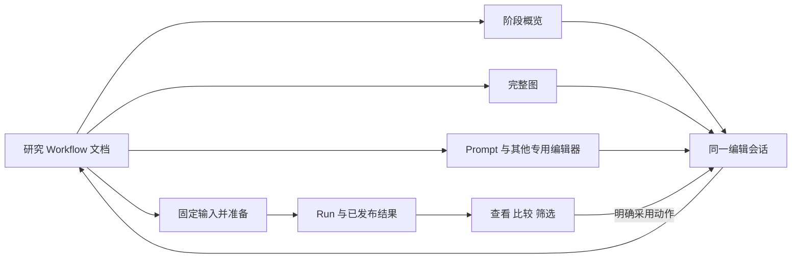
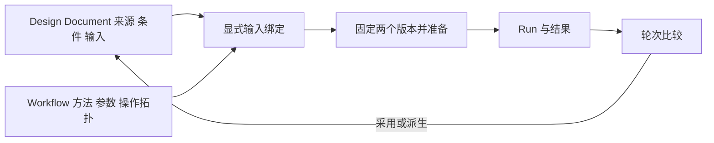

# 前端目标体验与候选架构

> 2026-10-06：用户通过原型并要求删除右侧检查栏。当前已取消检查栏、底部输出台及 A/B 切换，保留节点输出入口与 Results 回图定位。[当前原型](http://127.0.0.1:5180/prototype.html)。下文 A/B 内容为历史记录。

日期：2026-10-03。状态：**设计收敛提案，包含推荐方案；尚未经过交互原型与实现验收。**

> 2026-10-05 复核：首轮原型遗漏可编辑 Workflow 画布和完整专用编辑器，用户已指出不符合要求。下一轮以现有画布、Prompt Studio 与 Results 的完整操作流程为基础；阶段概览本来就是现有画布的一层，不能用阶段表单替代。详见[原型范围纠偏](../2026-10-05-prototype-scope-correction.md)。本文的 A/B 和新增能力仍为候选，首轮演示不能用于判定胜负。

> 历史实现入口（现已收敛为默认 `/`）：[完整画布功能原型](../../../webui/README.md)，提供[A 侧栏](http://127.0.0.1:5180/prototype.html?variant=A)与[B 底栏](http://127.0.0.1:5180/prototype.html?variant=B)。两者复用现有完整 App，重点体验节点输出、Results 回图及 Prompt 归属；这组布局 A/B 不等于本文的对象模型 A/B，也不据此判定后者胜负。试用步骤与范围见入口说明，验证结论另行记录。

本轮把[六个开源项目的架构研究](../2026-10-03-frontend-architecture/README.md)转成可比较的产品方案、对象归属和 Interface。既有科学契约、规格、ADR、技术框架和功能排除范围均可重评；科学含义仍需明确说明，不从代码形状或上游界面推导。

## 1. 先读推荐

**建议采用 A：研究 Workflow 为主要编辑对象，以阶段组织默认体验，通过专用编辑器完成精细蛋白设计。** 编辑器拥有当前编辑意图；核心拥有科学解释、已确认版本、执行与结果事实。两者通过明确的版本和回执联系。

推荐的理由是：目前可确认的任务既包含 Prompt 生成，也包含 FASTA 批量分析、折叠、评分、筛选与中间结果复用。Workflow 能容纳这些任务，阶段视图则减少用户一开始要理解的图细节。这个判断基于任务覆盖，未获得用户研究或原型测量支持。

**B：蛋白设计文档为主要编辑对象，Workflow 作为可编辑的执行方式**，仍是认真保留的备选。如果日常工作主要是反复改来源片段、约束和局部结构，而很少修改多阶段处理过程，B 可能更合适。

首要旅程的偏好尚待反馈；本文暂按“完整研究流程优先、精细设计可深入进入”比较。该假设影响 A/B 推荐，不影响“提交固定输入、结果有明确来源、选区用途分开”等共同建议。

| 本轮建议收敛的选择 | 理由 | 保留的验证条件 |
|---|---|---|
| 默认阶段视图，提供完整 Workflow 图与专用编辑器 | 同一研究对象有不同阅读深度 | 用户能否预测阶段作用，能否顺利定位内部操作 |
| 将已准备请求、Run、结果与正在编辑的版本分别表达 | 运行期间允许继续编辑，旧结果仍可解释 | 版本切换、采用、撤销与恢复是否一致 |
| 为项目提供精简 Run 历史与跨次比较入口 | 支持回答“哪个改动带来这个结果” | 从既有持久记录构建查询，避免再维护第二套运行事实 |
| 焦点、比较、勾选、临时残基选区和生成约束分别建模 | 它们有不同后果和寿命 | 两个候选并排操作时是否易于理解 |
| 结构预览的交互反馈与确认后的科学结果分别处理 | 连续操作需要即时反馈，落盘需要明确含义 | 3Dmol / Mol* 实测；本轮不预定渲染器 |
| 先用明确的编辑、准备、运行和查看 Interface | 集中版本、错误和资源生命周期 | 不引入尚无真实变化的通用插件系统 |

这些是本轮推荐，不能标成用户已确认的产品要求。执行中的模型调用、性能和可用性也没有因文档完成而得到验证。

## 2. 文档导航

| 文档 | 读完应能决定什么 |
|---|---|
| 本文 | 目标旅程、A/B 产品结构、推荐理由与视觉交互方向 |
| [对象、交互与 Interface](interaction-and-interface-contracts.md) | 谁拥有状态；编辑、准备、提交、取消、采用与联动如何工作 |
| [原型与评估计划](prototype-evaluation-plan.md) | 用哪些具体场景推翻或保留推荐，下一轮交付什么 |
| [最小 Interface 对照](interface-minimal.md) | 将执行闭环压到少量入口会隐藏什么，又会限制什么 |
| [核心命令对照](interface-core-owned.md) | 核心拥有全部编辑事实时，统一规则与同步成本如何交换 |
| [设计文档中心对照](interface-design-first.md) | 怎样让精细设计成为主流程，并处理批量分析的例外 |

三个独立 Interface 方案是比较材料，未作为并存的产品实现。本文和 Interface 文档给出综合推荐；对照稿中不同的签名与规则不自动进入推荐方案。

## 3. 用相同的研究旅程比较

以下旅程来自已讨论的产品用途；它们是设计评价场景，不意味着保留旧实现方式。样例中的数量仅用于原型，不代表科学阈值或实验结论。

| 旅程 | 用户要完成什么 | 必须能够解释的事实 | 设计成功的观察 |
|---|---|---|---|
| J1 来源驱动设计 | 导入结构，选来源片段，配置目标条件，预览并生成候选 | 来源到目标对应、哪些值固定/待生成、实际生成参数 | 用户提交前能说清输入，采用结果后能追溯和撤销 |
| J2 批量候选分析 | 导入多条 FASTA，评分、折叠、比较并筛选 | 每个结果属于谁，分数的方法/单位/参考对象 | 无需人为创建 Prompt；可查看任意中间阶段 |
| J3 分支比较 | 同一输入以不同方法或参数执行，再比较结果 | 每个候选与测量来自哪个 Run/操作；哪些指标可比 | 切换当前编辑不改写旧 Run，不能以同名分数直接混排 |
| J4 结果进入下一轮 | 查看已发布结果，选轨道或候选，创建后续编辑，撤销再重做 | 采用对象、目标位置、来源引用与将替换的内容 | 一个明确动作完成采用；撤销恢复原文档而不删除已有结果 |
| J5 长任务中的控制 | 提交后继续编辑，断连、取消、重开项目 | 正在编辑与正在执行的版本；停止请求与实际终止 | 重开不重复提交；已发布部分结果仍能查看；未知状态明确显示 |

J1 和 J4 检查设计工作是否顺手；J2 和 J3 检查架构是否过度偏向生成；J5 检查 Interface 是否覆盖真实时序。不能只展示一次顺利生成的演示就宣布方案成立。

## 4. 候选 A：研究 Workflow 为中心

### 用户看到的结构

项目打开后首先显示阶段及其输入、主要操作和输出。用户可以在阶段中直接修改常用参数，进入 Prompt、筛选或结构编辑器，也可以切换到完整 Workflow 图。**阶段参数是同一文档字段的投影，专用编辑器是同一编辑会话的入口。**

结果工作区按 Run 与输出组织；它保持自己的查看上下文。用户可以查看旧 Run，同时继续编辑新版本。只有明确的“采用到当前设计”或“从这个输入开始新版本”会改变编辑内容。



这里的箭头表示职责关系，不是新增网络服务。阶段是否进一步成为可复用的计算单元，应独立决定；不能从“折叠卡片”推导执行、缓存或取消语义。

### 优势与付出的成本

A 对 J2/J3 最自然：没有 Prompt 的研究依然是完整产品场景，中间输出和跨阶段引用不需要例外。Node Type、Method 和输入依赖可以逐步揭示，而不是全部露在第一屏。

它的主要风险是专用设计体验仍被图的结构牵制。用户可能要理解“这个 Prompt 属于哪个操作”，跨操作采用结果也可能显得绕。若必须频繁离开设计区才能完成 J1/J4，阶段视图只是在遮盖复杂度，应重新评估 A。

## 5. 候选 B：蛋白设计文档为中心

### 用户看到的结构

项目首页是一份 Design Document（候选术语）：来源、目标条件、输入候选和设计轮次。用户在其中完成片段映射、轨道修改和结构预览，再选择一个执行 Workflow。Workflow 有自己的版本和具名输入，用户仍可查看和修改其操作。

**绑定是显式关系，不能把图反编译回设计意图。** Design Document 拥有来源和条件，Workflow 拥有操作拓扑及未对外绑定的执行参数。显式对外绑定的参数值由 Design Document 持有，Workflow 对应位置只保留引用；解除绑定后才成为 Workflow 自有字面值，避免两份文档各存一套可独立修改的温度或约束。



纯 FASTA 分析以候选输入进入，不强制伪造多轨道 Prompt。任意中间输出仍可成为结果入口。若这些情况占据主导，B 的“设计轮次”导航可能需要让位于流程导航。

### 优势与付出的成本

B 对 J1/J4 更直接：修改研究意图、执行、比较、采用自然形成循环。它的成本是两份文档的版本与输入绑定：改 Workflow 后原设计还适用吗，新增输入在哪里填写，同一个设计的不同执行方式如何命名和比较，都需要明确规则。

独立对照稿进一步给出 [Design Document Interface](interface-design-first.md)。本轮不将这个新术语直接写入项目根 `CONTEXT.md`，因为是否采用 B 尚未决定。

## 6. 比较结果与反转条件

| 比较维度 | A：Workflow 中心 | B：Design Document 中心 |
|---|---|---|
| J1 精细设计 | 通过专用编辑器进入，需要清楚显示归属 | 默认入口，路径更短的假设值得验证 |
| J2 无 Prompt 的批量分析 | 常规研究路径 | 需要候选输入模式，检验是否出现额外概念 |
| J3 自由改拓扑与中间结果 | 与主要文档一致 | 进入执行 Workflow，处理两份版本的关联 |
| J4 采用与下一轮 | 一次改变文档的明确动作 | 文档派生/轮次直接表达，但不能混同 Run |
| 需要解释的版本 | 编辑版本与已准备/执行版本 | 设计版本、Workflow 版本、二者绑定与执行版本 |
| 隐式状态的主要风险 | 阶段、图和专用编辑器重复存值 | 设计条件与 Workflow 参数重复存值 |
| 初步判断 | 在当前暂定任务权重下优先 | 当精细条件设计占主导时可能反超 |

不使用未经测量的加权分数。**A/B 选择不能由代码改动较少来代替产品判断。** 若 B 在 J1/J4 明显减少理解负担，且 J2/J3 不出现人为绕路，应转向 B，即使需要重新组织现有科学与持久化模型。

## 7. 与产品形态分开决定：编辑事实由谁拥有

两套产品方案都可以采用客户端或核心拥有编辑事实。综合推荐：**一个客户端编辑 Module 拥有当前 desired revision；核心保存已确认版本、解释科学语义并拥有 Run。** desired 与 acknowledged 是两个有不同含义的状态，不是两份竞争的“当前真相”。

客户端负责输入缓冲、编辑动作、撤销、即时交互和保存调度。核心接收确切的不可变快照，进行它拥有的解释与验证；返回归属于该版本的规范结果或诊断。后端回复不能静默覆盖更新的编辑意图。专用编辑器不再另开一套可独立发布的 Workflow 真相。

全部编辑经核心命令的方案仍有价值：它集中规则，适合以后需要第二种编辑客户端的情况；代价是连续输入与拖拽需要额外的预览和确认协议。详见[核心命令方案](interface-core-owned.md)。在当前单用户场景下，暂不为假定的多客户端需求承担这一成本。

“最少入口”对照也提供一个反例：把准备、启动、观察和采用塞进少量入口，不一定降低调用者要掌握的概念。推荐按完整用例划分 Interface，而不是为追求三个方法限制重复运行或历史查看。详见[最小 Interface 方案](interface-minimal.md)。

## 8. 目标界面与外观表达

这里给出信息层级与交互要求，供原型制作，不把配色或组件库选型预先固定。

| 区域 | 主要信息与操作 | 需要明确的视觉区别 |
|---|---|---|
| 项目顶栏 | 项目、当前编辑版本、保存状态、运行入口 | “正在编辑 v12”与“查看 Run R7，来自 v9”可以同时存在 |
| 阶段/设计导航 | 当前任务、输入、输出及下一步；允许进入完整图 | 当前位置、内容有改动、运行失败是不同状态 |
| 主编辑区 | 默认阶段；进入后使用轨道矩阵、结构或领域表单 | 活动格、选区、输入缓冲、已提交改变分别可辨 |
| 运行栏/抽屉 | 范围、输入版本、接纳状态、执行活动、部分结果和停止能力 | 排队、执行、停止请求、终态、连接状态分别表达 |
| 结果工作区 | Run 历史、输出位置、候选列表、相邻详情/比较 | 当前焦点、加入比较、勾选、下一轮采用分别标注 |
| 来源与解释面板 | 来源残基、目标位置、Method、单位、参考对象、诊断 | 默认显示可读摘要，精确信息可展开并复制 |

设计区的低保真布局：

```text
项目 / 当前编辑 v12 / 保存中…                 [准备运行]
阶段或设计导航 ┃ 来源与目标摘要               ┃ 解释/诊断
              ┃ 结构视图                     ┃ 当前操作
              ┣ 残基轨道矩阵 / 选择摘要       ┃ 影响范围
              ┃ [预览] [应用] [取消]          ┃ 来源详情
运行栏：R7 使用 v9 · 正在执行 · 查看已发布结果
```

结果区的低保真布局：

```text
当前编辑 v12                  查看 R7（来自 v9）
Run / 输出列表 ┃ 候选列表       ┃ 详情或并排比较
               ┃ 焦点 / 比较 / 勾选各自显示
               ┣ 筛选表达与可用指标说明
               ┃ [保存为选择操作] [采用到当前设计]
```

颜色辅助表达，状态名称、图标或线型同时提供信息；hover 不承担唯一解释入口。来源色保持一致，运行状态色不复用为来源身份。键盘焦点与残基选区分别显示；同一语义动作在菜单、按钮与快捷键中使用同名描述。

窄桌面保留项目/Run 身份，将结构与矩阵切换或折叠说明栏，不把关键按钮挤出视口。性能密度、空状态、失败状态、键盘操作和焦点恢复与正常界面一起进入原型评估。

## 9. Run 历史与分组：本轮作出的具体选择

**建议提供精简的项目 Run 历史。** 每项显示来源版本、操作摘要、时间、结果状态与可查看输出；用户可以打开、比较或从旧输入准备新的 Run。它是现有持久执行事实的查询与导航，不能再写一份独立的执行状态账本。旧 Run 不因当前编辑变化而被标成失败或被覆盖。

历史读取与进程恢复分开：重新打开页面可以恢复查看；后端中断后是否继续计算取决于实际执行能力，不能把重新发起的计算伪装成原 Run 的继续。保留和删除结果的政策是后续明确项，不默认自动清理。

**阶段默认是内容组织与参数投影。** 若需要可复用计算封装，另用明确输入/输出的组合定义；若需要内部失败或取消策略，作为进一步的执行能力单独设计。三种语义不从同一个“创建组”动作隐式产生。阶段要不要成为科学定义，由原型中的真实重复任务决定，不受旧“只做 UI 分组”约定限制。

## 10. 收敛状态与实施顺序

| 项目 | 本轮状态 | 下一步依据 |
|---|---|---|
| A/B 主对象 | 暂推荐 A，优先级假设待反馈 | 用 J1–J4 的同任务原型比较 |
| 编辑 owner | 推荐客户端编辑会话 + 核心已确认版本 | 准备期间继续编辑、晚到响应、撤销用例 |
| Run 历史 | 推荐作为首轮目标能力 | 当前持久记录盘点与跨次比较原型 |
| 视图协调 | 推荐固定、类型明确的共享上下文 | 两候选联动；真实出现动态面板后再评估 scope 配置 |
| 结构 renderer | 保持开放 | 3Dmol / Mol* 同一数据与操作的测量 |
| 分组执行语义 | 阶段与执行封装分开 | 复用与失败传播的实际场景 |
| 科学编辑含义 | 明列需定的问题，不继承旧 ADR 作为答案 | 轨道状态、范围、映射、变换、随机性逐项形成新定义 |

先按[原型计划](prototype-evaluation-plan.md)验证关键差异，再整理实施规格、对象词汇和必要的 ADR。进入代码阶段时，一次替换一个完整用例的生产者、消费者与测试，删除被替代路径；不用适配旧开发产物来维持双轨实现。

本轮文档没有修改产品代码或根领域词汇，没有运行测试、构建、Provider 或性能测量。源代码现状只是成本与差距的证据；候选方案的正确性仍需上述具体场景检验。
