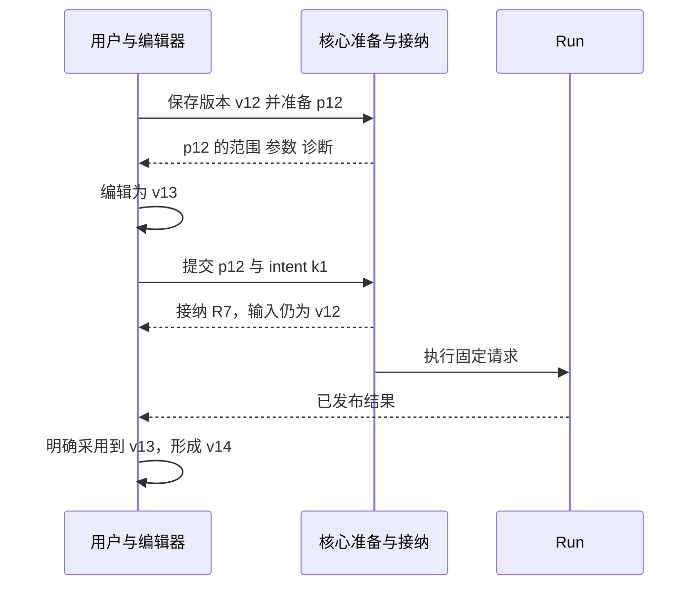

# 对象、交互与 Interface：推荐方案的可评审草案

[返回总览](README.md)。日期：2026-10-03。状态：候选设计，不是已发布的协议或新的科学规格。

本文展开总览中的 A 方案，并标出哪些决定同时适用于 B。方法名称是伪代码；后续实施可沿现有 public protocol 组织，不要求逐个创建同名 HTTP endpoint。

## 1. 用词与职责

沿用 `Workflow`、`Node Type`、`Method`、`Run`、`Candidate`、`Score Observation` 等可识别词汇。这里的推荐不默认继承它们在旧规格里的全部字段与约束；若改变科学含义，应在新规格中明确变更，而不是仅改 UI 名称。工程上的 Module 不等同于科学 Node Type。

| 对象 | 建议含义 | 身份与主要 owner | 保存与恢复 |
|---|---|---|---|
| 编辑快照 | 某时刻完整、可定位的编辑内容，可以尚未可执行 | 客户端编辑 Module 持有本次会话的 revision；不可原地改写历史快照 | 核心确认保存后获得持久版本引用；待保存内容与已确认内容分开 |
| 已确认版本 | 核心已接纳保存、可重新读取的精确编辑内容 | 核心持有持久版本 ID | 可用于重新打开；不等于已完成科学执行准备 |
| PreparedRun（候选概念） | 对一个确切版本、范围和执行意图完成解释后的提交对象 | 核心拥有 preparation ID、输入闭包与相关解释；不能指向“当前最新值” | 提交依赖的准备值需可恢复；不是永久占用 GPU 或保证 Provider 就绪 |
| Run | 一次被核心接纳的实际执行及其记录 | 核心持有 Run ID；一个准备值可由不同的明确运行意图发起多次 Run | 历史读取与计算续跑分别定义 |
| 已发布结果 | 由真实执行或明确复用产生的可查看数据及其来源 | 结果内容/来源的 owner；不能以 UI 行号替代身份 | 独立于当前表格排序和页面生命周期 |
| Candidate 引用 | 精确指向被查看、比较或采用的数据对象 | 包含需要区分内容版本与来源的关联信息 | 不能仅按名字、序号或相同序列猜对应 |
| View Context（候选概念） | 一组视图当前查看哪些对象、共享哪些交互状态 | 前端协调 Module，按项目与被查看对象分隔 | 只保存可序列化身份、视图偏好与引用，不保存 GPU/SDK 对象 |

revision、持久版本、preparation ID、Run ID 各自解决不同问题。浏览器的局部 revision 不冒充核心版本；一次 `undo` 可以恢复旧内容，但仍产生新的编辑动作和版本，不改写旧 Run 的输入。

## 2. 推荐的四个 Module

| Module | 调用方需要掌握的 Interface | 隐藏的 Implementation | 主要依赖 |
|---|---|---|---|
| Authoring | 编辑动作、快照、撤销/重做、保存回执、预览/采用 | 跨视图事务、输入缓冲、规范结果归属、保存顺序、过时响应 | 内存文档计算；我们拥有的核心解释与持久化 |
| Execution | 准备、提交、查接纳回执、查看 Run、请求停止 | 冻结输入、请求身份、接纳、观察与状态聚合 | 我们拥有的 runtime；由 runtime 调用真实 Provider Adapter |
| Result Reading | 按 Run/输出查结果、比较引用、分页与诊断 | 多 Run 读取寿命、数据缓存、指标上下文、错误与刷新 | 持久结果与只读 HTTP 传输 |
| Structure Interaction | 载入精确结构、临时变换、选区、镜头、释放 | renderer 对象、拾取到残基身份的翻译、更新时序和资源 | 浏览器内渲染库；由 Authoring 提供确认后的 projection |

View Context 的协调逻辑可作为前端组合层的内部 Module，不必为它新增后端服务。普通参数控件与复杂编辑器消费同一内容，不各自持有独立的可提交副本。

四个 Module 是完整职责，不是四个必须新建的包。当前已有同类 owner 时应重整或替换其 Interface；不要只在旧入口外再包一层转发。

## 3. Authoring：一个动作怎样成为新版本

```text
edit(expectedRevision, typedChange) → EditReceipt
preview(exactSnapshot, previewIntent) → PreviewResult
save(exactSnapshot) → SavedVersion | SaveFailure
undo() / redo() → EditReceipt
prepareAdoption(exactResultRefs, targetRevision, adoptionIntent) → AdoptionPreview
applyAdoption(adoptionPreview, expectedRevision) → EditReceipt
```

`typedChange` 是有限、类型明确的操作集合，例如改字段、连线、替换轨道、采用候选、提交结构变换；不是任意路径 patch 或字符串脚本。每种操作的前置条件与结果可以单独说明。一个字段修改如果需要科学解释，交给拥有该含义的核心 Interface，不在前端另写一套近似科学规则。

### 输入、确认、撤销与保存

1. 键入、拖拽、旋转过程中先有临时缓冲；Escape 取消缓冲，不改变文档。
2. 确认一个单格、多格粘贴、来源映射或完整变换时，形成一个可命名的编辑动作。核心解释失败则保留可纠正的输入与诊断，不悄悄写入部分值。
3. 文档级撤销在阶段、图与专用编辑器之间使用同一动作历史；恢复内容不删除已发布输入、Run 或结果。活动文本输入框仍使用它自己的输入缓冲撤销，提交之后进入文档历史。
4. 普通导航、hover、镜头移动不进入文档撤销。显式布局编辑可以拥有独立的布局历史与动作名称；快捷键按当前操作区域分派，并显示将撤销的动作，不能让两个栈同时消费一次按键。
5. 每份文档使用一个串行保存通道：前一项得到确定回执后再发送后一项。回执只推进对应队列项的 acknowledged，不能倒退，也不能把更新的 desired 标成“全部已保存”。失败或回执未知时保留 desired 与队列，先核对该次保存的结果；显式重发需保留保存操作身份，不在未知结局上继续发布下一版本。

保存操作在核心关联操作身份、输入快照和确定回执，成功发布当前版本与成功回执属于同一次持久提交。项目切换产生新的读取代次，旧项目回执只能更新原项目状态；不能覆盖当前项目。首轮不引入多浏览器并发编辑或自动合并。

统一文档撤销是对当前独立 Prompt 撤销与工作区撤销的重设计建议。它的风险是长时间 Prompt 编辑导致历史过细；连续输入可按明确交互动作合并，但不能把跨轨道或跨对象的不同研究动作随时间任意合并。

### 采用结果

采用预览必须显示：来源 Run/输出/Candidate、目标编辑版本、采用哪些轨道或对象、对应范围、将替换或保留什么。采用不能把“当前焦点”或“所有可见行”隐式视为输入。

若目标版本已改变，原采用预览失效；保持预览内容和当前文档，重新准备后再应用。前端不自动变基科学映射。对同一 Candidate 的两份内容或不同参考对象的 Score，不按标签自动替代。

在 A 中，采用可产生普通来源/条件/选择操作或修改目标编辑字段；具体语义由采用种类声明。在 B 中，目标是 Design Document。两者都不能通过直接修改 renderer 或 SDK 对象完成持久研究编辑。

## 4. Execution：准备与提交是两种操作

```text
prepare(savedVersionRef, runIntent) → PreparedRun | PreparationDiagnostics
submit(preparationId, submissionIntentId) → AdmissionReceipt
lookupSubmission(submissionIntentId) → AdmissionStatus
readRun(runId) → RunProjection
observeRun(runId, afterCursor) → Subscription
requestStop(runId, stopIntent) → StopReceipt
listRuns(projectId, query) → RunSummaryPage
```

这组操作不为最少函数数量牺牲可解释性。`observeRun` 的订阅释放只停止读取；它不是 `requestStop`。精简的运行摘要可以读取既有 Run 记录，不创造新的账本。

### PreparedRun 必须固定和说明什么

| 内容 | 建议承诺 |
|---|---|
| 编辑输入 | 确切保存版本和它引用的数据内容；不在启动时重新读取 mutable latest |
| 执行范围 | 哪些操作进入本次运行，哪些依赖已有结果，哪些需要新计算；发生变化必须重新准备或明确报告 |
| 科学解释 | 所选 Node Type/Method、输入映射、参数及为解释结果所需的定义；不要只保存控件显示字符串 |
| 随机性 | 区分请求的随机意图、此时已确定的有效值、执行时才能报告的值；不声称所有 Provider 都提供 seed |
| 复用与前置条件 | 复用目标的精确引用；当前可检查条件及诊断；未来实际可运行性仍由执行时观察决定 |
| 诊断与定位 | 问题属于哪个版本、操作、字段、来源或残基范围；可从摘要返回相应编辑位置 |

准备不自动启动计算，也不保证队列等待后环境仍相同。若依赖的操作定义或数据已不可用，提交应给明确诊断；不静默改用当前新定义、其他来源或备用 Provider。准备对象的失效条件与保留期限属于协议需明确的部分。

### 运行中继续编辑



当当前编辑变为 v13，运行确认区必须持续显示它准备的是 v12。默认要求重新准备当前内容；用户可以明确选择执行已固定的 v12。两条操作都只提交对应快照，不把新旧参数拼接。

### 请求身份与未知回执

`submissionIntentId` 表示一次明确的启动意图。发送前，浏览器先持久保存 `{projectId, preparationId, submissionIntentId}` 的待确认记录；写入失败则不发送。网络断开、回执丢失或页面重开时从该记录恢复同一标识，查到确定回执后归档。它只是提交恢复元数据，不是另一份 Run 状态账本。

核心持久记录该标识与接纳结果的关联，相同标识和相同准备值至多接纳一个 Run；同标识不同准备值是本地协议错误。显式重发保存/提交都只适用于我们定义的接纳协议，不能据此重放未知结局的外部 Provider 请求。

回执未知时先显示“正在确认是否已启动”，通过查询获得事实，不生成新身份重提。查询暂未发现记录不能证明原请求永远不会到达；若提供显式重发，应复用同一标识并由上述接纳规则处理。这里没有新增自动重试或 Provider 请求重放策略。

用户明确选择“再运行一次”才创建新标识；可以沿用同一准备值，也可改参数后重新准备。相同参数不保证随机结果不同；若要求独立随机试验，需要明确受支持的随机条件并形成相应请求。

这是针对我们拥有的接纳层的语义提案，不是对 Biohub 或其他 Provider 的幂等承诺。进程中断后不能因请求身份相同，就假定外部调用未发生并自动重放。

### Run 快照与事件如何衔接

`readRun` 返回完整 projection、单调运行版本及与该投影一致的持久 cursor。`observeRun(afterCursor)` 先交付其后已确认的事件，再进入实时更新；不能在读取快照和开启观察之间丢失状态变化。客户端只确认已经处理的 cursor，断连后沿这个位置恢复，并按需要刷新 projection；旧 projection 不覆盖较新的运行版本。

事件用于触发读取和展示活动，完整 projection 决定当前结果与终态。若 cursor 已不在可恢复范围内，协议明确返回需要重新读取快照的结果，再从新 cursor 观察；不能悄悄跳到尾部。读取恢复不提交新 Run，也不恢复已中断的科学计算。现有 cursor 机制可作为实现起点，是否满足上述关联规则仍需验证。

## 5. 状态与停止：用户究竟知道什么

建议分开表达下列事实，避免单一 `status` 同时承担所有含义：

| 维度 | 示例 | 谁能确认 |
|---|---|---|
| 提交接纳 | 未提交、回执未知、已接纳、被拒绝 | 核心接纳记录 |
| 执行生命周期 | 等待、执行、结束、中断 | runtime 与其持久事实 |
| 终态结果 | 成功、含失败、停止后结束，以及可用输出范围 | 执行事实与发布记录，不能从连接关闭推导 |
| 读取连接 | 已连接、同步中、暂不可达 | 当前读取会话 |
| 停止操作 | 可请求范围、请求已收到、待确认、实际终止或已结束 | 核心与真实执行能力 |

表中的标签是产品语义草案，不要求照搬为新枚举。节点、样本与整次 Run 的数量口径分别说明；没有可靠估计时，不把节点计数百分比显示成剩余时间。

停止能力至少区分停止后续调度和中止已开始的 Provider 调用。若后者不存在，界面说明仍在等待的调用，不显示虚构的已停止。请求与完成并发时，以最终事实收敛；已经完成不会被一次晚到的停止请求改写为失败。

已发布结果可以在整体未成功时查看和采用；未发布的 renderer 画面、预览张量或尚未确认的响应不冒充结果。采用这些结果时保留实际 Run 状态与来源，不把失败背景隐藏。

## 6. Result Reading 与视图协调

推荐固定、类型明确的 View Context 起步，随真实多面板需求再评估 Vitessce 式 scope 配置。

| 状态 | 作用范围 | 持久化建议 | 明确不产生的后果 |
|---|---|---|---|
| focusedCandidateRef | 一个详情视图 | 可保存当前引用 | 不自动勾选、比较或采用 |
| comparisonMembers | 一个比较工作区，可跨 Run | 保存精确引用与顺序 | 不自动推导残基对应或指标可比性 |
| checkedCandidateRefs | 一次人工选择/导出准备 | 保存时带输入范围，重开按精确引用恢复 | 不以新排序下相同行号替换 |
| filterDraft / appliedFilter | 一个输出集合或显式比较集合 | 草稿与已应用规则分开 | 不直接改变 Workflow 计算 |
| residueSelection | 绑定精确结构/布局的临时选区 | 可保存引用；切换内容时核对适用对象 | 不自动成为生成约束或跨候选对应 |
| hover / keyboardFocus | 当前交互 | 不作为研究内容保存 | 不切换研究对象或滚动其他视图 |
| camera / displayStyle | 单个结构视图 | 可保存显示偏好 | 不改变结构坐标或科学结果 |
| linkedSelection / linkedCamera | 一对视图的显式关系 | 保存选择映射引用、镜头联动模式与各自中心 | 开启镜头联动不自动开启残基联动 |

跨候选联动需要明确映射来源。无映射时可独立查看，不能按残基序号猜对应；映射不完整时显示可对应与未对应部分，不静默补全。命名集合、筛选结果或被采用为约束的选择进入研究对象；View Context 仅持有其当前引用。

首轮镜头联动建议为“同步视角操作”：向两视图分派同一相对旋转、缩放比例与按视口归一化的平移，各自保留独立的结构中心和当前朝向；不直接复制绝对 camera 数值，也不声称结构已经对齐。若需要按结构配准同步视角，必须另有明确的显示变换及来源。显示变换不改写科学坐标，残基对应本身也不能代替空间配准。

一次“框选并保存成命名集合”若同时更新成员、颜色和名称，应作为一个操作发布，保证撤销与保存一致。普通临时框选可以只更新视图状态，两者用不同动作命名。

比较读数必须带 Metric、Method、单位与相关参考上下文。缺少可比条件时显示分栏与原因；要构造排序目标时，再进入显式定义规则的操作，而非在显示层做隐式归一化。

## 7. Structure Interaction：即时反馈与科学确认

```text
load(structureRef, exactData, residueIdentityMap) → SceneReceipt
beginTransform(selectionRef, baseStructureRef, targetRevision) → TransformPreview
updateTransform(previewId, transformIntent) → DisplayReceipt
proposeTransform(previewId) → RevisionBoundTransformIntent
resolvePreview(previewId, acceptedProjectionOrDiagnostics) → DisplayReceipt
cancelPreview(previewId)
setSelection(selectionRef) / setCamera(viewState)
dispose()
```

该 Interface 隐藏 renderer-specific model、Loci、atom index 与释放细节。是否能让 3Dmol 和 Mol* 都满足它，需要原型证明；本轮不会因为写了 Interface 就宣称已有可替换 Adapter。

连续变换从操作开始的精确坐标计算临时显示，避免每次输入累积漂移。取消回到操作基准；相机保持自己的状态。Structure Interaction 只产生绑定目标 revision、基准结构与选区身份的 intent，保留预览并等待结果；**Authoring 独占科学确认、编辑历史与文档发布的协调职责。**

Authoring 先请求核心进行不发布文档的解释/预览。返回成功时，只有目标 revision、预览代次与基准结构仍匹配，才把规范文档和 projection 作为一个编辑动作原子接受，并替换临时画面；之后按正常保存队列持久保存。解释失败则保留可纠正的预览与诊断。失败重试不能从已经变形的显示坐标再次累积计算。

确认期间取消、切换结构或对目标作新编辑，会使该预览代次失效；晚到结果不能发布内容。当前显示恢复到当前文档对应的结构，旧 intent 可作为明确的待重做操作保留，但不能自动映射到新目标。若成功动作已被接受，后续撤回通过文档撤销完成，不能再以“取消预览”掩盖已发生的编辑。

本地显示与核心结果应按预先定义的变换含义一致。若确认失败或超过约定差异，保留待处理操作并显示原因；不把近似画面直接当成科学结果。单位、坐标系、旋转中心、残基/原子选择、映射和可接受差异，都在下节列为需明确的问题。

数据切换或视图销毁后，旧加载/预览响应不得写回新结构；owner 以对象身份和操作代次处理过时响应，并释放旧资源。取消加载与取消科学执行是不同操作。

## 8. 必须显式解决的科学设计问题

旧规格可提供案例，不能替代本轮决定。原型可以使用明确标注的合成数据或现有已解释数据；未定含义不应伪装成实现默认值。

| 问题 | 本轮建议的决策方式 | 必须记录的例子 |
|---|---|---|
| 轨道的未提供、未知、待生成与固定值 | 先定义用户可执行的动作，再映射各模型表示 | 整轨缺省与全空轨；修改生成目标后含义如何变化 |
| 来源到目标残基的身份 | 精确来源和显式映射为默认；自动映射若引入必须声明方法 | 多链、插入码、缺残基、同序号不同链 |
| 结构变换 | 明确坐标系、单位、中心与作用对象 | 同一选区旋转后数值结果；取消/确认/撤销一致 |
| 多来源合并 | 指定重叠、缺失、冲突和优先关系 | 两个片段覆盖同一目标，不能靠最后一个 UI 事件决定 |
| 随机条件 | 分开编辑中物化的条件与执行时采样 | 预览/保存/准备是否重复抽样，哪些参数由 Provider 实际支持 |
| 跨结果比较 | 明确科学身份与参考上下文后定义可比性 | 同名指标不同 Method/归一化；不齐全结果的排序规则 |

这些问题应在进入对应原型的科学计算部分之前形成短规格。仅做界面与状态演示时使用固定的明确样例，不调用模型来掩盖尚未决定的含义。

## 9. 当前实现的差距与复用位置

这是源码静态盘点，既不是兼容要求，也不代表下列问题已经修复。行号对应本轮阅读时的工作区；产品代码基线为 Git `3b8d851693adbd199895df46f87d3eda6ce20ef8`，本轮未修改产品代码。

| 当前事实与位置 | 对推荐方案的影响 |
|---|---|
| [WorkspaceEditor](../../../webui/src/workspace-editor.ts) L28、218、253 已拥有 desired、acknowledged、history 和保存队列 | 可以围绕完整编辑职责重整；不是只替换状态库 |
| [PromptStudio](../../../webui/src/PromptStudio.tsx) L248、267、332 另有 preview、过时响应过滤和 undoStack | 统一文档撤销需要重新安排事务归属，不能同时保留两套发布路径 |
| [App](../../../webui/src/App.tsx) L751 与 [RunDialog](../../../webui/src/RunDialog.tsx) L6 保存 Draft、commit、preview scope；PreparedRun 当前是 UI 包装 | 推荐的核心 preparation ID 是协议变化，不应描述成现成功能 |
| [client](../../../webui/src/protocol/client.ts) L156 在每次 start 调用生成请求 ID；[run routes](../../../protein_workbench_public/http/run_routes.py) L128、168、189 已有 preview/start/cancel | 需要将请求身份提升为启动意图的生命周期，核对核心接纳规则 |
| [Ledger](../../../core/execution/ledger/ledger.py) L142、522、708 已持久写入 Run，重启将未结束 Run 标成 interrupted | 保留已有运行事实 owner；历史 UI 不需要另建执行账本 |
| [ProjectManager](../../../core/project/manager.py) L260、272 能枚举存储 Run，public/UI 当前主要打开最近 Run | 新增稳定排序、摘要、分页与历史入口；目录修改时间不宜作为研究发生时间的最终语义 |
| [PublishedResults](../../../webui/src/published-results.ts) L17、43、105 持有单个 Run 的订阅和缓存 | 跨 Run 比较需多个明确读取 owner 或可按引用读取的共享层 |
| [ResultsWorkbench](../../../webui/src/ResultsWorkbench.tsx) L54、81、108 已区分焦点、比较、勾选、筛选；L163 起可保存为 Workflow 操作 | 沿已有差异扩展，不重新合并为一个 selection；重开保存与跨页记忆需分别定义 |
| [StructureViewer](../../../webui/src/StructureViewer.tsx) L74、175 经防抖预览并在 PDB 改变时 clear/addModel | 高频坐标更新与数据身份一起进入原型；换 renderer 不自动解决往返路径 |

## 10. 依赖策略与验证责任

内存文档变换和视图协调直接通过 Interface 检验，不为纯计算造 Adapter。我们的 HTTP 后端可在用例级测试中以可控响应检验延迟、顺序与错误；这只能证明前端编排，不能证明后端持久化或模型行为。

真实核心验证准备/接纳/恢复的持久事实。Provider Adapter 遵循实际官方契约；真实 Provider 验收仍独立进行，mock 不替代科学结果或取消能力。renderer 的拾取、局部更新、相机与释放需要真实浏览器验证。

所有可运行测试、类型检查、构建、浏览器和 Provider 验证按[远端执行政策](../../backend-verification.md#execution-policy)及 [WebUI 入口](../../../webui/README.md)完成。本轮只交付设计与阅读证据。
