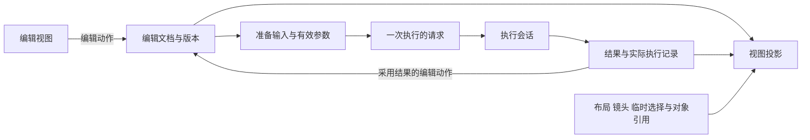

# 前端架构深研：从六个开源项目学习 API 与模块边界

研究日期：2026-10-03。对象：Biohub ESM、Mol* / MolViewSpec、Galaxy、KNIME、ComfyUI、Vitessce。

后续设计：[前端目标体验与候选架构](../2026-10-03-design-convergence/README.md)已将本研究转为两套产品方案、状态与 Interface 草案及原型评估计划。

**本轮最重要的结论：值得借鉴的是它们怎样分配状态、固定一次操作的输入、解释异步结果，以及把变化限制在少数接口内。** 外观和交互模式可以吸收，但应先明确界面背后的对象与生命周期。没有一个项目适合原样成为我们的完整架构。

本文是阅读入口与跨项目分析，六篇专题提供真实调用链、固定版本源码、错误与取消语义、测试入口和可选设计。研究只做静态阅读，没有运行上游程序、性能基准、本项目测试、构建或 Provider；文中的测试指上游已有测试代码，不表示本次执行通过。

## 1. 本轮的设计前提

按照本轮要求，**当前科学契约、规格、ADR 和实现均是可重新评估的材料，不是不可修改的设计要求。** 因此，本报告重新开放工作流分组的执行语义、运行历史、编辑与执行对象的组织方式、视图联动方式及结构渲染器选型。此前报告中“保留当前框架”“不增加历史”等范围判断，不用于否决这里的方案。

重新设计仍然要说明科学含义：来源残基如何对应目标、缺失与待生成如何区别、模型转换是否有损、随机性与结果可复查到什么程度。这些含义需要显式决定，不能从上游 SDK 字段或界面行为中推导。

下文区分三类内容：**事实**有上游源码或官方文档支持；**推断**解释这些实现的得失；**建议**是我们的候选设计。建议中的接口名称只是说明职责，不是新增协议、实施计划或批准后的架构。

## 2. 怎样阅读这组文档

| 你想解决的问题 | 优先阅读 | 已深入核查的内容 |
|---|---|---|
| 如何把蛋白质条件编辑变成模型可执行输入？ | [ESM](esm.md) | 来源片段、轨道编译、可变输入、本地与远端执行、随机性、结果采用 |
| 结构显示、选择与镜头怎样分工？ | [Mol* / MolViewSpec](molstar.md) | 状态树、transform 更新与释放、Loci 身份、场景声明、快照和真实扩展点 |
| 一次运行如何独立于画布编辑而存在？ | [Galaxy](galaxy.md) | Workflow 版本、Invocation、Job、持久调度、状态查询、取消和结果来源 |
| 配置检查、编辑命令和执行策略怎样拆开？ | [KNIME](knime.md) | configure/execute、端口规格、命令与快照同步、组件策略、传输与渲染变化 |
| 一个交互图如何成为执行请求？ | [ComfyUI](comfyui.md) | 编辑图与执行图转换、schema 驱动控件、扩展 hook、队列、事件与状态收敛 |
| 多个视图怎样共享部分状态而保持独立？ | [Vitessce](vitessce.md) | coordination scope、选择传播、Loader/Source、配置保存、缓存与生命周期 |

阅读顺序可以按工作推进：先用 ESM 确定编辑任务，再用 ComfyUI / KNIME 比较编辑与执行边界，用 Galaxy 思考运行和结果，最后结合 Mol* / Vitessce 设计结构与多视图交互。每篇末尾都有从调用者进入源码的阅读路线，无需从仓库根目录逐层猜测。

本文使用三个术语：**Interface（接口）**包括输入输出、调用顺序、错误、生命周期和成本；**Seam（可替换边界）**是调用方保持不变而能替换某段行为的位置；**Adapter（适配实现）**是这个位置上的具体实现。HTTP API 只是接口的一种。一个短函数若要求调用者理解大量全局状态，并不代表接口简单。

## 3. 六个项目真正提供了什么

| 项目 | 最有价值的职责划分 | 已核查的具体变化或实现 | 需要支付的代价 |
|---|---|---|---|
| ESM | 编辑条件 → 模型表示 → 生成结果 | 本地 `ESM3` 与远端 `ESM3ForgeInferenceClient` | 相同基类不保证能力一致；widgets 仍识别具体类；输入和配置可能被修改 |
| Mol* | 数据/状态树 → representation → Canvas；选择、焦点与镜头分别管理 | 格式、representation、theme、preset 和 transformer 的注册位置 | `PluginContext` 接口很大；Loci 依赖运行时结构；整体 renderer 并非随意可换 |
| Galaxy | Workflow → 运行配置 → Invocation → Job → 数据结果 | XML/YAML ToolSource；Local/Pulsar runner | 持久执行模型较重；调度、Job、缓存、UI 各有状态，必须解释其关系 |
| KNIME | 规格配置 → 实际执行；命令 → 状态投影；算法 → 执行策略 | 普通/组件 JobManager；桌面/WebSocket 传输；SVG/WebGL 视图 | 节点作者要理解较大的生命周期；命令返回和 UI 同步完成是两个时刻 |
| ComfyUI | 可编辑 workflow → executable prompt → job/事件投影 | 节点定义到控件注册；执行转换与子图展开；job API 投影 | 转换含可变 hook；事件可能先于 HTTP 响应；本地 history 存于进程内 |
| Vitessce | 文件描述 → Loader/Source → 视图；共享状态由 scope 表达 | CSV/AnnData embedding Loader；AnnData/MuData Source | 通用配置与实体集合约定较多；部分选择更新非原子；缓存和配置寿命耦合 |

以上为各专题的压缩对照，不是能力评分。尤其不能把“有注册表”“有基类”“有 JSON”直接等同于“容易替换”“所有实现等价”或“可以完整恢复”。

## 4. 第一处关键边界：用户正在编辑什么？

ESM 的优势是操作语言贴近研究任务：选来源片段、放到目标轨道、编译、生成、采用结果。但 widgets 同时管理颜色、来源映射、切片与可变 SDK 对象，采用结果可直接修改编译产物，绕开原来的片段编辑器。[调用链与分析](esm.md)

ComfyUI 给出了另一种清楚的区分：用户保存的图含布局和编辑信息，执行端接收另一份图。不过当前转换会调用 widget 序列化、虚拟节点处理和前后回调，不能把它当作纯函数；某些 seed 还会在回调时改变。[转换与提交路径](comfyui.md)

KNIME 则让执行核心拥有工作流，前端提交命令并接收投影。新增节点拿到命令结果后，还要等匹配的 `snapshotId` 更新到达再选中它。Galaxy 的 scoped stores 与可撤销 action 展示了另一类由前端管理编辑会话的实现。[KNIME 命令路径](knime.md)、[Galaxy 编辑器](galaxy.md)

**推断：这里有两个可以分别决定的维度——主要编辑对象是什么，以及编辑事实由客户端还是核心拥有。** 蛋白质条件文档可以由任一方拥有，研究工作流也可以投影为专用蛋白编辑器。组合时要让同一事实有明确的 owner，再决定撤销、版本和同步职责。

| 设计维度 | 候选 | 获得什么 | 必须解决什么 |
|---|---|---|---|
| 主要编辑对象 | 蛋白质条件文档 | 用户少接触计算图；围绕轨道、来源、生成和采用组织操作 | 多模型和复杂流程如何进入文档；采用结果是覆盖、约束还是新分支 |
| 主要编辑对象 | 研究工作流文档 | 表达自由编排与阶段；同一文档可投影为图、阶段或专用表单 | 专用编辑器与计算流程如何关联；复杂度如何按需展现 |
| 编辑事实归属 | 客户端拥有文档，核心接收准备后的请求 | 交互反馈直接；编辑动作与前端撤销容易集中 | 固定提交版本；跨视图动作的原子性；保存与失效职责 |
| 编辑事实归属 | 核心拥有文档，前端提交命令并消费投影 | 统一操作和撤销语义；便于多种客户端共用 | 拖拽等即时预览；命令确认与投影确认；请求顺序与错误定位 |

不必一次决定全部维度。下一步可以用同一个任务比较不同组合：修改来源区段、预览结构、采用一次结果、撤销、再次准备运行。哪种组合需要最少的隐式同步，才值得继续。

## 5. 第二处关键边界：一份配置不等于一次运行

Galaxy 把 Workflow 版本、运行输入、Invocation、Job 和结果分开；ComfyUI 将编辑图嵌入运行元数据，却在本地服务内使用进程内 queue/history；ESM3 的 `batch_generate` 则主要是调用与结果，不能据此假定有持久 task ID、可查询进度和取消能力。[Galaxy](galaxy.md)、[ComfyUI](comfyui.md)、[ESM](esm.md)

这说明运行 API 至少要回答：提交返回的是什么、执行事实由谁拥有、页面重开后能查询什么、部分成功怎样表示、什么时刻可以显示完成。是否保存长期历史应由研究需求决定；“当前尚未实现”不是排除理由，“别的项目有”也不是增加理由。

建议先在概念上区分以下四类信息。它们可以存于同一文件或数据库，不要求四套服务。

| 信息 | 主要回答 | 保存它本身仍不能保证 |
|---|---|---|
| 编辑文档 | 用户想做什么，来源、条件与操作如何组织？ | 后续执行一定采用了这些值 |
| 已准备的执行请求 | 哪个文档版本、哪些输入与有效参数被提交？ | 执行成功或随机结果可以逐数值重现 |
| 显示状态 | 当前布局、镜头、焦点、临时选区和颜色是什么？ | 数据没有变化，或选区能跨候选正确对应 |
| 执行与结果记录 | 实际执行了什么、得到哪些结果、哪些失败、结果来自哪里？ | 缺失的远端内部过程或随机状态可以恢复 |

这里的临时选区与研究对象要区别处理：命名集合、保留的筛选结果或被采用为生成约束的选择，应由相应研究对象保存；视图可以保存其当前引用。一次框选可能进入不同用途，不能仅按鼠标操作分类。

Mol* 的 State 树/Plugin 快照、带资产的 Mol* 归档和 MVS 场景描述，以及 Vitessce 的 view config，都说明：**可保存的视图，不自动等于可复查的研究结果。** 配置可能引用外部数据；运行时对象、缓存和完整来源记录并不必然包含其中。[Mol* 持久化](molstar.md)、[Vitessce 配置生命周期](vitessce.md)

下面是本报告提出的候选职责关系，并非任何上游的原样架构：

图中的模块可合并实现。只有职责与寿命确实不同，拆分才有收益；不需要为每个箭头造一个抽象层。

## 6. 第三处关键边界：联动状态与科学身份分开

Vitessce 让两个视图只共享指定状态：共享选区并不要求共享相机。它的选择流程还揭示实际复杂度：框选可以同时产生集合、集合选择、颜色与编码方式，多次 setter 并不天然组成原子操作。[状态传播链](vitessce.md)

Mol* 把高亮、选中、结构焦点和镜头拆成不同 manager；Loci 则携带运行时 Structure、Unit 与 indices。其 remap 不是生物学序列对齐，不能据此推出换一个候选后同序号残基自动对应。[选择与身份](molstar.md)

**建议：先定义联动的单位，再选择状态框架。** 候选焦点、比较成员、残基选区、hover、镜头和用于下一轮生成的约束，往往需要不同的寿命和作用范围。“全部放入一个 selected 对象”会把这些区别转嫁给每个视图。

可以比较两种方式：固定、类型明确的共享上下文，或像 Vitessce 一样显式配置共享 scope。前者适合少量固定视图，后者适合用户自由拆分比较窗口。两者都需要独立的候选/残基身份与映射规则；选择框架不能代替科学对应关系。

视觉上可用独立标记说明“正在查看”“加入比较”“已选为下一轮输入”，并让视图间的联动关系可见。颜色可辅助区分来源，但精确来源和范围仍要能读到。具体样式需通过交互原型检验，本次静态阅读没有证明用户能正确理解这些标记。

## 7. 第四处关键边界：扩展能力要落在真实变化上

有明确变化时，接口最容易设计得合理。Galaxy 将工具定义格式与执行环境放在不同边界；Vitessce 分离逻辑数据加载和物理来源；KNIME 将节点算法与执行策略分开。这些都有具体实现可对照，而不是只存在于架构图上的替换承诺。[Galaxy](galaxy.md)、[Vitessce](vitessce.md)、[KNIME](knime.md)

ESM 提醒我们不要把“大而统一的接口”当成目标：本地与远端 client 对异步、原始模型访问、批次错误和配置修改的支持不同。Mol* 也不是一套可直接替换任意底层渲染器的空壳，它的数据模型、representation、Canvas 与 picking 之间有实际耦合。[ESM](esm.md)、[Mol*](molstar.md)

建议按下面的顺序讨论我们的 seam：

1. 列出用户需要完成的用例，以及调用者应当不用理解的细节。
2. 找到确实要变化的实现，例如同一数据的两种读取方式、两个模型执行方式或两个结构展示实现。
3. 比较输入、身份、错误、取消与资源释放能否满足同一含义；不相同的能力明确另列。
4. 用两种实际实现验证边界；如果当前只有一种真实需要，先集中复杂逻辑，保留小接口即可。

节点描述驱动表单也有范围。ComfyUI 的 definitions/widgets 可减少普通控件重复；它的扩展 hook 同时允许修改构造器与转换过程，扩大了隐式接口。我们可以用描述生成标量、枚举和范围控件，同时为来源映射、结构操纵和多轨道编辑提供专用交互，避免把复杂科学操作硬塞进通用表单。[定义到控件链](comfyui.md)

分组也应重新决定：它可以只是布局容器、可复用的计算模块，或带失败/取消策略的执行单元。KNIME 的 metanode/component 和组件 JobManager 证明后两种设计有具体实现，但不意味着我们的组应同时承担三种含义。[组件与执行策略](knime.md)

## 8. 接口必须解释的六个“完成”

以下是源码中最容易影响产品反馈的细节，应直接进入后续 API 评审。

| 场景 | 上游事实 | 对我们的接口与界面意味着什么 |
|---|---|---|
| 模型调用返回 | ESM 不同路径可能返回错误值、抛异常或逐样本返回错误；配置可能被调整 | 返回类型、部分失败和有效参数须明确；调用结束不能默认全部样本成功 |
| 场景更新 Promise 完成 | Mol* 有 cell 错误状态与回滚/日志行为；不能只依赖 Promise 判成功 | 结构视图要知道目标数据是否可用，失败后哪个版本仍在显示 |
| Workflow 已 scheduled | Galaxy 调度状态与具体 Job 终态分别计算 | 进度与“完成”必须说明计算口径，不把调度完成显示为研究完成 |
| 编辑命令已返回 | KNIME 还等待相应 snapshot 更新到前端 | 可交互的新对象何时存在，应由同步协议决定 |
| 提交返回 HTTP 200 | ComfyUI 可接纳有效输出，同时返回其他输出的 `node_errors` | 接纳、部分有效、实际成功要分别展示；不能只按状态码弹成功提示 |
| 选择状态已更新 | Vitessce 的一次选择可连续写多个协调字段 | 若我们的动作要求一致撤销与保存，应在应用操作层定义一次原子更新 |

证据分别见 [ESM](esm.md)、[Mol*](molstar.md)、[Galaxy](galaxy.md)、[KNIME](knime.md)、[ComfyUI](comfyui.md)、[Vitessce](vitessce.md)。

取消同样需要具体含义：删除待执行项、请求中断、底层过程停止、保留已发布结果，是不同事实。Galaxy 的 invocation cancellation 与 Job 停止分层处理；ComfyUI 有 job cancellation 与通用 interrupt 两条路径；Vitessce 通用数据查询未贯通网络 AbortSignal。这些机制不能统一解释成“取消按钮按下即一切停止”。

对于本项目，应只展示实现真实支持的操作结果。若需要“正在停止”状态，就让执行 owner 报告终止事实；若 Provider 没有停止能力，则不能由前端制造这种能力。具体支持项要依据选定 API，而不是抄上游按钮。

## 9. 与当前代码怎样对照

下列文件是定位重设计讨论的入口，不是要求保留的结构。现状分析见 [前一轮报告](../2026-10-02-frontend-interaction-and-appearance-review.md)；本轮没有实施这些变更。

| 当前入口 | 适合带着上游研究提出的问题 |
|---|---|
| [PromptStudio.tsx](../../../webui/src/PromptStudio.tsx)、[ResidueMatrix.tsx](../../../webui/src/ResidueMatrix.tsx) | 一个跨轨道、来源和结构的动作由谁拥有？采用结果能否作为一次明确编辑，撤销后重新准备是否一致？ |
| [StructureViewer.tsx](../../../webui/src/StructureViewer.tsx) | 数据装载、局部坐标预览、残基身份、selection 与 camera 的职责是否清楚？更换 renderer 会具体改变哪些调用者？ |
| [App.tsx](../../../webui/src/App.tsx)、[RunDialog.tsx](../../../webui/src/RunDialog.tsx) | 画布文档与一次执行怎样关联？确认时看到的请求，是否就是执行 owner 接收的版本？ |
| [ResultsWorkbench.tsx](../../../webui/src/ResultsWorkbench.tsx) | 焦点、比较、筛选、勾选与下一轮采用怎样区分？两个结构视图应该共享哪些状态？ |
| [workspace-editor.ts](../../../webui/src/workspace-editor.ts) | 文档保存、显示状态恢复与执行结果保留分别承诺什么？若增加历史或分支，需要什么身份和寿命？ |

科学含义、前端操作、运行接口与持久化若一起变化，应共同形成新设计；不用为了旧开发产物增加兼容层。具体应删除或替换哪些实现，需要后续方案和验证，当前研究不作推断。

## 10. 下一步用什么实验作决定

与其先决定“全面采用某框架”，更有价值的是用小实验比较候选。以下均为建议，尚未实现或测量。

| 实验 | 比较什么 | 应观察的证据 | 能决定什么 |
|---|---|---|---|
| 来源编辑 → 准备 → 采用 → 撤销 | 条件文档/研究工作流两种对象，与客户端/核心拥有两种归属的可行组合 | 相同操作后文档与准备结果；是否修改输入；问题定位；跨视图同步量 | 编辑对象、事实归属与准备接口 |
| 两个候选的矩阵和 3D 联动 | 固定共享上下文与显式 scope | 焦点/选区/镜头独立控制；切换数据后的身份；整次选择的撤销与保存 | 是否需要通用协调模型 |
| 局部坐标实时预览 | 现有 3Dmol 路径与 Mol* 相关更新机制 | 代表性结构上的帧时间、更新耗时、内存/释放、镜头及选区保持 | 结构模块边界与 renderer 选型；不能仅由 API 名字判断 |
| 提交与取消交错、关闭后重开 | 轻量执行会话与持久执行记录 | 提交后编辑不影响请求；部分失败可定位；取消事实可解释；能恢复哪些状态 | 历史与恢复的实际需求 |
| 复合阶段的失败与复用 | 纯布局组、可复用模块、带执行策略的组件 | 内部失败的传播；输入输出解释；缓存及重运行范围；用户能否预测行为 | 分组是否承担计算与策略语义 |
| 普通参数与复杂科学编辑 | 描述驱动控件与专用操作界面 | 节点作者需掌握的规则；参数错误位置；科学操作是否必须绕开通用表单 | 描述 schema 的合理边界 |

实验的可运行验证应遵循项目的[远端验证政策](../../backend-verification.md#execution-policy)与 [WebUI 验证入口](../../../webui/README.md)。转换与状态测试可以证明应用行为；模型能力、真实操作结果与性能仍需对应真实环境验证。

进入实现前，优先决定三个产品问题：主要编辑对象是什么；一次执行要保留和恢复到什么程度；结构、多轨道与候选比较需要哪些独立/共享交互。它们会决定 API 的形状，比先选择状态库或插件框架更有影响。

## 11. 来源快照与研究边界

所有专题的重要实现结论链接到固定 SHA 的文件与行号。下列是阅读快照，不是推荐部署版本；多仓库项目的提交不代表本次验证过的兼容发布组合。

| 官方仓库 | 固定提交 | 主要阅读范围 |
|---|---|---|
| Biohub/esm | [`43b4548`](https://github.com/Biohub/esm/tree/43b4548b86762edfa747b07d5f440aad3c33acee) | widgets、SDK、本地模型路径、Forge client、相关测试 |
| molstar/molstar | [`68ce089`](https://github.com/molstar/molstar/tree/68ce0890a92a6a3c875be053c99bf5931f31b43f) | Plugin/State、structure/representation、selection、仓库内 MVS 扩展 |
| galaxyproject/galaxy | [`11e413d`](https://github.com/galaxyproject/galaxy/tree/11e413dc58be6f8ddc26fdd7a997c44a184c3ec8) | 编辑 stores、运行表单/API、Invocation 调度、Job runner、相关测试 |
| knime-oss/knime-core | [`5487725`](https://github.com/knime-oss/knime-core/tree/5487725ad40b45793b8ed8180ff8fd6bbd937302) | `releases/STS` 上节点生命周期、执行策略与保存 |
| knime-oss/knime-ui | [`b0b6d63`](https://github.com/knime-oss/knime-ui/tree/b0b6d63a86c9f7d24d18e5ee4aa7aedad619bbae) | UI 命令、事件同步、传输和渲染入口 |
| knime-oss/knime-gateway | [`d8888c4`](https://github.com/knime-oss/knime-gateway/tree/d8888c478b87f95c5c9bc6586ea80c1f993753a2) | 命令、撤销、Workflow 投影与 patch |
| Comfy-Org/ComfyUI_frontend | [`2eeecc9`](https://github.com/Comfy-Org/ComfyUI_frontend/tree/2eeecc917a7e4ba2f38f93216b1f78f8bda8da43) | definitions/widgets、图转换、提交、job/事件状态 |
| Comfy-Org/ComfyUI | [`3c169c2`](https://github.com/Comfy-Org/ComfyUI/tree/3c169c2c7de85ccec4582af336a92c469f14df02) | 本地 server 接纳、队列、执行、缓存、history/jobs 投影 |
| vitessce/vitessce | [`fed6719`](https://github.com/vitessce/vitessce/tree/fed6719970740e1930f3e495bc0ef5855b49ab08) | 配置/协调 store、subscriber、Loader/Source、生命周期与测试 |

许可证与复用范围在各专题中单独列出。研究设计机制与直接复制代码是两种复用方式；模型权重、服务、图标或文档的条件不一定与核心代码相同。

本轮覆盖关键端到端路径，不是各仓库的完整审计。性能、无障碍实际体验、生产故障率、所有插件组合和用户可用性没有通过静态阅读得到验证；报告不对这些方面排名。对 API/seam 的评价以调用者必须知道多少细节、真实变化是否被隔离、状态与失败是否可解释为依据。
