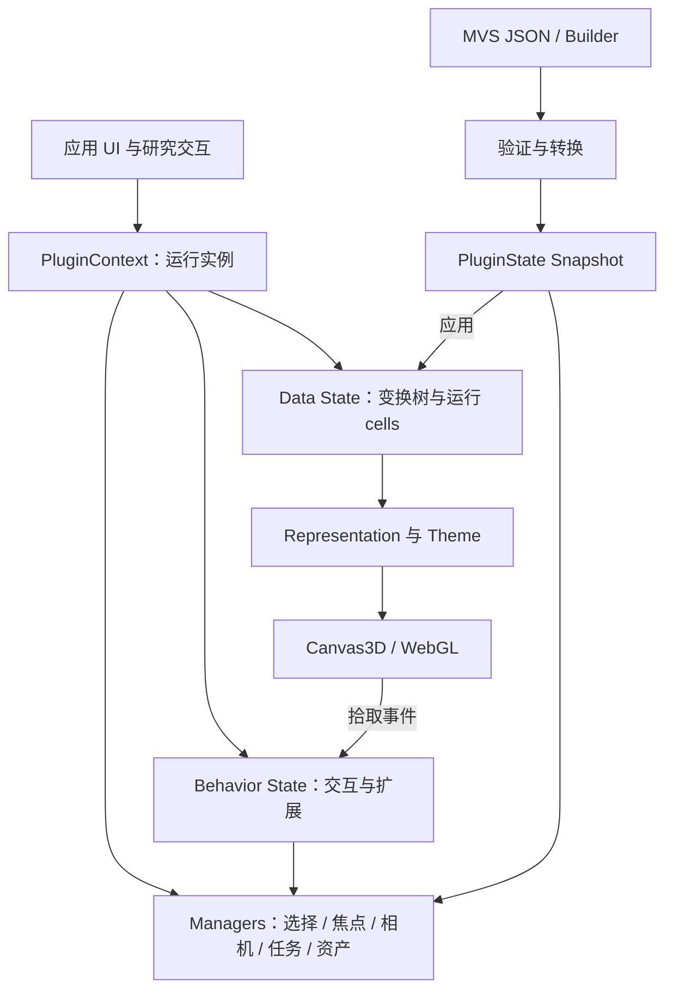
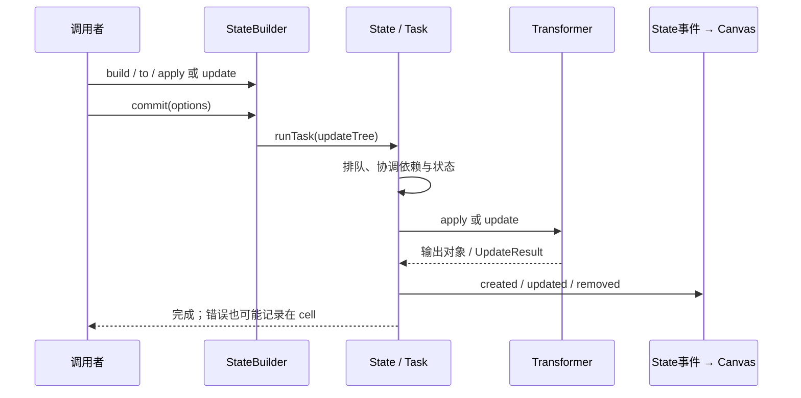
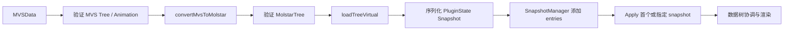

# Mol* 与 MolViewSpec：结构工作台的状态、选择与场景描述

[返回总览](README.md)。

查阅日：2026-10-03。本文是设计研究，不是迁移决定；当前项目的科学契约与 ADR 作为可重新讨论的设计材料，不作为排除方案的要求。

**核心判断：最值得学习的是将“可保存的场景描述”“运行中的结构对象”“短暂交互”分开，以及让状态变换承担更新和资源释放。Mol* 可以成为结构工作台的实现，但不能仅把 `addModel` 换成 Mol* 调用就获得完整能力。**

## 阅读范围与证据

| 项目 | 本次固定材料 |
|---|---|
| 源码 | `molstar/molstar`，`master`，commit `68ce0890a92a6a3c875be053c99bf5931f31b43f` |
| 包版本 | 该快照 `package.json` 为 `5.12.0`；这不表示本文审核了某个已发布 npm 包。[源码](https://github.com/molstar/molstar/blob/68ce0890a92a6a3c875be053c99bf5931f31b43f/package.json#L1-L8) |
| MVS 范围 | 同一 commit 内 `src/extensions/mvs` 的 TypeScript builder、schema、loader 和 Mol* 扩展；未深审独立 Python builder |
| 官方材料 | [Mol* 文档](https://molstar.org/docs/)、[MVS 文档](https://molstar.org/mol-view-spec-docs/)；文档可能随上游变化，行为以固定源码为准 |
| 许可 | Mol* 仓库 MIT；集成时仍需核对实际发行依赖和第三方资产。[LICENSE](https://github.com/molstar/molstar/blob/68ce0890a92a6a3c875be053c99bf5931f31b43f/LICENSE#L1-L21) |
| 验证方式 | 阅读官方文档、源码、测试与调用链；没有运行构建、测试、性能测量或真实浏览器验收 |

文中“源码事实”指可直接追踪到所列实现；“设计判断”与“建议实验”是我们的推断，不是上游承诺。Interface 不只包含方法名，还包括初始化、调用顺序、对象身份、失败、取消和释放规则。

## 1. 先理解四个 Module

这不是一般的 React 组件树。`PluginContext` 直接拥有状态、registries、builders、managers、Canvas3D 与行为事件；`PluginSpec` 决定装配哪些 actions、behaviors、formats、animations 和初始配置。[Context](https://github.com/molstar/molstar/blob/68ce0890a92a6a3c875be053c99bf5931f31b43f/src/mol-plugin/context.ts#L146-L238)、[Spec](https://github.com/molstar/molstar/blob/68ce0890a92a6a3c875be053c99bf5931f31b43f/src/mol-plugin/spec.ts#L32-L63)

| 核心对象 | 谁拥有 | 为什么存在；调用者应知道什么 |
|---|---|---|
| `PluginContext` | 一次 viewer 运行实例 | 负责组合和生命周期；`init()` 与 Canvas 初始化是不同步骤 |
| `StateTree` / `StateTransform` | `state.data` 或 `state.behaviors` | 描述如何生成状态；包含 transformer、参数、ref 等，不是所有运行对象的 JSON 拷贝 |
| `StateObjectCell` / `StateObject` | State 运行时 | 保存实际数据、状态、错误、依赖与 cache；ref 能定位 cell，但 cell 不一定成功产生对象 |
| `Structure` / `Unit` / `Model` | 数据变换的输出 | 是 Mol* 的分子表示，选择、几何、主题都依赖它们 |
| `Loci` | 交互和选择 managers | 定位某个运行中结构的元素集合，不是应用层永久残基身份 |
| `PluginState.Snapshot` | snapshot manager / 调用者 | 能包含 data、behavior、selection、camera 等 Mol* 状态；字段按选项保存 |
| `MVSData` | 文档作者或 builder | 面向分子场景的声明数据；由具体 viewer extension 解释 |

对象状态与 snapshot 字段见 [StateObject](https://github.com/molstar/molstar/blob/68ce0890a92a6a3c875be053c99bf5931f31b43f/src/mol-state/object.ts#L70-L116)、[PluginState](https://github.com/molstar/molstar/blob/68ce0890a92a6a3c875be053c99bf5931f31b43f/src/mol-plugin/state.ts#L39-L85)、[MVSData](https://github.com/molstar/molstar/blob/68ce0890a92a6a3c875be053c99bf5931f31b43f/src/extensions/mvs/mvs-data.ts#L71-L104)。

**设计判断：** Mol* 对“读入结构并管理它的表示”是 deep module；把整个 `PluginContext` 暴露给每个页面，会把其巨大 Interface 和时序知识分散到所有调用者。我们更适合在结构工作台层集中这些知识，内部使用 Mol* 的多个 seam。

## 2. 一条真实调用链：结构数据如何变成画面

以已有结构文本为例，真实入口是 `loadStructureFromData(plugin, data, format)`；它等待 `plugin.initialized`，创建原始数据节点，解析 trajectory，再应用默认 hierarchy preset。[入口](https://github.com/molstar/molstar/blob/68ce0890a92a6a3c875be053c99bf5931f31b43f/src/extensions/plugin/loaders.ts#L69-L74)

1. `builders.data.rawData(...)` 在根下添加 `RawData` transform，执行带 `revertOnError` 的 commit。[DataBuilder](https://github.com/molstar/molstar/blob/68ce0890a92a6a3c875be053c99bf5931f31b43f/src/mol-plugin-state/builder/data.ts#L17-L24)
2. `parseTrajectory` 根据格式解析 provider；mmCIF provider 添加 `ParseCif → TrajectoryFromMmCif`。所以数据格式替换 seam 是真实的，已有 mmCIF、PDB 等多种 Adapter。[StructureBuilder](https://github.com/molstar/molstar/blob/68ce0890a92a6a3c875be053c99bf5931f31b43f/src/mol-plugin-state/builder/structure.ts#L28-L56)、[formats](https://github.com/molstar/molstar/blob/68ce0890a92a6a3c875be053c99bf5931f31b43f/src/mol-plugin-state/formats/trajectory.ts#L25-L112)
3. 默认 hierarchy preset 依次生成 model、custom properties、structure、structure properties，然后应用 representation preset。[preset](https://github.com/molstar/molstar/blob/68ce0890a92a6a3c875be053c99bf5931f31b43f/src/mol-plugin-state/builder/structure/hierarchy-preset.ts#L45-L76)
4. representation builder 创建 `StructureRepresentation3D` transform；它调用 representation provider 的 factory，附着属性、建立 theme，再 `createOrUpdate` 几何。[builder](https://github.com/molstar/molstar/blob/68ce0890a92a6a3c875be053c99bf5931f31b43f/src/mol-plugin-state/builder/structure/representation.ts#L118-L139)、[transform](https://github.com/molstar/molstar/blob/68ce0890a92a6a3c875be053c99bf5931f31b43f/src/mol-plugin-state/transforms/representation.ts#L143-L179)
5. State 发出对象事件；`SyncRepresentationToCanvas` 将 representation 加入 Canvas3D。替换或删除时，它负责移除并销毁旧 representation。[同步](https://github.com/molstar/molstar/blob/68ce0890a92a6a3c875be053c99bf5931f31b43f/src/mol-plugin/behavior/static/representation.ts#L18-L47)

此链条有两个值得借鉴的点。第一，声明“需要什么结构和表示”与真正创建 GPU 对象分开。第二，颜色、表示、坐标不是一个不透明的重新加载动作，可以有各自的更新策略。

同时不能把 default preset 当作中性科学决定：它优先展示 assembly，否则展示 model；`createStructure` 也有相应默认选择。我们若采用 Mol*，必须明确选择模型、组装体和坐标空间；这需要新设计说明，不是由旧 ADR 决定。[默认规则](https://github.com/molstar/molstar/blob/68ce0890a92a6a3c875be053c99bf5931f31b43f/src/mol-plugin-state/builder/structure.ts#L86-L100)

## 3. State seam：更新是一套协议

`StateTransformer` 的 Interface 是 `from/to + params + apply + update + dispose`，还可以包含 applicability、serialization、dependencies。`update` 的结果区分 `Unchanged / Updated / Recreate / Null`；例如换 representation 类型会要求 recreate，而主题变化可以更新原 representation。[Transformer](https://github.com/molstar/molstar/blob/68ce0890a92a6a3c875be053c99bf5931f31b43f/src/mol-state/transformer.ts#L44-L148)、[实际更新](https://github.com/molstar/molstar/blob/68ce0890a92a6a3c875be053c99bf5931f31b43f/src/mol-plugin-state/transforms/representation.ts#L158-L188)

必须读到的 Interface 细节：

| 问题 | 固定源码中的行为 | 对集成的含义 |
|---|---|---|
| builder 何时执行？ | `apply/update` 先编辑树，`commit` 才运行 `updateTree` | 可以组合变更，但不能把 builder 当作已经完成的结果 |
| 能否重用 builder？ | 同一 builder 再次应用会抛错 | 每次后续更新新建 builder |
| 更新顺序？ | `updateTree` 通过 `AsyncQueue` 排队 | 不能据此推断外部 UI 的所有请求都自动 latest-wins |
| 异常如何到达调用者？ | 节点失败会记录 cell error；transaction 默认可回滚并写日志 | Promise resolve 不等于目标表示已经成功建立 |
| 取消等于回滚？ | `revertOnError` / `revertIfAborted` 是更新选项 | 取消策略应明确选择，并验证最终对象状态 |
| 资源何时释放？ | delete/recreate/null 调用 transformer dispose；`Updated` 需实现自行处理失效资源 | “更新”不等于资源管理免费完成 |

证据：[commit](https://github.com/molstar/molstar/blob/68ce0890a92a6a3c875be053c99bf5931f31b43f/src/mol-state/state/builder.ts#L127-L142)、[排队与回滚](https://github.com/molstar/molstar/blob/68ce0890a92a6a3c875be053c99bf5931f31b43f/src/mol-state/state.ts#L292-L359)、[节点错误](https://github.com/molstar/molstar/blob/68ce0890a92a6a3c875be053c99bf5931f31b43f/src/mol-state/state.ts#L970-L993)、[事务](https://github.com/molstar/molstar/blob/68ce0890a92a6a3c875be053c99bf5931f31b43f/src/mol-state/state.ts#L235-L281)、[dispose 约定](https://github.com/molstar/molstar/blob/68ce0890a92a6a3c875be053c99bf5931f31b43f/src/mol-state/transformer.ts#L108-L121)。

**设计判断：** 我们需要学习“局部更新结果与生命周期”，不必复制整套 StateTree。尤其不能把这个渲染派生树直接视为科研 Workflow；它解决的是运行中对象与表示的协调，其 lineage、失败恢复、持久化目的须分别设计。

## 4. 第二条调用链：选择、高亮和镜头各有主人

Canvas 的 click/hover 被转发到 `plugin.behaviors.interaction`。默认动态 Behavior 解释按键组合并调用 interactivity manager；highlight provider 最终调用 `canvas3d.mark`。这是事件订阅、交互策略和标记实现之间的 seam。[转发](https://github.com/molstar/molstar/blob/68ce0890a92a6a3c875be053c99bf5931f31b43f/src/mol-plugin/context.ts#L325-L330)、[Highlight Behavior](https://github.com/molstar/molstar/blob/68ce0890a92a6a3c875be053c99bf5931f31b43f/src/mol-plugin/behavior/dynamic/representation.ts#L44-L88)

| 用户意图 | Mol* 真实入口 | 状态与效果 |
|---|---|---|
| 临时指向 | `lociHighlights.highlightOnly({ loci })` | 清除先前 highlight；不等于添加持久选区 |
| 添加选区 | `lociSelects.select({ loci })` | 修改 structure selection，再应用 select 标记 |
| 局部结构观察 | `structure.focus.setFromLoci(loci)` | 与 focus representation 联动，和相机移动是不同动作 |
| 镜头对准 | `camera.focusLoci(loci)` | 根据结构及其装饰变换计算范围，交给 camera；无 canvas 时可直接返回 |

入口与语义见 [interactivity manager](https://github.com/molstar/molstar/blob/68ce0890a92a6a3c875be053c99bf5931f31b43f/src/mol-plugin-state/manager/interactivity.ts#L138-L235)、[官方交互说明](https://molstar.org/docs/plugin/viewer-state/)、[camera](https://github.com/molstar/molstar/blob/68ce0890a92a6a3c875be053c99bf5931f31b43f/src/mol-plugin-state/manager/camera.ts#L53-L106)。默认 granularity 为 residue，会把拾取扩展为残基；调用者也可以显式控制是否应用粒度。[granularity](https://github.com/molstar/molstar/blob/68ce0890a92a6a3c875be053c99bf5931f31b43f/src/mol-plugin-state/manager/interactivity.ts#L73-L116)

### 选择身份是最容易误判的地方

源码中的 `StructureElement.Loci` 保存 `Structure`、`Unit` 和 `OrderedSet<UnitIndex>`，索引指向 `unit.elements`。相等比较首先检查是否同一个 structure 对象，再检查 unit ID 与索引。[Loci](https://github.com/molstar/molstar/blob/68ce0890a92a6a3c875be053c99bf5931f31b43f/src/mol-model/structure/structure/element/loci.ts#L35-L70)

这意味着：

- “第 10 个显示残基”“mmCIF `label_seq_id=10`”“`auth_seq_id=10`”“Mol* unit element index=10”不是同一概念。官方提供 Schema/MolQL 来按具体字段建立选择。[选择文档](https://molstar.org/docs/plugin/selections/)
- `Loci.remap` 根据 unit ID 和实际 element 集合求交；它不是序列比对或生物学同源映射。[remap](https://github.com/molstar/molstar/blob/68ce0890a92a6a3c875be053c99bf5931f31b43f/src/mol-model/structure/structure/element/loci.ts#L192-L205)
- selection manager 在结构更新后检查 unit IDs/indices 是否兼容；兼容时 remap，否则清空对应选择。[更新](https://github.com/molstar/molstar/blob/68ce0890a92a6a3c875be053c99bf5931f31b43f/src/mol-plugin-state/manager/structure/selection.ts#L255-L301)
- selection snapshot 保存的是 `tree ref + Bundle`，恢复时回到该 ref 找结构。可序列化并不使它自动成为跨文件、跨候选、跨编辑版本的残基身份。[保存与恢复](https://github.com/molstar/molstar/blob/68ce0890a92a6a3c875be053c99bf5931f31b43f/src/mol-plugin-state/manager/structure/selection.ts#L476-L498)

**设计判断：** 研究工作台应决定自己的残基定位规则，然后在结构 Module 内翻译成 Loci。身份需要覆盖哪些变化——重编号、插入、删除、模型切换、assembly instance——应作为新设计问题独立论证。不能从 Mol* 的索引便利性反推科学含义。

## 5. MVS 的 seam：声明格式与执行实现分离

MVS 用树描述下载、解析、结构、component、representation、颜色、标注、相机等场景。官方定位是可跨软件分享的可重现可视化描述；但查阅时官方介绍仍只列 Mol* 一种 viewer extension。因此“格式不绑定 viewer”与“已有多个可替换 Adapter”是两件事。[官方定位与实现现状](https://molstar.org/mol-view-spec-docs/)

真实 TypeScript builder 不执行下载：`download`、`camera` 等方法只追加节点，`getState()` 返回树的深拷贝和 metadata；文件保存被明确留给调用方。[builder](https://github.com/molstar/molstar/blob/68ce0890a92a6a3c875be053c99bf5931f31b43f/src/extensions/mvs/tree/mvs/mvs-builder.ts#L31-L98)

在本次固定源码中，加载链比“JSON 直接画图”多一层：

`loadMVS` 要求 MolViewSpec Behavior 已注册；以 Task 运行，逐个准备 snapshot entry，默认替换 snapshot 列表，再应用选定 entry。`keepCamera`、`keepCameraOrientation`、`appendSnapshots`、`sourceUrl` 都影响行为。[options 与执行](https://github.com/molstar/molstar/blob/68ce0890a92a6a3c875be053c99bf5931f31b43f/src/extensions/mvs/load.ts#L48-L144)

`convertMvsToMolstar` 处理格式差异，将声明中的 structure 展开为 trajectory/model/structure 等执行节点。`loadTreeVirtual` 使用 StateBuilder 生成可序列化树；`UpdateTarget` 提供确定性的 transform refs。[转换](https://github.com/molstar/molstar/blob/68ce0890a92a6a3c875be053c99bf5931f31b43f/src/extensions/mvs/tree/molstar/conversion.ts#L51-L110)、[虚拟加载](https://github.com/molstar/molstar/blob/68ce0890a92a6a3c875be053c99bf5931f31b43f/src/extensions/mvs/load-generic.ts#L40-L52)、[UpdateTarget](https://github.com/molstar/molstar/blob/68ce0890a92a6a3c875be053c99bf5931f31b43f/src/extensions/mvs/load-generic.ts#L101-L135)

这里有真正值得参考的 compiler-like 结构：文档层保持可读；执行层补齐实现细节；最后复用既有 state runtime。MVS 不需要让每个上层作者知道 Mol* 的所有 transform。

但 MVS 的 `custom` 扩展并不天然可移植。LoadingExtension 有 per-node action、创建/清理 context 等 hook；Mol* 专有扩展仍依赖 PluginContext、StateBuilder 和 Mol* transforms。[扩展 Interface](https://github.com/molstar/molstar/blob/68ce0890a92a6a3c875be053c99bf5931f31b43f/src/extensions/mvs/load-generic.ts#L18-L37)

另一个容易误读的点：`MVSData.fromMVSJ()` 只 JSON.parse 并提示版本问题，不完成 schema validation；校验在 `validationIssues` 或 loader 中发生。应将 parse、validate、apply 的失败语义分别理解。[MVSData](https://github.com/molstar/molstar/blob/68ce0890a92a6a3c875be053c99bf5931f31b43f/src/extensions/mvs/mvs-data.ts#L106-L120)、[validation](https://github.com/molstar/molstar/blob/68ce0890a92a6a3c875be053c99bf5931f31b43f/src/extensions/mvs/mvs-data.ts#L172-L180)

## 6. 四类持久化，不应混成一个“保存”

| 保存对象 | 实际包含什么 | 适合用途与限制 |
|---|---|---|
| State tree snapshot | transformer 身份、参数和树结构 | 重建派生状态；需要相应 transformer 已注册 |
| Plugin snapshot / `.molj` | 可选 data、behaviors、camera、selection 等；collection 带 plugin version | 恢复 Mol* 工作状态，依赖其运行模型 |
| `.molx` | Mol* snapshot JSON 加 AssetManager 中的文件 | 将运行态和已管理资产打包；不能直接等同科研项目完整档案 |
| `.mvsj` / `.mvsx` | 场景描述；MVSX 还可包含被引用的数据与标注 | 分享/再现表达意图；不自动包含应用全部编辑会话、Workflow、科研证据 |

证据：[transformer 注册依赖](https://github.com/molstar/molstar/blob/68ce0890a92a6a3c875be053c99bf5931f31b43f/src/mol-state/transformer.ts#L175-L197)、[snapshot 字段和恢复顺序](https://github.com/molstar/molstar/blob/68ce0890a92a6a3c875be053c99bf5931f31b43f/src/mol-plugin/state.ts#L61-L151)、[Mol* archive](https://github.com/molstar/molstar/blob/68ce0890a92a6a3c875be053c99bf5931f31b43f/src/mol-plugin-state/manager/snapshots.ts#L268-L321)、[MVSX 资产收集](https://github.com/molstar/molstar/blob/68ce0890a92a6a3c875be053c99bf5931f31b43f/src/extensions/mvs/mvs-data.ts#L123-L169)。用途判断来自这些字段的范围，不是对上游完整科研溯源的承诺。

恢复 snapshot 时，源码先停动画，再恢复 component options、behavior/data、canvas、selection/focus、camera，最后可能启动动画。由此可见，保存 camera 数值只是恢复过程的一部分。[恢复顺序](https://github.com/molstar/molstar/blob/68ce0890a92a6a3c875be053c99bf5931f31b43f/src/mol-plugin/state.ts#L88-L149)

**设计判断：** 项目材料、编辑提交、渲染会话、可分享场景可以各自保存。我们可采用 MVS 做场景导出，并保留应用拥有的身份、修改历史和计算证据；如果决定统一文档模型，也需要明确每种状态的 owner，而不是把全部内容塞进 MVS custom 字段。

## 7. 时序、失败、取消和释放

| Interface 要求 | 上游机制 | 我们需要明确的结果 |
|---|---|---|
| 初始化 | Context 有 `initialized` 和 `canvas3dInitialized`；Canvas 创建另行执行 | 何时允许载入数据，何时允许镜头/截图/拾取 |
| Command 完成 | `PluginCommandManager` 依次等待 subscribers；无 subscriber 也会 resolve | 完成 dispatch 不证明发生了预期效果 |
| 长任务 | TaskManager 发布 progress；requestAbort 记录请求，由可中止进度机制处理 | 取消请求已提交与资源/任务已结束要区分 |
| finished 事件 | TaskManager 在 `finally` 中发布 | 它包括成功、异常、取消，不能直接表示成功 |
| 节点错误 | State cell 可为 error；事务可回滚；MVS 自身捕获的异常 log 后重抛 | 在集成 seam 汇总为明确的操作结果，避免 UI 只看 Promise |
| 关闭工作区 | Context dispose 退订、停动画、释放 Canvas、State、managers 并 unmount | 调用方自己的订阅也要释放；任务取消策略要单独设计 |

证据：[初始化](https://github.com/molstar/molstar/blob/68ce0890a92a6a3c875be053c99bf5931f31b43f/src/mol-plugin/context.ts#L129-L142)、[Command](https://github.com/molstar/molstar/blob/68ce0890a92a6a3c875be053c99bf5931f31b43f/src/mol-plugin/command.ts#L64-L101)、[TaskManager](https://github.com/molstar/molstar/blob/68ce0890a92a6a3c875be053c99bf5931f31b43f/src/mol-plugin/util/task-manager.ts#L28-L93)、[Context dispose](https://github.com/molstar/molstar/blob/68ce0890a92a6a3c875be053c99bf5931f31b43f/src/mol-plugin/context.ts#L394-L423)。尤其 TaskManager 的 `dispose()` 只释放事件，不能推断“销毁 viewer 自动取消全部工作”。

## 8. 哪些 seam 可用，哪些替换承诺过大

| seam | 已有替换/扩展能力 | 应支付的实现成本 |
|---|---|---|
| 格式 provider | 同一 builder 处理多个格式 | 转成 Mol* trajectory/model，管理输入资源 |
| representation / theme / preset | registry、provider、preset 的多种实现 | 遵守 Mol* Structure、Loci、WebGL 和生命周期模型 |
| Behavior / Command | 可注册交互策略、订阅命令、接外部控件 | 明确订阅顺序、粒度与 state owner；不是持久命令日志 |
| MVS loader extension | 可改变声明节点到执行节点的翻译 | Mol* 专有 hook 会减少文档的跨 viewer 可移植性 |
| UI 外壳 | 可用 PluginContext 配自己的 UI | 要承担面板状态、交互反馈、快捷键与可访问性 |
| 整个 renderer | 不存在“任意 renderer 注入 PluginSpec”的通用槽位 | Canvas3D、representation、picking、camera 和 Loci 联动都需重新适配 |

前四项的实际装配可见 [MVS Behavior 注册多类扩展](https://github.com/molstar/molstar/blob/68ce0890a92a6a3c875be053c99bf5931f31b43f/src/extensions/mvs/behavior.ts#L35-L110)。最后一项由 Context 直接 `Canvas3D.create`、representation factory 接收 Mol* WebGL context，以及静态 behavior 同步 Canvas 得出，是基于耦合位置的设计判断。[Canvas 创建](https://github.com/molstar/molstar/blob/68ce0890a92a6a3c875be053c99bf5931f31b43f/src/mol-plugin/context.ts#L290-L306)

换言之，Mol* 的扩展性主要是“在 Mol* 模型内更换格式、表示、主题和行为”。若我们真的需要 3Dmol/Mol* 两套实现并存，seam 应放在应用自己的结构工作台 Interface 上，并用两套真实实现验证它；只写一层逐方法转发会降低 Locality。

## 9. 对我们当前实现的三条设计路线

当前 `StructureViewer.tsx` 集中 3Dmol、选择、镜头和 G/R 操作；预览等待 90ms 尾沿延迟，PDB 变化后 `clear → addModel` 并恢复相机。`PromptStudio.tsx` 拥有 preview 和确认/取消会话。[viewer](../../../webui/src/StructureViewer.tsx)、[PromptStudio](../../../webui/src/PromptStudio.tsx)、[变换数学](../../../webui/src/viewport-transform.ts)

以下是**备选设计**，不是必须保持现有行为：

| 路线 | 主要收益 | 成本/风险 | 适合先回答的问题 |
|---|---|---|---|
| A. 继续 3Dmol，重画结构 Module 的 Interface | 分开载入、临时坐标、选择、镜头和提交；减少刷新整份 PDB | 仍要自行实现高级表示、标注和身份映射 | 当前延迟主要来自预览往返、解析还是渲染？ |
| B. Mol* 成为结构工作台实现 | 复用 representation、selection、properties、snapshot、MVS | 生命周期和模型映射复杂；交互编辑并非现成产品 | 学习/维护成本是否被真实需要的能力抵消？ |
| C. 应用场景模型 + MVS 导出/呈现 | 场景可分享、可重建；与研究编辑文档分离 | 增加转换层；细粒度编辑需运行时 Interface | 需要保存的是完整编辑会话，还是解释结果的场景？ |

A 与 B 都应先回答同一个问题：**临时可视变换和最终坐标提交分别由谁拥有？** 换引擎不直接消除后端预览往返，也不自动定义取消后应恢复什么。

Mol* 已有 `TransformStructureConformation`（作用于一个 Structure 的变换）和 `ModelWithCoordinates`（替换坐标 frame 并提供 update）可供实验。前者不等于完整“编辑任意选区后合并回原模型”，后者不等于免成本的逐帧更新；下游几何、选择和序列映射仍需验证。[结构变换](https://github.com/molstar/molstar/blob/68ce0890a92a6a3c875be053c99bf5931f31b43f/src/mol-plugin-state/transforms/model.ts#L651-L673)、[坐标更新](https://github.com/molstar/molstar/blob/68ce0890a92a6a3c875be053c99bf5931f31b43f/src/mol-plugin-state/transforms/model.ts#L719-L751)

建议先做四个有判别力的实验：

1. 用同一结构和同一选区，分别测临时坐标更新、全部 PDB 重载、表示更新；记录输入到首帧和确认耗时，不凭截图判断性能。
2. 覆盖多链、插入码、缺失坐标、assembly copies，以及编辑后的重新编号；验证应用 residue identity 与 Loci 往返，禁止靠视觉近似判断正确。
3. 连续修改、取消、切换结构、销毁 viewer，再恢复 scene；检查陈旧请求、选区、相机和资源是否符合事先写出的新规则。
4. 同一展示意图分别用 MVS 和原生 builders 完成，比较学习成本、可保存信息和交互限制；把不适合 MVS 的编辑状态列出来。

## 10. 测试 seam 与继续阅读顺序

Mol* 的 State 测试用很小的自定义 Root/Leaf/Transformer，在无 Canvas 条件下验证 dispose，说明数据协调的部分可以通过自己的 Interface 测试。[测试](https://github.com/molstar/molstar/blob/68ce0890a92a6a3c875be053c99bf5931f31b43f/src/mol-state/_spec/state.spec.ts#L11-L81)

不能由“存在测试文件”推断全面验收：本快照 `mvs-data.spec.ts` 的两项示例测试为 `it.skip`。本研究没有执行它们，也不把它们当作 MVS 集成通过的证据。[源码](https://github.com/molstar/molstar/blob/68ce0890a92a6a3c875be053c99bf5931f31b43f/src/extensions/mvs/_spec/mvs-data.spec.ts#L11-L46)

我们的测试可按实际 seam 分工：纯数学/身份转换检查坐标与定位；结构 Module 检查更新、取消、释放；浏览器验收检查拾取、高亮、镜头和多视图联动；场景导出检查重新载入后的表达意图。新实现验证按仓库远端执行规则进行，不在本地用假 renderer 代替可视验收。

推荐后续精读顺序：

1. `extensions/plugin/loaders.ts`、`builder/structure/hierarchy-preset.ts`：先顺着一个真实“显示结构”用例读懂组合。
2. `mol-plugin/context.ts`、`spec.ts`：确认哪些状态和能力由实例持有，哪些能注册替换。
3. `mol-state/transformer.ts`、`state/builder.ts`、`state.ts`：追一次 update、error 和 dispose。
4. `manager/interactivity.ts`、`manager/structure/selection.ts`、`element/loci.ts`：明确选择身份和更新兼容性。
5. `extensions/mvs/tree/mvs/mvs-builder.ts`、`load.ts`、`load-generic.ts`：理解声明描述到执行状态的转换。
6. `mol-plugin/state.ts`、`manager/snapshots.ts`：最后决定哪些状态值得进入我们自己的保存格式。

本轮建议优先采纳“场景描述与运行状态分离、选择身份集中翻译、局部更新与生命周期归属清晰”三项设计原则。是否引入 Mol*，应由上述实验的能力覆盖和成本决定；当前处于开发期，允许直接替换现有设计，无需人为保留兼容层。
