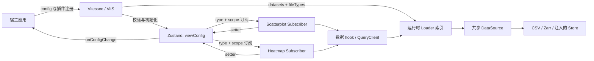

# Vitessce：把多视图联动变成显式、可保存的状态关系

[返回总览](README.md)。

调研日期：2026-10-03。阅读范围是官方文档与官方仓库源码，没有运行上游程序、测试或性能基准。
源码固定在 `vitessce/vitessce` 的 `main` 快照 `fed6719970740e1930f3e495bc0ef5855b49ab08`，提交于 2026-09-30；该快照主包版本为 `4.0.10`。[版本来源][version]
在线文档页脚另标 `changeset-release/main@362bf129`、2026-09-30，因此实现结论优先引用下面的固定源码链接。[官方概念说明](https://vitessce.io/docs/coordination/)

本文把 **Module** 用于具有 Interface 与 Implementation 的模块，把 **Seam** 用于可替换行为的位置，把 **Adapter** 用于满足该 Interface 的具体实现。
当前项目的科学契约、ADR 与已有前端设计都只是待评估材料；下面的迁移建议是新的设计候选，没有把旧设计当作不可改变的约束。

## 1. 最值得学什么

**Vitessce 的主要价值是把“哪些视图共享哪个状态”从事件处理代码里提出来，表示为配置中的关系。**
它区分了四件事：文件在哪里、逻辑数据是什么、视图怎样布局、哪些视图使用同一份交互状态。
一个视图可以与另一个视图共享选择，同时独立缩放；这种关系通过 scope 配置表达，不需要两个视图互相调用。[配置 schema][schema]

第二个价值是实际存在的两层数据 Seam：Loader 把具体文件解释成逻辑数据；DataSource 提供文件或存储访问能力。
CSV 与 AnnData embedding Loader 可以满足同一个逻辑数据消费位置；同一个 AnnData embedding Loader 又可以使用 AnnDataSource 或 MuDataSource。[内置注册][base-files] [Loader 实现与双 Source 测试][loader-test]

第三个价值是承认运行时对象不能直接等同于可保存状态：配置、Loader 实例、查询缓存、渲染器与临时交互分别有不同的拥有者。
但上游也暴露了值得改进的地方：配置 identity 与生命周期耦合、多层缓存、非原子的选择更新，以及未贯通的通用取消 Interface。[状态存储][state] [配置生命周期][lifecycle] [通用数据请求][data-query]

对我们的建议是先学习协调关系与数据表示的分离，再决定是否复用框架。把它整体接入蛋白质工作台，会同时引入其观察对象、集合、布局与插件约定；不能把安装一个包视为完成状态设计。

## 2. 对象、身份与拥有者

| 对象 | 表示什么 | 拥有者／保存位置 | 调用方需要知道的约定 |
| --- | --- | --- | --- |
| `datasets[].uid` | 一组引用相同实体的文件 | 可序列化 view config | 同一 dataset 内文件的实体身份应能对应；名字相同不自动形成映射 |
| `files[]` | `fileType`、URL、options、文件匹配标签 | 可序列化 view config | `coordinationValues` 在这里用于选择正确文件，不是视图间的 scope 引用 |
| `layout[]` | view 类型、位置、尺寸、props、状态映射 | 可序列化 view config | `component` 必须已注册；`uid` 用于识别某个 view |
| coordination type | 可协调的属性，如 `obsSetSelection` | 插件注册提供 schema/default | 是属性种类，不是当前选中的值 |
| coordination scope | 某属性的一份命名存储 | `coordinationSpace[type][scope]` | 两个 view 指向同一个 scope，才共享该属性 |
| coordination value | 某个 scope 当前的值 | `viewConfig` | 可以是数值、数组、对象；必须匹配注册 schema |
| `layout[].coordinationValues` | view 自己持有的值 | 同一 config 的 layout | 普通单层读取时优先于 scope；写回需要 view UID |
| Loader / DataSource | 加载与解释数据的运行时实例 | Zustand 的 `loaders`，内部持有 Source | 不经 `onConfigChange` 序列化；可由 `onLoaderChange` 暴露 |
| QueryClient / typed arrays | 请求结果、二进制数据、缓存 | QueryClient、Loader、Source | 不是配置快照的内容 |
| 工具、尺寸、回调 | 当前画框工具、canvas 尺寸、临时状态 | view 本地状态及 auxiliary store | 不保证保存后恢复 |

以上不是对名称的推断：schema 分开声明 datasets/layout/coordinationSpace，store 分开保存 `viewConfig` 与 `loaders`，auxiliary store 的注释明确把回调排除在 view config 之外。[schema][schema] [主 store][state] [auxiliary store][auxiliary]



图表达源码中的依赖关系；箭头不代表各步骤一定顺序串行。特别是同一 view 的数据请求可能并行执行。

## 3. 协调 Interface：读写值，还是发送事件？

`useCoordination(parameters, coordinationScopes, coordinationValues?, viewUid?)` 返回 `[values, setters]`。
调用方声明需要哪些属性；hook 从 Zustand 按映射取值，并生成 `setXxx(value)`。
setter 最终调用 `setCoordinationValue`，更新共享 scope 或该 view 的直接值。[hook Interface][coord-hook] [写入规则][state]

这里没有“散点图告诉热图更新”的调用。散点图只改共享值，热图按自身订阅重新取值。
这种 Seam 的 Depth 在于调用者不用知道有哪些其他视图、使用哪种渲染器、是否同时挂载。
它的 Interface 仍然包含语义：同一 scope 中的 ID 属于哪个 dataset、值能否为 null、哪些属性应同时改变，不能只写成一个泛型 setter 就算完成设计。

一个示意配置关系如下，仅展示协调片段，不是可直接运行的完整上游配置：

```json
{
  "coordinationSpace": {
    "obsSetSelection": { "sharedSelection": [["My Selections", "Selection 1"]] },
    "embeddingZoom": { "leftZoom": 2, "rightZoom": 5 }
  },
  "layout": [
    { "component": "scatterplot", "coordinationScopes": {
      "obsSetSelection": "sharedSelection", "embeddingZoom": "leftZoom" } },
    { "component": "scatterplot", "coordinationScopes": {
      "obsSetSelection": "sharedSelection", "embeddingZoom": "rightZoom" } }
  ]
}
```

Builder 的 `linkViews(views, cTypes, cValues?)` 会创建 scope，再把多个 view 映射进去。[Builder 的 linkViews][builder-link]
更复杂时有 `coordinationScopesBy` 与 meta-coordination：前者按上层 scope 指定下层映射，后者把映射本身集中管理。
它们确实支持多层空间图层等复杂关系，但也增加解析与优先级规则；我们应先证明“多个比较面板需要独立和共享的状态组合”，再引入同等复杂度。[scope 解析与优先级][scopes]

### 一次框选如何影响另一个视图

1. `Scatterplot.createSelectionLayer()` 的 `onSelect(obsIds)` 调用 `setCellSelection`。这是渲染实现输出的实体 ID，不是像素坐标。[选择层][selection-layer]
2. `EmbeddingScatterplotSubscriber` 把该回调接到 `setObsSelection(...)`，并传入集合、颜色及多个 setter。[Subscriber 转换][selection-subscriber]
3. helper 创建 `My Selections / Selection N` 层级集合，保存 ID，并依次更新 `additionalObsSets`、`obsSetColor`、`obsSetSelection`、`obsColorEncoding`。[选择语义][selection-helper]
4. setter 写入 config 中相应的 scope；`CallbackPublisher` 的 Zustand 订阅把改变后的 config 发布给宿主。[状态写入][state] [发布回调][publisher]
5. 映射到相同 scope 的 `HeatmapSubscriber` 读取集合与选择路径，合并原始集合和用户集合，再计算颜色并渲染。[热图订阅][heatmap] [热图派生计算][heatmap-derived]

**关键细节：这不是“一个全局 selectedIds”。** 原始交互 ID 被转成持久的命名集合，实际联动同时依赖集合内容、选中集合路径与颜色。
如果两个 view 只共享 `obsSetSelection` 而没有共享对应的用户集合，它们不一定能解释相同的路径；这是调用约定的一部分。
helper 中的多次 setter 也不是显式事务，外部订阅有机会接到中间配置；这是源码可见的设计成本，不是本轮运行复现的故障。[选择语义][selection-helper] [发布回调][publisher]

对蛋白质工作台的直接启发是：先分别定义 hover、当前残基选区、命名残基集合、候选比较集合、导出集合，再决定哪些 view 共享它们。
是否把一次临时选区自动升级成可保存集合，应由我们的研究操作决定，不应因 Vitessce 这样实现就直接照搬。

## 4. 文件 Interface：物理格式与逻辑数据分开

三个常用扩展入口如下；构造器名称与参数顺序来自上游，表中的解释是本次归纳。[插件定义][plugins]

| 入口 | 调用约定 | 注册解决的问题 |
| --- | --- | --- |
| `PluginViewType(name, component, coordinationTypes)` | React view + 使用的属性名 | config 的 view 名称如何解析成运行时实现 |
| `PluginCoordinationType(name, defaultValue, valueSchema)` | Zod 值 schema + 初始化默认值 | 自定义状态怎样进入校验与初始化 |
| `PluginFileType(name, dataType, LoaderClass, SourceClass, optionsSchema)` | `new Source(params)`；`new Loader(source, fileDef)`；`loader.load()` | 某文件格式怎样提供逻辑数据 |
| `PluginJointFileType(name, expandFunction, optionsSchema)` | 一个 fileDef 转成多个原子 fileDef | 一个 AnnData 容器可同时声明多个数据投影 |

内置插件与调用方插件通过 props 合并，然后参与 schema 构造及运行时查找。
这不是自动扫描第三方目录的插件系统；调用方需提供 JavaScript 类或 React 实现。注册同名项也不能视作受支持的 override 机制：数组合并是内置在前，而 view/file 查找使用 `find`。[注册合并][entry] [view 查找][grid] [file 查找][registry]

### 一个 CSV 文件如何成为散点图

1. config 提供 `fileType: obsEmbedding.csv`、URL、列 options，以及用于匹配的 `obsType`、`embeddingType`。
2. `buildConfigSchema` 通过 fileType 判别选择 options schema，同时限制 view 名称、coordination type 与值形状；`VitS` 随后执行初始化。[schema][schema] [初始化入口][lifecycle]
3. `createLoaders` 根据注册表得到 `CsvSource` 与 `ObsEmbeddingCsvLoader`，生成 dataset → dataType → 文件协调值的 Loader 索引。[构建 Loader][create-loaders] [内置注册][base-files]
4. Source 以“URL 或 options 字符串 + Source 类索引”为键共享；Loader 则按 fileDef 实例化。因此同一物理文件的不同逻辑投影可共用读取结果。[Source identity][create-loaders]
5. Scatterplot Subscriber 调用 `useObsEmbeddingData(..., {obsType, embeddingType})`；hook 进入 `useDataType`，QueryClient 依据 dataset/dataType/匹配值等构建 key。[消费位置][embedding-consumer] [数据请求][data-query]
6. `getMatchingLoader` 以文件协调值的子集匹配选择第一个 Loader；`dataQueryFn` 调 `load()`。[匹配规则][match-loader]
7. CSV Source 此时 `fetch` 并解析文本；Loader 读取列，产生 `obsIndex` 与含 `Float32Array` 的 `{data, shape}` embedding。[CSV Source][csv-source] [CSV 解释][csv-loader]
8. `LoaderResult` 带回逻辑数据与 URL 等元信息；hook 返回数据、状态、URL、错误，Subscriber 将逻辑数组传给渲染实现。[结果容器][loader-result] [数据请求][data-query]

CSV Source 构造时只保存参数，读取发生在 `loadCsv`。因此这条链是按需求加载；不能由此断言每一种上游 Source 都没有构造阶段 I/O。[CSV Source][csv-source]
匹配规则没有证明“一定唯一”：子集匹配取第一项，重复的完整键也可能在 InternMap 中替换。
对需要严谨选择观察来源的产品，更明确的投影 ID 往往比隐式匹配更容易解释；这是我们的设计候选。[匹配与索引][match-loader] [构建 Loader][create-loaders]

### 哪些是真实 Seam

| Seam | 已存在的不同 Adapter | 证据与判断 |
| --- | --- | --- |
| 逻辑 `obsEmbedding` 数据 | CSV Loader、AnnData Loader | 二者均产出 `obsIndex/obsEmbedding`；view 消费相同 data hook，是实际变化点 |
| AnnData Loader 所需 Source 行为 | AnnDataSource、MuDataSource | 同一个 Loader 在测试中配两种 Source，后者改变实体索引路径，是实际变化点 |
| Zarr 字节访问 | URL 构造的 store、传入的内存 fixture store | 测试使用 `createStoreFromMapContents` 注入真实数组片段，无须模拟整个 UI |
| React view 注册 | Scatterplot、Heatmap、controller 等 | 共用布局与状态接入，但不是“任意 view 具有完全相同的数据能力” |
| 通用 DataSource TypeScript 类型 | 空 interface | 本身没有规定读取方法，不能把这个类型声明误认作已完善的统一协议 |

证据：[Loader 和双 Source 测试][loader-test] [Zarr Source 的注入点][zarr-source] [插件类型声明][plugins]。
特别要区分：CSV Source 与 AnnDataSource 的方法集合不同，不能任意把后者塞到 CSV Loader 后面；真实的可替换性需要在具体消费 Interface 上证明。

## 5. 保存、缓存、失败与取消

**配置是交互状态的可保存描述，运行时数据仍需另行取得。** `onConfigChange` 发布 view config，`onLoaderChange` 发布运行时 Loader；这两个出口刻意分开。[发布回调][publisher]
Builder `toJSON()` 把 datasets、scope 值和 layout 转成 JSON；它不是二进制数据包，也不包含 QueryClient 或 GPU 状态。[Builder 序列化][builder-json]
因此保存 URL 与选择不等于冻结 URL 对应内容；本次链路中没有自动生成文件内容哈希的步骤。若我们需要可复现结果，资源版本或内容身份应成为独立设计议题。

还有一个具体限制：该快照的 `VitessceConfig.fromJSON` 没有显式重建全部 view props、`coordinationScopesBy`、顶层 `uid` 等字段。
不能承诺 `fromJSON(...).toJSON()` 对所有配置无损；如要使用 builder 编辑已有快照，应先针对实际用到的字段做往返验证。[fromJSON 实现][builder-json]

controlled 用法也不只是把 `config` 当作普通 React 值替换：

- `config.uid` 存在时用作 `configKey`；没有时入口依赖对象，内层使用 JSON 字符串作为 key。
- 改变 key 会触发验证、QueryClient 与 Loader 创建；默认还 remount 状态 Provider。
- 同一 UID 的内部交互由 store 自己更新，再回调宿主；不能假设宿主修改同一 UID 的任意 JSON 字段都会被重新安装。
- `<Vitessce uid>` 是样式作用域身份，与 `config.uid` 的生命周期职责不同。

这些约定由源码与官方 props 文档共同确认；应把“状态通知”和“加载另一份配置”的调用区别写进宿主 Interface。[入口 key][entry] [生命周期][lifecycle] [受控更新 effect][controlled-grid] [官方 React Interface](https://vitessce.io/docs/js-react-vitessce/)

| 层 | 缓存／失败行为 | 对设计的启示 |
| --- | --- | --- |
| 通用 data hook | query key 不含 URL，而包含 dataset、dataType、匹配值等；loader 放在 query meta | 数据变更依赖配置生命周期，不能只换 URL 后期待缓存自动识别新版本 |
| CSV Source / Loader | 缓存已完成 CSV 与转换结果；CSV Source 未缓存进行中的 Promise | 共享 Source 不自动保证不同投影的并发读取只发一次请求 |
| AnnData / Zarr Source | 部分列和节点缓存 Promise；读取失败后删除这些缓存项并继续抛错 | 不让失败 Promise 永久占位；不同方法的策略仍应逐项核查 |
| Zarr store | queryClient 支持相同块合并，`staleTime: Infinity`、30 秒 gc；流式大数组可绕过块缓存 | 已有数据结果缓存之外，再做块缓存会增加内存生命周期复杂度 |
| QueryClient | 关闭窗口聚焦重取；一般错误最多重试两次，`MatrixTooLargeError` 不重试；onWarn 通知 | 这是上游明确策略，不是我们应无条件继承的 Provider 策略 |

来源：[data hook][data-query] [CSV Source][csv-source] [CSV Loader][csv-loader] [AnnData 列缓存][anndata-cache] [Zarr 节点缓存][zarr-source] [块缓存][chunk-cache] [QueryClient 策略][lifecycle]。

通用 `dataQueryFn` 调用的是无参数 `loader.load()`，没有把 query context 的 `signal` 传下去；CSV Source 只接受初始化时的 `requestInit`。
所以“卸载 view／取消 query”不能在本次链路中保证中止底层 fetch。某个具体 store 接受 RequestInit 不等于整个取消链已连通。[数据请求][data-query] [CSV Source][csv-source]
未来若设计我们的加载 Interface，取消应明确区分：停止展示旧结果、终止网络、释放解码结果、保留共享缓存；共享请求还有多个消费者时不能简单全部 abort。

## 6. 可测试性与维护成本

值得复用的测试思路有三类：初始化测试直接喂配置与插件；scope 解析用纯函数；Loader 测试注入内存 store，但仍执行实际 Loader 的索引与形状解释。[初始化测试][initialization-test] [scope 测试][scope-test] [Loader 测试][loader-test]
这使科学数据解释与视图渲染不必在每次测试时绑在一起，是具有 Locality 的设计。
本轮只研读这些测试，没有执行，不能据此声称上游在我们的数据上已经正确。

成本也相当具体：

- `PluginViewType` 只声明需要的 coordination types，没有完整声明 view props schema；schema 中 props 是任意值映射。[schema][schema]
- `DataLoader.load` 的公开类型仍为 `Promise<any>`，DataSource 类型为空；部分准确契约落在实现、JSDoc 和测试里。[插件定义][plugins]
- `validateOnConfigChange` 默认关闭；打开后其失败处理是记录日志，不能把它理解为拒绝非法状态的事务门禁。[发布回调][publisher]
- `null` 在 data hook 的初始化逻辑中表示“需要初始化”，这会占用本可表达业务空值的状态空间。[初始化空值规则][data-query]
- 多层 scope、view 直接值与 meta-coordination 提升表达力，也提高配置诊断成本；UI 最好能解释某个状态当前由哪份 scope 控制。[scope 解析][scopes]

官方文档还明确提示插件辅助函数在 minor 版本可能变化。若直接依赖该生态，应锁定版本与关键 Interface 验证，而不是假定插件兼容性天然稳定。[官方插件开发说明](https://vitessce.io/docs/dev-plugins/)

## 7. 我们可以怎样重新设计

以下是候选方案，不是已存在于本项目或上游的 API。

| 候选 | 核心 Interface | 得到什么 | 主要代价／淘汰条件 |
| --- | --- | --- | --- |
| A：有限的分析上下文 | 明确的 focus、residueSelection、comparison 等字段，view 用 selector 订阅 | 词汇清楚、类型与原子更新容易检查 | 如确实需要多个同时独立的分析面板，单一上下文会受限 |
| B：显式协调 scope | 每个 view 声明某类状态绑定的 scope；store 管理值 | 支持部分联动、多个研究上下文、保存布局 | 要建设 scope 的创建、删除、诊断与原子操作，而不只是加 Map |
| C：直接嵌入 Vitessce | 把蛋白质数据投影成插件 view 与逻辑数据 | 获取布局、配置、数据 hook 等现成组合 | 需要确认观察对象模型、插件类型、取消和快照语义的适配成本 |

A 与 B 都可保留当前渲染库，也允许之后更换。C 适合独立的只读分析页面先做验证，不宜在没有成本证据时成为整个工作台的基础。
优先应比较 A/B：做“两个候选的序列、结构、指标同时打开，选择可联动或脱钩”的最小实验，看看哪些状态真的需要 scope。
如果大部分交互总属于一个分析上下文，有限字段的 Interface 可能比全套通用协调引擎更深、更易读。

若实际选择 B，建议把一次研究操作设计成原子命令，例如“创建残基集合并设为当前选择”，由一个 Module 同时更新集合内容和选择引用。
数据侧可独立采用 `资源描述 → 逻辑投影 → view 数据` 的结构；先确认至少两种真实来源或表示需要不同 Adapter，再建立新的 Seam。
同一个后端响应有多个消费 view，不一定意味着我们需要一个新插件框架。

下一轮需要验证的具体问题：

1. 跨候选选择依赖何种显式残基对应关系？scope 只解决共享存储，不能自行推断生物学上的对应。
2. 一个命名选择需要保存成员、选择规则、对应关系版本中的哪些内容？临时 hover 是否排除在 snapshot 之外？
3. 是否采用稳定资源版本作为加载 key，使“视图状态变更”不触发重取，“数据版本改变”一定失效？
4. 选择变化应是原子命令还是独立 setter？撤销、自动保存与外部订阅应看到哪一个完成状态？
5. Source / Loader / QueryClient 各层允许保留多少数据，旧 view 关闭时谁释放？需要实际测量请求数、内存与交互延迟。
6. 对本项目真实的 CSV、结构与指标数据，两个 Adapter 是否能通过同一份 Interface 测试，而不丢失单位、形状及身份解释？

## 8. 源码阅读路线与复用条件

按“一个 UI 动作到底改了什么”阅读，比从全部 hook 清单开始更容易理解：

1. `schemas/schema-builders.ts`：先看配置里有哪些对象，哪些字段可直接保存。
2. `plugins/index.ts`、`main/all/src/base-plugins.ts`：看名称怎样绑定实现与 schema。
3. `vit-s/src/state/hooks.js`：看 store、selector、setter 与 scope 优先级。
4. `Scatterplot.js → EmbeddingScatterplotSubscriber.js → sets-utils/utils.js → HeatmapSubscriber.js`：追一次真实选择。
5. `vitessce-grid-utils.js → data-hook-utils.js → CsvSource / ObsEmbeddingCsvLoader`：追一次读取。
6. `VitS.js → CallbackPublisher.js → VitessceConfig.js`：看生命周期、通知、保存与重建。
7. `ObsEmbeddingAnndataLoader.test.js`：确认第二个 Adapter 真的穿过同一个消费 Interface。

仓库代码采用 MIT；复制实质性代码时保留其许可与版权声明。官方文档为 CC BY 4.0；本文使用自己的归纳与固定源码引用。[代码许可证][license] [官方文档许可说明](https://vitessce.io/docs/coordination/)
本轮没有测量帧率、内存或加载规模，不给出“换成此模型会更快”的承诺。

[version]: https://github.com/vitessce/vitessce/blob/fed6719970740e1930f3e495bc0ef5855b49ab08/packages/main/all/package.json#L1-L5
[schema]: https://github.com/vitessce/vitessce/blob/fed6719970740e1930f3e495bc0ef5855b49ab08/packages/schemas/src/schema-builders.ts#L89-L194
[plugins]: https://github.com/vitessce/vitessce/blob/fed6719970740e1930f3e495bc0ef5855b49ab08/packages/plugins/src/index.ts#L5-L86
[entry]: https://github.com/vitessce/vitessce/blob/fed6719970740e1930f3e495bc0ef5855b49ab08/packages/main/all/src/Vitessce.tsx#L19-L83
[state]: https://github.com/vitessce/vitessce/blob/fed6719970740e1930f3e495bc0ef5855b49ab08/packages/vit-s/src/state/hooks.js#L416-L497
[auxiliary]: https://github.com/vitessce/vitessce/blob/fed6719970740e1930f3e495bc0ef5855b49ab08/packages/vit-s/src/state/hooks.js#L655-L691
[coord-hook]: https://github.com/vitessce/vitessce/blob/fed6719970740e1930f3e495bc0ef5855b49ab08/packages/vit-s/src/state/hooks.js#L768-L820
[scopes]: https://github.com/vitessce/vitessce/blob/fed6719970740e1930f3e495bc0ef5855b49ab08/packages/vit-s/src/state/hooks.js#L113-L225
[lifecycle]: https://github.com/vitessce/vitessce/blob/fed6719970740e1930f3e495bc0ef5855b49ab08/packages/vit-s/src/VitS.js#L135-L368
[publisher]: https://github.com/vitessce/vitessce/blob/fed6719970740e1930f3e495bc0ef5855b49ab08/packages/vit-s/src/CallbackPublisher.js#L5-L74
[controlled-grid]: https://github.com/vitessce/vitessce/blob/fed6719970740e1930f3e495bc0ef5855b49ab08/packages/vit-s/src/VitessceGrid.js#L92-L113
[grid]: https://github.com/vitessce/vitessce/blob/fed6719970740e1930f3e495bc0ef5855b49ab08/packages/vit-s/src/vitessce-grid-layout/VitessceGridLayout.js#L19-L45
[base-files]: https://github.com/vitessce/vitessce/blob/fed6719970740e1930f3e495bc0ef5855b49ab08/packages/main/all/src/base-plugins.ts#L303-L337
[registry]: https://github.com/vitessce/vitessce/blob/fed6719970740e1930f3e495bc0ef5855b49ab08/packages/file-types/abstract/src/loader-registry.js#L1-L28
[create-loaders]: https://github.com/vitessce/vitessce/blob/fed6719970740e1930f3e495bc0ef5855b49ab08/packages/vit-s/src/vitessce-grid-utils.js#L127-L198
[match-loader]: https://github.com/vitessce/vitessce/blob/fed6719970740e1930f3e495bc0ef5855b49ab08/packages/vit-s/src/state/hooks.js#L1361-L1389
[data-query]: https://github.com/vitessce/vitessce/blob/fed6719970740e1930f3e495bc0ef5855b49ab08/packages/vit-s/src/data-hook-utils.js#L27-L125
[csv-source]: https://github.com/vitessce/vitessce/blob/fed6719970740e1930f3e495bc0ef5855b49ab08/packages/file-types/csv/src/CsvSource.js#L5-L20
[csv-loader]: https://github.com/vitessce/vitessce/blob/fed6719970740e1930f3e495bc0ef5855b49ab08/packages/file-types/csv/src/csv-loaders/ObsEmbeddingCsv.js#L3-L18
[loader-result]: https://github.com/vitessce/vitessce/blob/fed6719970740e1930f3e495bc0ef5855b49ab08/packages/file-types/abstract/src/LoaderResult.js#L6-L18
[loader-test]: https://github.com/vitessce/vitessce/blob/fed6719970740e1930f3e495bc0ef5855b49ab08/packages/file-types/zarr/src/anndata-loaders/ObsEmbeddingAnndataLoader.test.js#L12-L73
[anndata-cache]: https://github.com/vitessce/vitessce/blob/fed6719970740e1930f3e495bc0ef5855b49ab08/packages/file-types/zarr/src/AnnDataSource.js#L26-L93
[zarr-source]: https://github.com/vitessce/vitessce/blob/fed6719970740e1930f3e495bc0ef5855b49ab08/packages/file-types/zarr/src/ZarrDataSource.js#L18-L59
[chunk-cache]: https://github.com/vitessce/vitessce/blob/fed6719970740e1930f3e495bc0ef5855b49ab08/packages/utils/zarr-utils/src/normalize.ts#L42-L168
[embedding-consumer]: https://github.com/vitessce/vitessce/blob/fed6719970740e1930f3e495bc0ef5855b49ab08/packages/view-types/scatterplot-embedding/src/EmbeddingScatterplotSubscriber.js#L78-L225
[selection-layer]: https://github.com/vitessce/vitessce/blob/fed6719970740e1930f3e495bc0ef5855b49ab08/packages/view-types/scatterplot/src/Scatterplot.js#L405-L435
[selection-subscriber]: https://github.com/vitessce/vitessce/blob/fed6719970740e1930f3e495bc0ef5855b49ab08/packages/view-types/scatterplot-embedding/src/EmbeddingScatterplotSubscriber.js#L305-L322
[selection-helper]: https://github.com/vitessce/vitessce/blob/fed6719970740e1930f3e495bc0ef5855b49ab08/packages/utils/sets-utils/src/utils.js#L89-L139
[heatmap]: https://github.com/vitessce/vitessce/blob/fed6719970740e1930f3e495bc0ef5855b49ab08/packages/view-types/heatmap/src/HeatmapSubscriber.js#L56-L93
[heatmap-derived]: https://github.com/vitessce/vitessce/blob/fed6719970740e1930f3e495bc0ef5855b49ab08/packages/view-types/heatmap/src/HeatmapSubscriber.js#L170-L181
[builder-link]: https://github.com/vitessce/vitessce/blob/fed6719970740e1930f3e495bc0ef5855b49ab08/packages/config/src/VitessceConfig.js#L879-L899
[builder-json]: https://github.com/vitessce/vitessce/blob/fed6719970740e1930f3e495bc0ef5855b49ab08/packages/config/src/VitessceConfig.js#L993-L1055
[initialization-test]: https://github.com/vitessce/vitessce/blob/fed6719970740e1930f3e495bc0ef5855b49ab08/packages/vit-s/src/view-config-utils.test.jsx#L11-L57
[scope-test]: https://github.com/vitessce/vitessce/blob/fed6719970740e1930f3e495bc0ef5855b49ab08/packages/vit-s/src/state/hooks.test.js#L9-L101
[license]: https://github.com/vitessce/vitessce/blob/fed6719970740e1930f3e495bc0ef5855b49ab08/LICENSE#L1-L21
