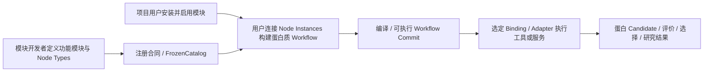

# Protein Workbench 专利前置检索：可扩展蛋白质设计工作流软件

项目要求以[当前有效决策](../documentation-governance-decisions.md)为准；项目实现边界见[技术事实](2026-10-13-patent-project-evidence.md)。文中外部文献事实限定于所列检索日期，文档治理未重新核查法律状态或网页变化。

检索日期：2026-10-13（中国大陆发明专利准备阶段）。本文是初步技术检索记录，不是授权可能性结论、无效分析或自由实施意见。未运行本项目的测试、构建或 Provider。

## 1. 当前重点与初步判断

研究对象是整体软件：模块开发者将 ESM、SimpleFold 等工具封装到功能模块，定义节点与接入契约；项目用户安装启用模块并连接节点，构建和执行自己的蛋白质设计 Workflow。这里的“注册”是扩展模块的接入，不预设为输入一个 API URL 即自动接入，也不预设为运行时动态修改 Catalog。

**这两条宽泛功能已有很强的直接先例。** KNIME 2009 论文公开了自定义节点 API、外部工具包装、插件机制、用户连接节点和端口类型兼容；Galaxy ToolShed 2014 论文公开了作者自写工具包的发布、安装与注册；Taverna 和 Kepler 公开了将生物信息服务变为可连接的工作流组件。下面的专利文献还直接出现蛋白质输入、画布节点、外部功能模块与自动执行。不能仅凭“用于蛋白质研究”“支持 ESM/SimpleFold”或“自定义模块＋可视化连线”把项目概括为已经成立的发明点。[KNIME 原论文](https://www.kdd.org/exploration_files/p4V11n1.pdf)、[Galaxy ToolShed 原论文](https://link.springer.com/article/10.1186/gb4161)、[Taverna 2006 原论文](https://academic.oup.com/nar/article/34/suppl_2/W729/2505722)、[WO2002046915A2 原文](https://patents.google.com/patent/WO2002046915A2/en)。

本报告把比较对象保持为**完整的软件机制**：扩展定义→注册节点库→用户图编辑→编译与执行→蛋白质研究结果。具体科学接入契约、数据关联、评价和证据用于说明这条链如何工作及产生技术效果。检索到相似功能不等于完整方案被同一文献公开；检索未发现某字段也不等于该字段具有新颖性。以下“差异候选”均是待比较的整体方案特征，不是本报告认定的可专利区别。

## 2. 项目比较基线

本节比较现有源码机制，术语见 [GLOSSARY.md](../../GLOSSARY.md)。这些机制不是不可修改的产品要求，也不授权新增科学证据体系；目标行为与实现差异见[项目技术事实](2026-10-13-patent-project-evidence.md)。



这是检索用的整体机制图。用户安装启用的目标已确认；实际安装协议及完整实施材料仍待对齐。F1–F8 是同一链中的细化比较项，不是八件独立专利提案。

| 编号 | 当前项目可用于比较的特征 | 规格依据与比较边界 |
|---|---|---|
| F1 | 一个 Module Package Registration 一次贡献 Node Types、Methods、Execution Bindings、Port Type Definitions、Metric Definitions、Utility Transforms、Availability/Readiness 声明 | [GLOSSARY.md](../../GLOSSARY.md)。用户安装启用的要求已确认，完整入口尚待实现；“存在扩展合同”不能证明“已实现用户插件安装”。 |
| F2 | Node Type 表示可复用科学操作；Method 表示算法/模型变体；Execution Binding 选定执行关联；Adapter 翻译部署或 Provider 表示，保留科学语义与 provenance | [GLOSSARY.md](../../GLOSSARY.md)。科学身份、部署机制与环境配置分别有明确角色；不能只用类名变化证明区别。 |
| F3 | Startup-frozen FrozenCatalog 一次准入稳定 ID 和跨声明关系；Compiler 添加具体 Workflow 来源；runtime 检查实际输出是否兑现同一声明 | [架构说明](../architecture.md)。不是通用服务目录或动态插件管理器。 |
| F4 | Port compatibility 按 exact nominal Port Type；科学合同拥有单位、形状、missing/mask 语义；相同 carrier 不代表相同科学含义 | [架构说明](../architecture.md)。类型化端口本身已有先例；须比较其科学语义及执行效果。 |
| F5 | Candidate Data Reference = Candidate identity + nominal data type + canonical content digest；显式 Candidate Relation 承担配对，消费 Method 声明 cardinality | [模块能力说明](../module-capabilities.md)。关系不靠独立列表位置猜测；同内容的不同 Candidate 仍保留不同主体。 |
| F6 | Score Observation 绑定精确主体、Metric、Method、Observation Context；Selection Objective 显式选定 Utility Transform、weight 和 missing policy | [GLOSSARY.md](../../GLOSSARY.md)、[结果与筛选说明](../results.md)、[架构说明](../architecture.md)。不能将一般评分/加权排序直接视为新特征。 |
| F7 | 残基值与 identity-complete layout 闭合；Candidate-associated residue axes 精确关联；预测时的 residue axis 与输出结构解析后的 axis 分开；共享 alignment correspondence/transform/normalization evidence | [架构说明](../architecture.md)、[模块能力说明](../module-capabilities.md)。残基映射的算法、适用条件和技术效果还需单独比较。 |
| F8 | 不可变 Workflow Commit 存最小科学定义快照；Result Identity 覆盖科学/执行 ID、规范输入参数与有效随机性；Run Ledger 区分 Cache replay、实际 Operation Attempt 与 Engine Invocation | [GLOSSARY.md](../../GLOSSARY.md)、[运行说明](../execution.md)。版本、溯源和内容缓存有大量先例；项目的具体闭合规则仍需比对。 |

## 3. 最接近的五组专利公开

下表合并同一发明的不同国家/阶段文献，不把 A/B、CN/WO/HK 分开计数。优先权日期和公开日期分开列示；优先权并不意味着当日已经公开。元数据主要核读 Google Patents 的专利原文转录，Calici 组的 HK/CN/WO 对应关系另用香港知识产权署公报交叉核实。**当前法律效力均标为未知**：本次没有核查 CNIPA/EPO/各国家最新登记簿或审查档案，不采信 Google 自动状态作为法律结论。

| 组 | 题名、申请人 | 已核日期与对应公开 | 核读的权利要求/说明书与相关性 |
|---|---|---|---|
| P1，首要 | **用于挖掘新药候选物质的基于多实例 GPU 的系统**；CALICI CO., LTD.（卡利希股份有限公司） | 最早主张优先权 2023-07-26；另主张 2023-12-18。已核读族内较早公开 [KR102708758B1](https://patents.google.com/patent/KR102708758B1/en)：2024-09-24；[WO2025023400A1](https://patents.google.com/patent/WO2025023400A1/en)：2025-01-30；[CN119836663A](https://patents.google.com/patent/CN119836663A/zh)：2025-04-15；[CN119836663B](https://patents.google.com/patent/CN119836663B/en)：2025-10-14；[HK40123392A](https://patents.google.com/patent/HK40123392A/zh)：2025-10-17 | CN B 权1：蛋白输入对象拖入画布形成节点、模拟流程、按节点分配 GPU，并有虚拟 GPU 容量比较等限制；权17–18：可连接节点提示与元数据。CN B/WO 说明书图2–3相关内容：external module area 148、第九节点、外部系统功能加入并连接既有节点。与蛋白质平台的用户连线和外部功能模块十分接近，但未据此认定本项目满足其全部权利要求。 |
| P2 | **一种基于云计算平台的蛋白质辅助设计和分析系统及方法**；页面列原申请人 Kangmaxin Shanghai Intelligent Technology Co Ltd、Kangma Healthcode Shanghai Biotech Co Ltd | 优先权/申请 2023-11-29；[CN120072027A](https://patents.google.com/patent/CN120072027A/zh)：2025-05-30；页面仅列此 CN 申请 | 权1：UI、应用仓库、数据加密存储、算力调度；权4：微服务集成结构预测、序列设计等蛋白工具；权9：选择应用、配参数、输入文件、执行与报告。说明书有组合应用的概括；实施例通过下载/再上传将预测接结构比对。它证明集成/组合蛋白工具，不足以单独证明画布节点连线或用户自写模块注册。 |
| P3，较早直接先例 | **Workflow system**；LION bioscience AG | WO 最早主张优先权 2000-11-13；[WO2002046915A2](https://patents.google.com/patent/WO2002046915A2/en)：2002-06-13；[EP1217515A1](https://patents.google.com/patent/EP1217515A1/en)：2002-06-26。WO 明确主张 EP00128348.0（2000-12-22）的优先权；两者作为相关优先权组比较，不能假定全部新增内容共用最早日期 | WO 权1：按目标结果回溯必要 workflow items 并执行；权3图形编辑；权5复用已完成结果；权8–9 activity 与 encapsulated process。说明书图7、11–13：activity 独立定义/编写、输入输出 interface、repository、工具封装和图形连接；蛋白结构流程使用 BLASTP→ClustalW→What If。与“自定义封装可复用活动＋蛋白工作流”直接相关。 |
| P4 | **具有易于使用特征的工作流开发系统 / Workflow development system with ease-of-use features**；Microsoft Technology Licensing LLC | 优先权 2015-11-23；[WO2017091387A2](https://patents.google.com/patent/WO2017091387A2/en)：2017-06-01；[CN108292206A](https://patents.google.com/patent/CN108292206A/zh)：2018-07-17；[CN108292206B](https://patents.google.com/patent/CN108292206B/zh)：2022-06-03 | CN B 权1/8：搜索步骤库、交互选择并在工作流 GUI 绘出步骤；权5/12/18：开发者在 API 注册时提供步骤元数据。说明书还公开将前一步输出对象置入后一步输入生成可执行逻辑。与注册后进入图形步骤库接近，独权还有特定搜索/交互条件；本次不把它当作覆盖全部模块注册的权利。 |
| P5，执行注册辅助 | **Workflow automation execution method applied in cloud-native biomedical informatics platform and system thereof, and computer readable medium**；Atgenomix Inc | 优先权 2022-08-29；[US20240079121A1](https://patents.google.com/patent/US20240079121A1/en)：2024-03-07；页面仅列此 US 申请 | 权1：TRS workflow 注册后，用 run sheet 把测序数据、TRS_FQN、Run ID 关联，生成 WES_FQN、导入 DRS 后执行 WES；权8–9匹配和动态解析。说明书使用 GA4GH API/WDL/容器。说明注册工具与自动化生物信息执行已有具体方案，但这里的 sequencing/run-sheet 条件与本项目蛋白模块合同不相同，也不是画布扩展的直接先例。 |

P1 对应关系的官方证据：[香港知识产权署 2025-11-21 专利公报](https://www.ipd.gov.hk/hkipjournal/21112025/Patent_21112025.pdf)，公报内部页码 614/693 列 HK40123392、CN119836663 B、PCT/KR2023/021355、WO2025/023400，以及两件 KR 优先权。**WO2025023402A1 只是检索页的相似文献，不是本报告据以认定的对应 PCT 文献。** Google 将另一主题 WO2025023404A1 列入扩展族；本次未核读其全部内容，不将不同主题的特征自动拼入 P1。

P1 需特别注意公开申请与授权文本不同：CN A 权1较短；CN B 权1增加任务提供模块、虚拟 GPU 第一/第二容量比较及用户变更第二容量等限制。评价“公开了哪些技术”要看说明书；评价“现有权利可能限制哪些实施”要看对应国家当前授权权利要求，不能用一句摘要代替。

## 4. 模块扩展与用户连接节点的原始论文

这些论文是比“检索关键词未命中”更强的正面证据。时间均取历史论文元数据；当前文档不用于反推历史功能日期。

| 优先级 | 论文、时间与直接原文 | 当时明确公开的特征 | 与项目比较的边界 |
|---|---|---|---|
| 1 | Berthold 等，**KNIME – The Konstanz Information Miner: Version 2.0 and Beyond**，2009，SIGKDD Explorations 11(1):26–31，DOI 10.1145/1656274.1656280；[ACM SIGKDD 全文 PDF](https://www.kdd.org/exploration_files/p4V11n1.pdf)、[作者大学全文](https://www.uni-konstanz.de/mmsp/pubsys/publishedFiles/BeCeDi09.pdf)。确切首次上线日未核实 | §3.4 外部工具包装、自定义 NodeModel/NodeDialog/NodeView、API/plugin 节点；用户从节点库连接工作流；§5.2 程序员定义任意 port types，不兼容端口禁止连接 | 直接涉及模块开发、安装与节点连接。一般节点 API 和类型兼容已有公开；本项目 F2–F8 的具体科学闭合规则仍要逐项比较。 |
| 2 | Blankenberg 等，**Dissemination of scientific software with Galaxy ToolShed**，2014-02-20，Genome Biology 15:403，DOI 10.1186/gb4161；[出版方全文](https://link.springer.com/article/10.1186/gb4161)、[原始补充材料](https://media.springernature.com/original/springer-static/esm/art%3A10.1186%2Fgb4161/MediaObjects/13059_2014_3225_MOESM1_ESM.pdf) | 自写 Python NVC 工具连同配置、依赖、测试上传版本仓库后安装进入 Galaxy；FreeBayes 案例下载编译并注册；工具分发和版本管理 | 直接说明自己的工具包可加入框架。不要据此声称其当时已实现本项目全部 REST Adapter 科学合同或证据闭包。 |
| 3 | Hull 等，**Taverna: a tool for building and running workflows of services**，NAR 34:W729–W732，DOI 10.1093/nar/gkl320；[出版方原文](https://academic.oup.com/nar/article/34/suppl_2/W729/2505722)、[PMC 原文](https://pmc.ncbi.nlm.nih.gov/articles/PMC1538887/)。Oxford Published 标 2006-07-01，PMC 页头标 2006-07-14，日期差异保留 | GUI 加入生物信息工具/数据库服务，构建、执行、共享工作流；WSDL/SOAP 与服务转换；实例连接 GenBank、RepeatMasker、GenScan、肽序列和 BLASTp | 直接覆盖“用户组合服务完成蛋白质相关研究”。此论文未充分核实自定义适配模块注册 API，不把未见细节当作不存在。 |
| 4 | Wolstencroft 等，**The Taverna workflow suite: designing and executing workflows of Web Services on the desktop, web or in the cloud**，2013-05-02 在线公开，DOI 10.1093/nar/gkt328；[出版方原文](https://academic.oup.com/nar/article/41/W1/W557/1094153) | 分布式服务与本地工具混合、桌面/Server 执行；REST、R、Grid/云、远程命令行；复用和改造流程，蛋白质组学用途 | 接入多种运行地点和工具已有近似先例。2013 这批能力不能归入 2006 的公开证据。 |
| 5 | Ludäscher 等，**Scientific workflow management and the Kepler system**，2005-12-13 在线公开，2006 期刊期次；DOI 10.1002/cpe.994；[Wiley 原文](https://onlinelibrary.wiley.com/doi/10.1002/cpe.994)、[作者公开稿 PDF](https://www.cs.ucdavis.edu/~ludaesch/pubs/kepler-swf.pdf) | 作者稿 §3.1：WSDL URL 实例化 WebService actor，服务输入/输出成为端口；Harvester 将服务仓库变为组件库，拖入画布连接；actor/director 分离，GenBank/BLAST 示例 | 很接近“外部服务成为可连模块”。细节依据作者稿；正式证据需对照出版终稿，不能凭首次上线日认定所有软件功能已在更早日期实现。 |

当前官方理解材料：[Galaxy 工具开发入口](https://galaxyproject.org/tools)、[ToolShed 官方说明](https://galaxyproject.org/toolshed/)。这些页面按检索日理解；其现行 XML schema、依赖工具和 API 不自动取得 2014 的公开日期。仓库已有 [KNIME 架构研究](frontend-reference-knime.md) 与 [Galaxy 架构研究](frontend-reference-galaxy.md)，它们用于找源码路径，不是历史公开的替代证据。

## 5. 身份、溯源、缓存和不可变状态的辅助先例

这些资料提供科学数据关联背景，不替代上面五组整体扩展平台的直接比较。

| 辅助来源 | 已核公开事实 | 对项目的含义 |
|---|---|---|
| [CN103745319A](https://patents.google.com/patent/CN103745319A/zh)，**一种基于多状态科学工作流的数据世系追溯系统和方法**，北京大学；优先权 2014-01-09、公开 2014-04-23；对应 B 2017-01-04 | 权1/5首次执行与重做时维护前后任务版本关系；权8使用 CurrentNode/Version、NextNode/Version；说明书执行图＋数据世系 | 节点版本与数据世系追溯已公开。F5 的 Candidate 身份/类型/内容三元引用不等于节点版本，需实际对照，不能仅凭名称差异认定新颖。当前效力未知。 |
| [US10528367B1](https://patents.google.com/patent/US10528367B1/en)，**Execution of workflows in distributed systems**，Intuit Inc；优先权 2016-09-02、公开 2020-01-07 | 权11–18与图3D–3E说明：内容/步骤 hash、canonical ordering、cache hash 和中间结果跨工作流复用；权19跟踪输入/Workflow/参数 | 内容派生缓存和复用不能作为宽泛新点。F8的科学身份和有效随机性范围、Cache replay 因果证据仍需比较。当前效力未知。 |
| [US20160048542A1](https://patents.google.com/patent/US20160048542A1/en) / [US20200117643A1](https://patents.google.com/patent/US20200117643A1/en)，**Data curation system with version control for workflow states and provenance**，Tamr Inc；优先权 2014-08-14；同组公开 2016-02-18/2020-04-16 | 2020文献权1、说明书 State Creation/Curation State Provenance：已有状态不可变，生成子状态，记录链接事实、DAG 与历史分支 | 不可变状态、版本历史和来源图已有先例。Workflow Commit 的具体 admitted scientific snapshots 与本报告不等同；需比较。当前效力未知。 |
| [US20190236175A1](https://patents.google.com/patent/US20190236175A1/en) / [US11120005B2](https://patents.google.com/patent/US11120005B2/en)，**Reliable workflow system provenance tracking at runtime**，IBM；优先权 2018-01-26；公开 2019-08-01/2021-09-14 | B权1：运行生成 provenance 与 global file ID，把它们作为输出文件 extended attributes 保存 | 结果与运行来源持久关联已公开；文件 global ID 不等于 Candidate 三元引用，也不自动证明本项目 Run Ledger 的具体事实区分。当前效力未知。 |
| [CN106251071A](https://patents.google.com/patent/CN106251071A/zh)，**一种支持多种引擎的云工作流实现方法**；页面列 Binhai Industrial Technology Research Institute of ZJU；优先权 2016-07-27、公开 2016-12-21 | 权1/4：插件维护异构引擎列表，转换任务参数和输入/结果格式，调用引擎并返回结果 | 异构执行适配为已有技术方向；该“引擎”主要是工作流执行引擎，不能直接当作蛋白预测 Method 或 Adapter 的相同概念。当前效力未知。 |
| Uhrin 等，**AiiDA 1.0**，2020-09-08，DOI 10.1038/s41597-020-00638-4；[出版方原文](https://www.nature.com/articles/s41597-020-00638-4) | 不可变节点内容、语义链接/基数规则、基于内容 hash 的计算复用 | 不可变性、显式 links/cardinality 和内容缓存作为一般组合也已有强论文先例。尚未做 F5–F8 的完整逐特征比对。 |

筛除误解的例子：[US8924323B2](https://patents.google.com/patent/US8924323B2/en)，Infosys，优先权 2011-06-21、A公开 2013-01-10、B公开 2014-12-30。其 registration module 注册的是 biological processes/inputs/outputs/derived forms 的标识与信息。出现 web service module 和 workflow module **不能直接证明**用户注册自己的预测计算服务；本报告不把它作为该宽泛功能的直接证据。

## 6. 以完整软件机制组织技术交底与对照

优先以 KNIME＋Galaxy ToolShed 的完整扩展链、LION 的可复用封装活动及蛋白流程、Calici 的蛋白画布及外部模块为整体比较对象。拟稿应说明一个自定义模块如何定义节点的输入输出和运行接口、如何进入可用节点库、用户如何连接并设置参数、如何形成可执行 Workflow、以及工具运行后怎样把结果交给后续节点与研究者。下面的问题用于充实同一系统方案的技术细节和因果关系。

| 已有明显先例的层次 | 项目需要提出并证实的更具体问题 |
|---|---|
| 自定义工具封装、插件安装、节点注册、可视化连接、类型兼容、自动执行 | 注册合同是否同时约束科学操作身份、Method 身份、部署 Binding、Provider translation、观测范围？与 KNIME/Kepler/Galaxy 的工具接口相比，哪些步骤和数据关系不同？ |
| 蛋白结构输入、预测、评价、选择、外部模块加入画布 | 用户将结构/置信度/多残基轨道在不同工具之间传递时，哪些真实错误由合同机制阻止？不能只列功能，要说明确定的输入、算法/约束、产出和错误消除因果。 |
| 评分、筛选、排序、语义类型与单位 | Metric/Method/Context 的精确识别是否解决同名指标不同模型、不同参考对象、不同归一化不可混排的问题？显式 Utility 如何与输入关联、缺失策略一起参与执行和 identity？ |
| 结果缓存、版本和来源图 | Cache replay 是否保留精确科学主体/残基映射并诚实地区分历史 engine provenance 与本次实际调用？技术效果是否可以用重复运行、重排、stale digest 等可复现例子证明？ |
| 对齐和显式关系 | 三元引用、ordered Candidate Relation、prediction/resolved axes 的区分和共享 alignment evidence 是否构成单一有因果联系的机制，而不是多个已知元数据的并列添加？ |

本报告只建议围绕这些问题准备技术交底和逐特征表，**不将任何一项列为已经确认具有新颖性或创造性**。需要把拟主张的全部必要特征与最接近单篇文献逐一比较，再审视其他资料的组合启示；还需单独确认本项目自己的首次公开日期和当时具体内容。

## 7. 实际检索式、方法与覆盖限制

实际执行的主要 Web 搜索式（原样）：

```text
site:patents.google.com patent scientific workflow provenance caching data type
site:patents.google.com patent workflow provenance immutable scientific data graph
site:patents.google.com patent biological workflow provenance residue mapping scores
site:patents.google.com "Data curation system with version control for workflow states and provenance"
site:patents.google.com "workflow" "content" "hash" "cache" scientific
site:patents.google.com "protein" "residue" "correspondence" workflow
site:patents.google.com "scientific workflow" "service" "registration"
site:patents.google.com "biological" "workflow" "visual" service registry
site:patents.google.com "Taverna" "workflow" service
"Multi-instance GPU" "drug" patent
"WO2025023402" patent
"2023-07-26" "drug candidate" patent
"用于挖掘新药候选物质" 专利
```

检索方法包括：阅读项目规格；关键词搜索专利公开原文；核读标题、优先权、公开日、Claims 和相关实施例；沿引用检索 LION 文献；依据香港官方公报核对 Calici 同族。核读范围包括 P1、P2、P5 的相关原文及 KNIME、Galaxy ToolShed、Taverna、Kepler 论文。搜索摘要不能替代必要特征与原文的比对；具体覆盖范围及未核实事项见下列限制。

限制与待补项：

- 尚未完成 CNIPA 分类号/申请人/引用网络的系统检索、WIPO 国际检索报告/书面意见、EPO 搜索意见、审查与无效档案核查；本次不是穷尽检索。已出现的分类入口包括 G16B15、G16B30、G16B45、G16C20、G06F8/34。
- Google 的 `/zh`、`/en` 转录内容和 `find` 结果存在差异；CN119836663B 中文 URL 曾无法打开、英文页包含中英文转录；CN A 的 `find` 未定位外部模块。未据这种抽取结果认定缺少特征。正式使用应保存公告 PDF并逐页核对。
- P1 的最早已核读公开是 KR102708758B1 2024-09-24，不承诺这是整个扩展族或更早关联申请的最早公开。优先权支持每个具体特征的情况未核实。
- 未核查全部国家的对应族与最新权利变化；未确认的状态统一为未知。A/B 和相关优先权申请已合并列示；不同国家或阶段的 claims 不假定相同。
- 未用当前网站内容证明历史功能；作者公开稿与出版终稿、论文上线日与期刊期次的差异保留。
- 尚未完整检索残基身份/modified-residue normalization、pairwise metric semantics、score utility transform 的专业文献与专利；F5–F8 的可能区别必须另做精确对照。
- 项目 GitHub 仓库公开；本报告没有确认首次公众可访问时间、各特征首次披露版本、所有贡献者或权属，也没有以 Git commit 作者时间代替公开时间。

