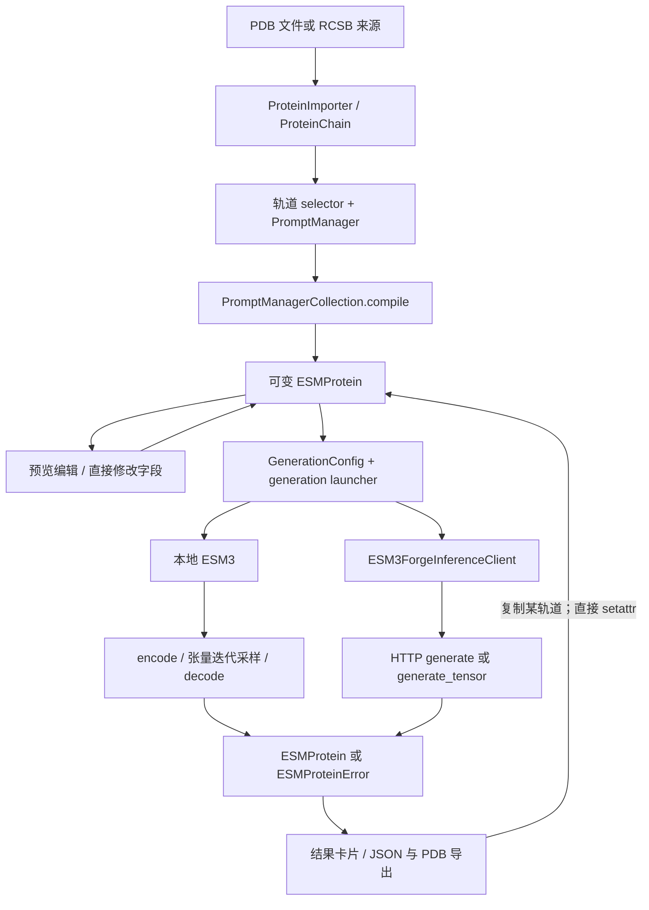

# Biohub/esm：从多轨道编辑到模型执行的 Interface 与 Seam

本文保存第三方固定源码中的技术事实与使用边界，不定义 Protein Workbench 的产品要求、接入协议或重构方案。本项目要求见[当前决策](../documentation-governance-decisions.md)，实现差异见[治理问题清单](../2026-10-15-documentation-governance-issues.md)。
[研究索引](README.md)。

资料核查日期：2026-10-03。源码固定为 `Biohub/esm@43b4548b86762edfa747b07d5f440aad3c33acee`，包版本 `3.4.1.post1`，见 [pyproject.toml](https://github.com/Biohub/esm/blob/43b4548b86762edfa747b07d5f440aad3c33acee/pyproject.toml#L1-L18)。仅静态阅读，未运行上游程序、模型或测试。

## 结论先读

**最值得借鉴的是“选择来源片段 → 放置到目标轨道 → 编译预览 → 生成某一轨道 → 将结果继续作为条件”的交互闭环。** 它直接对应蛋白设计操作，而不要求用户先理解计算图。
**最不应直接照搬的是对象共享方式。** Notebook widgets 的显示状态、片段来源、数组切片、可变 `ESMProtein`、模型配置彼此直接相连；这降低了演示门槛，也使撤销、结果追溯和不同执行方式的替换变难。
以上前者是源码事实，后者是对维护代价的推断，依据分别见 [generation.py](https://github.com/Biohub/esm/blob/43b4548b86762edfa747b07d5f440aad3c33acee/esm/widgets/views/generation.py#L128-L220) 与 [PromptManager](https://github.com/Biohub/esm/blob/43b4548b86762edfa747b07d5f440aad3c33acee/esm/widgets/utils/prompting.py#L122-L193)。

共享 `ESM3InferenceClient` 并不意味着本地与远端可透明互换：异步、原始模型、批次错误、参数突变和网络重试存在实际差异。
这里的 **Module** 是可被调用的一组行为；**Interface** 包含类型、调用顺序、不变量、错误和成本；**Seam** 是替换行为时调用方无需改动的位置；**Adapter** 是填入这个位置的具体实现。
**Depth** 指小 Interface 隐藏了多少复杂行为；让多个视图共享一次转换带来 **Leverage**，让模型知识集中维护带来 **Locality**。

## 1. 实际架构与对象归属



图中两条执行路径来自实际实现；远端路径没有在客户端逐次调用 `encode → sample → decode`，详见后文。

| 对象 / owner | 实际承担内容 | 使用边界 |
| --- | --- | --- |
| `ProteinImporter` / widgets | 上传文本、来源列表、`ProteinChain` 和界面事件 | 来源素材与待生成对象不是同一种值 |
| `PromptManager` / widgets | 来源片段、目标位置、切片值、颜色、标签与 slider | 编辑数据和显示状态存于同一对象 |
| `PromptManagerCollection` / widgets | 四条轨道 manager、功能注释；编译为 `ESMProtein` | 编译是物化多轨道条件，不是执行工作流 |
| `ESMProtein` / SDK | 原始序列、SS、SASA、注释、坐标及模型输出指标 | 是可变输入/输出记录，不是完整工作区文档 |
| `ESMProteinTensor` / SDK | token 轨道、坐标、设备与张量形状 | 是模型表示，包含模型专有编码 |
| `GenerationConfig` / SDK | 目标轨道、采样日程、温度、步数、token 排除项 | 既有用户意图，也有执行细节，且会被修改 |
| `ESM3` / models；`ESM3ForgeInferenceClient` / SDK | 本地神经网络；远端请求转换与 HTTP | 共享名义 Interface，实际能力不完全相同 |

表中字段可核对 [Importer](https://github.com/Biohub/esm/blob/43b4548b86762edfa747b07d5f440aad3c33acee/esm/widgets/utils/protein_import.py#L11-L49)、[PromptManagerCollection](https://github.com/Biohub/esm/blob/43b4548b86762edfa747b07d5f440aad3c33acee/esm/widgets/utils/prompting.py#L16-L40)、[SDK 数据类型](https://github.com/Biohub/esm/blob/43b4548b86762edfa747b07d5f440aad3c33acee/esm/sdk/api.py#L26-L66) 和 [Tensor / Config](https://github.com/Biohub/esm/blob/43b4548b86762edfa747b07d5f440aad3c33acee/esm/sdk/api.py#L230-L372)。

## 2. 端到端场景：固定一个片段，生成序列，再继续设计

以下是固定源码中的实际符号链，可用于核对交互与中间状态的归属。

1. `ProteinImporter.add_pdb_id()` 从上传工作区调用 `ProteinChain.from_pdb()`，或调用 `ProteinChain.from_rcsb()`，把来源放入 `_protein_list`。来源标签含 PDB ID 与 chain，导入失败在 widget 输出区打印。[源码](https://github.com/Biohub/esm/blob/43b4548b86762edfa747b07d5f440aad3c33acee/esm/widgets/utils/protein_import.py#L82-L127)
2. `create_sequence_prompt_selector()` 的 `handle_add_button_click()` 取得 slider 或手填范围，把 `range_to_sequence_motif()` 作为取值回调交给 `PromptManager.add_entry()`；范围切片使用含末端的 `start:end+1`。[源码](https://github.com/Biohub/esm/blob/43b4548b86762edfa747b07d5f440aad3c33acee/esm/widgets/components/sequence_prompt_selector.py#L135-L154)
3. `validate_and_transform_ranges()` 用目标 slider 与首个来源范围的差值平移，保留多个片段之间的间隔；`add_prompt()` 检查范围重叠、保存来源切片和目标范围，再刷新图示。[范围与事件](https://github.com/Biohub/esm/blob/43b4548b86762edfa747b07d5f440aad3c33acee/esm/widgets/utils/prompting.py#L226-L272)、[存储](https://github.com/Biohub/esm/blob/43b4548b86762edfa747b07d5f440aad3c33acee/esm/widgets/utils/prompting.py#L307-L392)
4. `generation.on_compile()` 调用 `PromptManagerCollection.compile()`：序列先全部 mask，再覆盖选择；结构缺省为 `None`，有片段时创建 `(L,37,3)` 的 NaN 数组并覆盖片段。得到的同一个 `ESMProtein` 交给预览和 launcher。[编译](https://github.com/Biohub/esm/blob/43b4548b86762edfa747b07d5f440aad3c33acee/esm/widgets/utils/prompting.py#L33-L119)、[接线](https://github.com/Biohub/esm/blob/43b4548b86762edfa747b07d5f440aad3c33acee/esm/widgets/views/generation.py#L184-L220)
5. launcher 的 `on_generate()` 创建 `GenerationConfig(track, num_steps, temperature, top_p)`，调用 `client_.batch_generate([protein] * n, configs=[config] * n)`；这会重复同一对象引用，不是生成 n 份副本。[源码](https://github.com/Biohub/esm/blob/43b4548b86762edfa747b07d5f440aad3c33acee/esm/widgets/views/esm3_generation_launcher.py#L133-L173)
6. `create_results_visualizer()` 按目标轨道提供结果卡片；“Copy to prompt” 最终进入 `generation.copy_to_prompt_callback()`，通过 `setattr(protein, modality, value)` 修改已编译对象，再重建预览与 launcher。[结果分派](https://github.com/Biohub/esm/blob/43b4548b86762edfa747b07d5f440aad3c33acee/esm/widgets/components/results_visualizer.py#L21-L96)、[回写](https://github.com/Biohub/esm/blob/43b4548b86762edfa747b07d5f440aad3c33acee/esm/widgets/views/generation.py#L128-L182)

**推断：** 最后一步绕过来源片段 manager；因此“已编译并修改的条件”和“来源片段编辑器”是两份可分叉的状态，重新 compile 可能覆盖后续修改。

## 3. 五个最有启发的 Interface / Seam

### 3.1 编辑 → 编译：值得保留交互，适合重画 Seam

**事实：** `PromptManager` 同时存 `prompts`、`tag_to_prompts`、`prompt_to_target_ranges`、颜色计数和 ipywidgets。条目的字典 key 是可读描述字符串；逻辑还通过拆分 `" Target:"` 复用来源。重置事件直接清空 widget 的私有 `_click_handlers.callbacks`。[字段](https://github.com/Biohub/esm/blob/43b4548b86762edfa747b07d5f440aad3c33acee/esm/widgets/utils/prompting.py#L122-L193)、[事件与 key](https://github.com/Biohub/esm/blob/43b4548b86762edfa747b07d5f440aad3c33acee/esm/widgets/utils/prompting.py#L300-L360)
这属于 widgets 的内部 Implementation，没有看到独立、稳定的编辑文档 Interface；`compile()` 虽然调用短，却要求调用方先操纵持有 widget 的对象。

**推断：** 这里的潜在 Depth 是“把范围、位置、冲突与轨道缺省一次处理好”，而不是把几个 widget 构造函数包装起来。
上游结构 manager 的 `allow_multiple_tags=False` 只是此实现的限制，不代表宿主应用必须继承该限制。[构造位置](https://github.com/Biohub/esm/blob/43b4548b86762edfa747b07d5f440aad3c33acee/esm/widgets/utils/prompting.py#L16-L25)

### 3.2 原始蛋白 → 模型表示：`encode/decode` 不是文件序列化

**事实：** `ESMProtein` 的轨道可分别缺省；`__len__()` 返回第一个可用轨道的长度，不负责检查所有轨道一致。Tensor 版本在读取长度和设备属性时才检查对应一致性；`.to()` 原地修改，`.copy()` 深复制。[原始类型](https://github.com/Biohub/esm/blob/43b4548b86762edfa747b07d5f440aad3c33acee/esm/sdk/api.py#L26-L66)、[Tensor 行为](https://github.com/Biohub/esm/blob/43b4548b86762edfa747b07d5f440aad3c33acee/esm/sdk/api.py#L230-L311)
本地 `ESM3.encode()` 对序列/SS/SASA 加模型 token，对结构调用学习到的结构编码器，并把表示移动到模型设备；结构 token 与原始坐标是两个字段。[入口](https://github.com/Biohub/esm/blob/43b4548b86762edfa747b07d5f440aad3c33acee/esm/models/esm3.py#L429-L508)、[结构编码](https://github.com/Biohub/esm/blob/43b4548b86762edfa747b07d5f440aad3c33acee/esm/utils/encoding.py#L48-L97)
`decode_protein_tensor()` 遇到未完成的结构 mask 时不解码结构；有效结构 token 优先于 coordinates，结构 decoder 生成 backbone 后再构造 atom37 坐标。功能注释编解码有损，生成流程会在目标不是功能时恢复原输入注释。[解码](https://github.com/Biohub/esm/blob/43b4548b86762edfa747b07d5f440aad3c33acee/esm/utils/decoding.py#L31-L111)、[结构重建](https://github.com/Biohub/esm/blob/43b4548b86762edfa747b07d5f440aad3c33acee/esm/utils/decoding.py#L138-L169)、[有损处理](https://github.com/Biohub/esm/blob/43b4548b86762edfa747b07d5f440aad3c33acee/esm/utils/generation.py#L118-L125)

这是导出的 SDK Interface，但不能推出通用、无损或跨模型稳定承诺；包元数据仍标记 Alpha。
同理，`FunctionAnnotation.start/end` 的 1-based inclusive 与 widget 的 0-based inclusive 范围应在一处转换；坐标记录还需保留来源残基身份，不能从导出 PDB 反推。上游 `to_protein_chain()` 并未回填原 chain/residue/insertion 标识。[注释](https://github.com/Biohub/esm/blob/43b4548b86762edfa747b07d5f440aad3c33acee/esm/utils/types.py#L14-L33)、[转换](https://github.com/Biohub/esm/blob/43b4548b86762edfa747b07d5f440aad3c33acee/esm/sdk/api.py#L148-L163)

### 3.3 生成执行：名义 ABC 与真实 Adapter 能力不同

**事实：** `ESM3InferenceClient` 是 ABC，声明同步/异步 generate、batch、encode/decode、logits、forward_and_sample、raw_model，但方法只有 `NotImplementedError`，没有 `@abstractmethod` 强制实现。真正使用 Python `Protocol` 的是更内部的 `TokenizerCollectionProtocol`。[Client](https://github.com/Biohub/esm/blob/43b4548b86762edfa747b07d5f440aad3c33acee/esm/sdk/api.py#L680-L751)、[Tokenizer](https://github.com/Biohub/esm/blob/43b4548b86762edfa747b07d5f440aad3c33acee/esm/tokenization/__init__.py#L15-L45)
本地 `ESM3(nn.Module, ESM3InferenceClient)` 提供同步生成及原始模型；异步方法未覆盖。Forge 实现 HTTP 同步/异步，但 `raw_model` 明确不可用。[本地](https://github.com/Biohub/esm/blob/43b4548b86762edfa747b07d5f440aad3c33acee/esm/models/esm3.py#L188-L265)、[Forge raw_model](https://github.com/Biohub/esm/blob/43b4548b86762edfa747b07d5f440aad3c33acee/esm/sdk/forge.py#L1166-L1170)
widgets 还使用 `isinstance(client, ESM3)` / `isinstance(client, ESM3ForgeInferenceClient)` 检查，其他实现即使满足声明也被拒绝。因此它不是只依赖公共 Interface 的插件式 UI。[launcher](https://github.com/Biohub/esm/blob/43b4548b86762edfa747b07d5f440aad3c33acee/esm/widgets/views/esm3_generation_launcher.py#L149-L169)

若只接 Biohub，先做一个深的生成 Module 即可；确定引入本地执行后，再以两种实际实现验证 Seam，而不是提前为任意 Provider 建立抽象注册系统。

### 3.4 采样配置 → 实际执行：需要冻结意图，记录有效配置

**事实：** `GenerationConfig` 含 `schedule`、`strategy`、`invalid_ids`、温度退火等；没有 seed 或 generator。默认 `strategy="random"`、`temperature=1.0`、`num_steps=20`。widgets 只让用户调整其子集。[Config](https://github.com/Biohub/esm/blob/43b4548b86762edfa747b07d5f440aad3c33acee/esm/sdk/api.py#L322-L372)、[界面](https://github.com/Biohub/esm/blob/43b4548b86762edfa747b07d5f440aad3c33acee/esm/widgets/views/esm3_generation_launcher.py#L49-L101)
本地 sampling 的 random 策略调用无 generator 参数的 `torch.randperm`，非零温度采样调用 `torch.multinomial`；温度为零也不能单凭此字段承诺整个多步过程可重现。[解 mask 顺序](https://github.com/Biohub/esm/blob/43b4548b86762edfa747b07d5f440aad3c33acee/esm/utils/generation.py#L281-L326)、[token 采样](https://github.com/Biohub/esm/blob/43b4548b86762edfa747b07d5f440aad3c33acee/esm/utils/sampling.py#L153-L197)
本地会按可采样位置数截短 `config.num_steps`；Forge 在有序列且步数超长时也原地修改它。调用者复用同一配置对象时，“表单输入”不一定仍等于“实际配置”。[本地](https://github.com/Biohub/esm/blob/43b4548b86762edfa747b07d5f440aad3c33acee/esm/utils/generation.py#L354-L401)、[Forge](https://github.com/Biohub/esm/blob/43b4548b86762edfa747b07d5f440aad3c33acee/esm/sdk/forge.py#L897-L925)

把“采样几份”和“随机种子可控”作为两个能力说明。不要新增一个 UI seed 文本框后便声称 Biohub 支持它；本地可控随机流也需要单独定义实际执行与并发规则。

### 3.5 结果 → 下一次编辑：结果身份应独立于展示顺序

**事实：** 结构结果按 pTM 降序展示，缺失 pTM 按零处理；任意一份生成返回 `ESMProteinError`，launcher 就不再展示该批其他成功结果。导出 JSON 是输出蛋白字段，不是来源、编辑、配置和执行的完整文档。[排序](https://github.com/Biohub/esm/blob/43b4548b86762edfa747b07d5f440aad3c33acee/esm/widgets/components/results_visualizer.py#L21-L43)、[批次显示](https://github.com/Biohub/esm/blob/43b4548b86762edfa747b07d5f440aad3c33acee/esm/widgets/views/esm3_generation_launcher.py#L171-L217)、[导出](https://github.com/Biohub/esm/blob/43b4548b86762edfa747b07d5f440aad3c33acee/esm/widgets/utils/serialization.py#L45-L75)
结构渲染函数接收 `ProteinChain` 和高亮范围，每次清空输出、新建 py3Dmol viewer、添加 PDB、设置 cartoon 与 zoom；这是 Notebook 的渲染 Implementation，而不是可直接嵌入 React 的持久场景 Interface。[绘制](https://github.com/Biohub/esm/blob/43b4548b86762edfa747b07d5f440aad3c33acee/esm/widgets/utils/drawing/draw_protein_structure.py#L8-L26)


## 4. 两条执行链，不能画成同一个内部流程

本地的逐符号调用链如下；`generate()` 是单样本的 batch 包装。

```text
ESM3.generate(raw, config)
  → ESM3.batch_generate([raw], [config])
  → iterative_sampling_raw
    → client.encode → ESMProteinTensor
    → client.batch_generate(tensors, configs)
      → iterative_sampling_tokens
        → _batch_forward → client.logits → ESM3.forward
        → sample / 更新被 mask 位置，重复若干步
    → client.decode → decode_protein_tensor → ESMProtein
```

证据：[分派](https://github.com/Biohub/esm/blob/43b4548b86762edfa747b07d5f440aad3c33acee/esm/models/esm3.py#L392-L427)、[raw 包装](https://github.com/Biohub/esm/blob/43b4548b86762edfa747b07d5f440aad3c33acee/esm/utils/generation.py#L99-L127)、[迭代与 logits](https://github.com/Biohub/esm/blob/43b4548b86762edfa747b07d5f440aad3c33acee/esm/utils/generation.py#L403-L549)。

Forge 的 raw-protein 路径则是：

```text
ESM3ForgeInferenceClient.generate(raw, config) [retry_decorator]
  → __generate_protein
  → _process_generate_protein_request
  → _post("generate", request)
    → prepare_request → httpx.Client.post("/api/v1/generate")
    → prepare_data
  → _process_generate_protein_response → ESMProtein / ESMProteinError
```

Tensor 分支使用 `generate_tensor`；`encode/decode` 是另有的独立 endpoint。请求转换将坐标 NaN 变为 wire `None`、注释变 tuple；输出做相反转换。raw 请求包含 `only_compute_backbone_rmsd`，tensor 请求没有该项。[请求字段](https://github.com/Biohub/esm/blob/43b4548b86762edfa747b07d5f440aad3c33acee/esm/sdk/forge.py#L545-L619)、[入口与 HTTP 分派](https://github.com/Biohub/esm/blob/43b4548b86762edfa747b07d5f440aad3c33acee/esm/sdk/forge.py#L897-L1017)、[独立 codec](https://github.com/Biohub/esm/blob/43b4548b86762edfa747b07d5f440aad3c33acee/esm/sdk/forge.py#L1066-L1116)
**推断：** 界面统一的是生成意图与结果处理，不是强迫远端暴露本地迭代细节。不能把等待 HTTP 响应显示为知道真实百分比的采样进度。

## 5. Interface 还包括时序、错误、取消与资源生命周期

| 行为 | 固定源码中的事实 | 对接需要明确什么 |
| --- | --- | --- |
| 批次参数 | 本地断言 inputs/configs 等长；Forge 两种 batch 均用 `zip`，不等长会截断 | 在请求准备的 owner 处保证配对数量，不能把丢样本当成功 |
| 批次顺序 | Forge sync 按 futures 提交顺序读取，async 用 gather | 结果序号可对应输入；随后 UI 排序需保留身份 |
| 批次错误 | sync 捕获任何 Exception 转 500 错误值；async 只捕获 `ESMProteinError` | 同一函数名不等于同一失败语义 |
| 错误类型 | `ESMProteinError` 同时继承 Exception 与 ProteinType | 明确何时为结果、何时被抛出；不要在每个视图分支检查 |
| 超时 / 重试 | 直接构造 Forge 默认单请求 120 秒、最多 5 attempts，带抖动退避；工厂可传入覆盖值 | 不能把单请求 timeout 解释成整次生成的时限 |
| 取消 / 进度 | 这条 ESM3 generate 路径未提供 task ID、cancel endpoint 或进度回调 | 本地停止等待与远端真正取消必须分别表达 |

批次依据：[Forge batch](https://github.com/Biohub/esm/blob/43b4548b86762edfa747b07d5f440aad3c33acee/esm/sdk/forge.py#L929-L966)、[本地检查](https://github.com/Biohub/esm/blob/43b4548b86762edfa747b07d5f440aad3c33acee/esm/models/esm3.py#L398-L427)；错误依据：[错误类型](https://github.com/Biohub/esm/blob/43b4548b86762edfa747b07d5f440aad3c33acee/esm/sdk/api.py#L314-L317)；重试依据：[默认值](https://github.com/Biohub/esm/blob/43b4548b86762edfa747b07d5f440aad3c33acee/esm/sdk/forge.py#L522-L543)、[装饰器](https://github.com/Biohub/esm/blob/43b4548b86762edfa747b07d5f440aad3c33acee/esm/sdk/retry.py#L18-L87)、[工厂](https://github.com/Biohub/esm/blob/43b4548b86762edfa747b07d5f440aad3c33acee/esm/sdk/__init__.py#L16-L32)。

重试处理返回的错误值和抛出的错误，覆盖 429、500、502、503、504；底层 `_post` 还会将部分本地异常包装成 400/500。因此重试不是只有遇到显式 HTTP 5xx 才发生。[HTTP 转换](https://github.com/Biohub/esm/blob/43b4548b86762edfa747b07d5f440aad3c33acee/esm/sdk/base_forge_client.py#L127-L220)
sync/async HTTP client 懒创建；`with` 关闭 sync，`async with` 关闭两者。需要一个执行 owner 管理生命周期，而不是在点击处理器里反复构造长期无主的客户端。[生命周期](https://github.com/Biohub/esm/blob/43b4548b86762edfa747b07d5f440aad3c33acee/esm/sdk/base_forge_client.py#L76-L110)
仓库另有 `_BaseForgeBatchClient` 的提交、轮询和取消机制，但属于另一条批任务路径；不能把它的能力归给 ESM3 `batch_generate`。[另一种任务 Interface](https://github.com/Biohub/esm/blob/43b4548b86762edfa747b07d5f440aad3c33acee/esm/sdk/base_forge_client.py#L223-L225)

**真正可互换的条件：** 相同的可接受输入表示、轨道与模型能力；显式的 mask/长度语义；独立输入与配置所有权；结果身份与错误规则；明确的异步/取消承诺；不承诺不存在的 seed 或相同数值输出。
这些是 Interface 要写清的事实，不意味着两边必须拥有同样模型规模、延迟或数值结果。SDK 的 model 名称/归一化也有各自选择，不能只凭同一 Python 类型推断模型等价。

## 6. 测试 surface：Interface 应让哪些问题可直接验证

**已存在的测试事实：**

- `track_round_trip_test.py` 检查 SASA/SS tokenizer 的往返、特殊值、NaN 拒绝和一残基一字符；它没有证明结构或功能的无损往返。[测试](https://github.com/Biohub/esm/blob/43b4548b86762edfa747b07d5f440aad3c33acee/tests/utils/track_round_trip_test.py#L12-L60)
- `test_oss_client.py` 对真实远端调用 encode、decode、logits、forward_and_sample、generate，主要断言返回类型；需要 URL/API key，默认 pytest 忽略，另有 Docker 入口。[远端测试](https://github.com/Biohub/esm/blob/43b4548b86762edfa747b07d5f440aad3c33acee/tests/oss_pytests/test_oss_client.py#L23-L52)、[默认配置](https://github.com/Biohub/esm/blob/43b4548b86762edfa747b07d5f440aad3c33acee/pyproject.toml#L69-L76)、[独立入口](https://github.com/Biohub/esm/blob/43b4548b86762edfa747b07d5f440aad3c33acee/tests/oss_pytests/Dockerfile#L18-L19)
- `base_forge_client_test.py` 的 fake-clock polling 测试针对另一批任务路径；不能当作 ESM3 取消或真实 Provider 验证。[测试](https://github.com/Biohub/esm/blob/43b4548b86762edfa747b07d5f440aad3c33acee/tests/sdk/base_forge_client_test.py#L129-L210)

该次核查静态检索未找到 widgets 编辑往返、ESM3 sync/async 批次错误一致性、共享 config 修改和 HTTP 生命周期的直接测试；这是阅读范围内的发现，不是运行后的覆盖率结论。
**建议的 surface：** 编辑文档 → 准备请求，验证范围映射、冲突、未提供与待生成区别以及不修改输入；执行请求 → 每样本结果，验证部分失败、参数记录和关联身份；结果采用 → 新版文档，验证撤销及再次编译不丢失采用动作。
模型 Adapter 的转换可通过固定样例验证；远端真实响应、随机性承诺和操作结果仍需真实 Provider 验收。不要用 HTTP mock 证明模型科学行为，也无需为了接这个 SDK 增加与可信本地产品无关的安全层。

## 7. 源码阅读路线与许可

建议按调用者到内部 Implementation 阅读，而不是从模型 attention 层开始：

1. `esm/widgets/views/generation.py` → `components/sequence_prompt_selector.py` → `utils/prompting.py`：确定编辑动作、来源和编译产物。
2. `esm/widgets/views/esm3_generation_launcher.py` → `components/results_visualizer.py`：确认真实可选参数、错误显示与结果回写。
3. `esm/sdk/api.py` → `utils/types.py`：区分原始表示、token 表示、Config、Error 与坐标语义。
4. `esm/models/esm3.py` → `utils/generation.py` → `utils/encoding.py` / `decoding.py` / `sampling.py`：理解本地生成中的 codec 和随机性。
5. `esm/sdk/forge.py` → `base_forge_client.py` → `retry.py`：逐字段核对远端 Adapter，以及 timeout、异常、重试和资源关闭。
6. `tests/utils/track_round_trip_test.py` → `tests/oss_pytests/test_oss_client.py`：区分纯转换测试与真实远端 smoke test。

上文源码链接固定同一 SHA。
代码许可为 MIT，要求保留版权与许可声明；依据是固定提交的 [LICENSE.md](https://github.com/Biohub/esm/blob/43b4548b86762edfa747b07d5f440aad3c33acee/LICENSE.md#L1-L9)。此结论只适用于所核查代码，不能推导模型权重或 Biohub 服务许可。
官方现已使用 Biohub 名称，类名仍保留 Forge；报告沿用真实符号，避免把名称变化误认为另一种执行机制。官方说明见 [README](https://github.com/Biohub/esm/blob/43b4548b86762edfa747b07d5f440aad3c33acee/README.md#L107-L111)。
