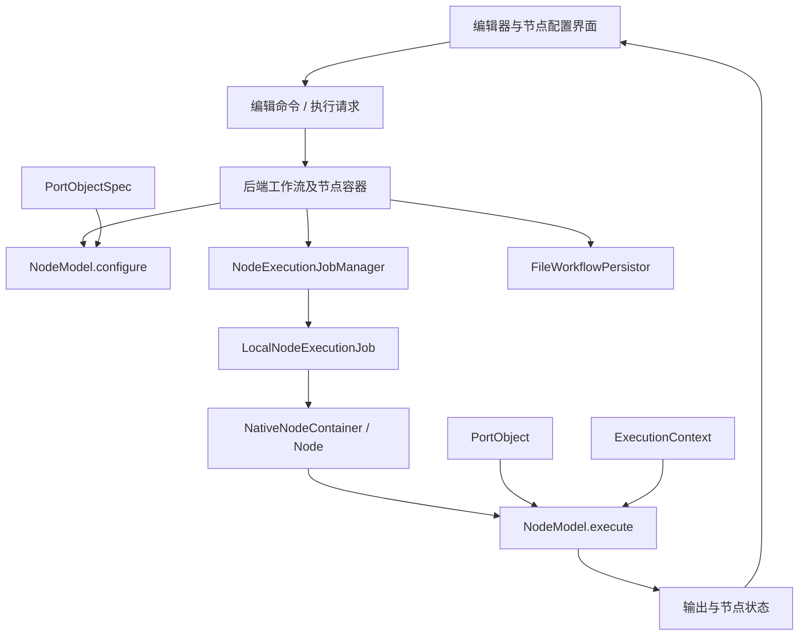
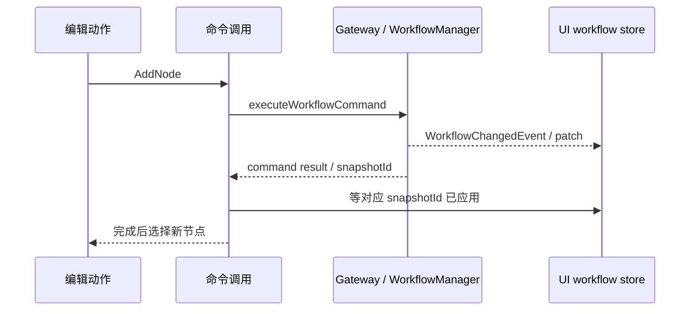

# KNIME：从节点执行契约到工作流编辑器

本文保存第三方固定源码中的技术事实与使用边界，不定义 Protein Workbench 的产品要求、接入协议或重构方案。本项目要求见[当前决策](../documentation-governance-decisions.md)，实现差异见[治理问题清单](../2026-10-15-documentation-governance-issues.md)。
[研究索引](README.md)。

资料核查日期：2026-10-03。仅阅读官方文档和下列固定源码，未安装或运行 KNIME、测试或性能基准。

## 结论

KNIME 最值得借鉴的是三种职责分离：输入规格与实际数据分离、编辑命令与显示投影分离、节点算法与执行策略分离。
它们分别改善“尚未运行时能否配置”“命令返回后界面是否真的更新”“复合节点如何控制内部执行”这三个具体问题。[C-spec][C-model][C-job]
这比照搬节点颜色、折叠卡片或所有插件机制更有价值。

KNIME 的 `NodeModel` 不是一个只有 `execute()` 的轻量函数：开发者还要理解参数验证、配置传播、重置、内部状态保存和取消。
这换来了统一执行与恢复能力，也增加节点作者必须掌握的 Interface；这里的 Interface 包括调用顺序和错误语义，不只是方法签名。[C-model][C-settings][C-internals]

KNIME 同时区分用于整理画布的 metanode 和拥有封装、配置、视图及局部变量作用域的 component。
因此“组是否只是布局”应该作为产品与执行模型的选择重新讨论；KNIME 不是只有一种分组语义。[D-components]
工作流保存或 UI snapshot ID 不能直接证明独立的科学 Run 记录已经存在。

## 固定研究版本

| 仓库/资料 | 分支与固定版本 | 用途 |
|---|---|---|
| `knime-oss/knime-core` | `releases/STS`，`5487725ad40b45793b8ed8180ff8fd6bbd937302` | 节点生命周期、端口值、执行策略、文件保存、测试 |
| `knime-oss/knime-ui` | `releases/STS`，`b0b6d63a86c9f7d24d18e5ee4aa7aedad619bbae` | 图编辑命令、RPC、显示状态、选区和渲染 |
| `knime-oss/knime-gateway` | `releases/STS`，`d8888c478b87f95c5c9bc6586ea80c1f993753a2` | 补足 UI 请求到 core 的命令、撤销和投影链 |
| 官方 Java 开发指南 | 2026-10-03 读取 `latest`，页面显示 5.12 | 对照最新声明式节点开发方向，不用它替代固定源码 |

SHA 来自当日 `git ls-remote --symref ... HEAD refs/heads/releases/STS`；只获取树目录和需要阅读的文件，没有克隆全部历史。
以下 `[C-*]` 是 core、`[U-*]` 是 UI、`[G-*]` 是 gateway 固定源码，`[D-*]` 是官方文档；文末按路径提供阅读顺序。

## 对象及各自负责的内容

| 对象 | 它负责什么 | 调用者必须知道什么 |
|---|---|---|
| `NodeFactory<T>` | 创建 NodeModel、配置对话框和视图，提供描述 | 工厂是节点发现后的构造入口，不是执行记录。[C-factory] |
| `NodeModel` | 输入/输出类型、配置、执行、参数、reset、internals | configure 与 execute 采用配对重载；泛型 Port 与表格专用版本有不同约定。[C-model] |
| `PortObjectSpec` | 配置阶段传播的小型结构描述 | 可在没有实际数据时存在；未知输出规格可以为空，不能等同运行失败。[C-spec][C-configure] |
| `PortObject` | 执行阶段传递实际表格或模型 | 配套 serializer 负责持久化；值和 spec 的保存位置分开。[C-port] |
| `ExecutionContext` | 表格创建、文件存储、进度和取消协作 | 不是任意业务依赖容器；表格产出方式还影响存储复用和写盘开销。[C-context] |
| `NativeNodeContainer` / `Node` | 为算法提供执行上下文，处理消息和输出安装 | 算法异常转换为节点状态/消息，不由画布解释 Java 异常。[C-container][C-execute] |
| `NodeExecutionJobManager` | 创建/提交执行任务、适用性及有关状态 | 执行策略可以改变，算法本身不必因此改写。[C-job][C-submit] |
| `FileWorkflowPersistor` | 保存节点、连接、端口及 UI 信息 | 这是带文件锁的状态保存过程；源码没有承诺跨所有文件原子提交。[C-save] |

这是根据源码整理的职责图，不是 KNIME 发布的类图；UI 的命令响应与事件投影存在额外的同步步骤，见后文。

## 真实调用链一：配置与执行不是同一个动作

首先看参数：`NodeModel.loadSettingsFrom` 先调用 `validateSettings`，再调用 `loadValidatedSettingsFrom`。
验证方法要求不修改现有模型；`saveSettingsTo` 则允许保存尚未完整或尚未一致的配置。[C-settings]
这允许编辑器保存工作进度，同时仍把“能够执行”作为独立判断。

随后是 `configureModel → configure(PortObjectSpec[])`：输入规格按声明类型检查，再由具体节点计算输出规格。
输出内容只有执行后才能确定的节点可以返回未知规格；源码以转置表格为例，行数未知意味着不能提前确定输出列数。[C-configure]
因此 configure 给下游编辑器提供的是可用的结构知识，不是伪造执行结果，也不是所有节点都能给出完整预测。

本地执行链由以下真实方法组成：

1. `AbstractThreadNodeExecutionJobManager.submitJob` 创建任务，将其放入线程池，并关联 Future。[C-submit]
2. `LocalNodeExecutionJob.mainExecute` 调用容器的 `performExecuteNode`。[C-localjob]
3. `NativeNodeContainer.performExecuteNode` 创建 ExecutionContext，设置 NodeContext，调用 `Node.execute`。[C-container]
4. `Node.execute` 检查取消并调用模型包装入口；`NodeModel.executeModel` 最终进入具体节点的 `execute`。[C-execute][C-model-exec]
5. 返回后再次检查取消、处理输出，并标记模型已有内容；容器仅在成功时把输出表放入共享存储。[C-model-exec][C-container]

这是建议，不代表蛋白质的完整残基对应、内容身份或评估结果可以提前推导；哪些信息能够静态确定必须逐操作定义。
避免为所有操作强求完整预览，否则会把 configure 变成另一条昂贵执行路径。

### 错误和取消

`ExecutionMonitor.checkCanceled()` 委托底层 monitor，节点实现需要在长循环或工作阶段中主动调用它。[C-monitor]
本地任务的取消另会调用 `Future.cancel(true)`；这包含线程中断，但不能保证任意外部进程或远端推理已经终止。[C-localjob]
模型即使吞掉中断后正常返回，包装层仍会再次 `checkCanceled()`，防止把已请求取消的执行当成成功输出。[C-model-exec]

异常发生时，`Node.execute` 区分取消、带结构化消息的异常和普通异常；重置模型并返回失败，取消通常形成 warning。
Try/Catch 流程有另外的显式行为：记录错误并产生 inactive 输出，让对应控制结构继续处理。[C-execute]
这些是 KNIME 的语义选择；其取消请求与远端 Provider 的实际终止能力是不同约定。

## 持久化实际保存了什么

节点参数、执行输出、模型内部状态和图/UI 信息不是同一件事。
`saveSettingsTo` 保存参数；`saveInternals/loadInternals` 只对已执行节点调用，用于恢复视图内容、hilite 映射等内部状态。[C-settings][C-internals]
`PortObjectSerializer` 明确不需要重复保存 spec，框架负责分别存放并在读取值时提供对应 spec。[C-port]

`FileWorkflowPersistor.saveContent` 先锁目录，再依次保存节点目录、连接、端口和编辑器 UI 信息，最后写 workflow XML；失败通过异常传播，finally 解锁。[C-save]
源码还有 dirty 检查、普通保存和自动保存路径；执行中保存与空闲保存的 dirty 处理不同。
据此可以说 KNIME 支持工作区恢复和带数据保存；不能据此说每次编辑都是不可变版本，也不能说所有文件具备事务提交保证。

它们可以一起设计保存入口，也可以分别有存储寿命；选择依据应该是恢复、比较和复现任务，而不是对现有接口数量的维护。

## 真实调用链二：新增节点之后，何时才算界面完成？

`nodeInteractions.addNativeNode` 处理选择、只读与网格位置，再调用 `API.workflowCommand.AddNode`；完成后才选中新节点。[U-add]
生成的 gateway API 把参数包装为 `kind: AddNode`，发送 `WorkflowService.executeWorkflowCommand` JSON-RPC。[U-api]
后端依次进入 `DefaultWorkflowService → WorkflowCommands → AddNode → NodeCreator → CoreUtil.createAndAddNode`，最终修改 WorkflowManager。[G-service][G-dispatch][G-create]
`NodeCreator` 在必须建立的连接失败时明确删除刚创建的节点并抛错；这是一条具体的补偿路径，不是所有命令的自动事务回滚。[G-create]

后端根据 WorkflowManager 生成 workflow entity，计算 patch，并通过事件附上 `snapshotId`；UI 将 patch 应用到 `activeWorkflow`。[G-projection][G-event][U-event]
命令响应**若带有** `snapshotId`，前端 wrapper 会等对应 patch 到达才 resolve；没有该字段的响应直接返回。[U-wait]
这个完成条件解释了为什么新增节点后的选中可以依赖对象已进入 UI store，也暴露了必须测试“响应和事件谁先到”的异步问题。
RPC 层负责把协议错误重新抛给调用方；命令执行成功、投影已到达、文件已持久化是三个不同判断。[U-error][C-save]

图中事件与命令响应的相对到达顺序不是保证；wrapper 的价值恰是协调二者。[U-wait]
撤销栈按 WorkflowKey 放在 gateway：执行返回确实修改工作流时才提交命令栈变化；异常时丢弃待提交栈操作，不能据此宣称数据修改全可回滚。[G-undo]
AddNode 的 undo 实际删除节点，能否撤销查询 core 的移除条件；因此这不是浏览器任意恢复一份旧 JSON。[G-addundo]

| 状态 | 实际 owner 与生命周期 |
|---|---|
| 选中/焦点 | UI selection store 区分 preview 与 committed；切换选择协调未保存配置。[U-selection-node][U-selection] |
| 节点位置/连线折点 | UI 拖动预览，完成时提交 Translate；gateway 改 NodeUIInformation、将 workflow 置 dirty，并提供反向操作。[U-moving][G-translate] |
| zoom/scroll | UI 按 project/workflow 跟踪画布视口，与 Translate 命令分开。[U-canvas] |
| 执行诊断 monitor | 后端从 WorkflowManager 形成监视投影；UI 管理加载、可见性及订阅生命周期。[G-monitor][U-monitor] |

## 已有实现证明的扩展位置

### 执行策略：普通节点与可配置 component

`ThreadNodeExecutionJobManager` 创建普通 `LocalNodeExecutionJob`。
`ThreadComponentExecutionJobManager` 对 SubNodeContainer 创建 `LocalComponentExecutionJob`，对内部普通节点仍可创建普通任务；对外可选择性由 `canExecute` 限制。[C-threadjob][C-componentjob]
这说明执行策略是真实存在的 Seam：有两种 Adapter 在同一提交位置提供不同执行行为，而不是只有一个实现的假想抽象。

component 的配置包含 `cancelOnFailure`；该次核查固定源码未发现这里有每组最大线程数选项，不推断存在。
`LocalComponentExecutionJob.beforeExecute` 按需监听内部节点状态，遇到致命事件取消内部 workflow；结束后移除监听。[C-componentexec]
这样保留内部错误传播给 component，而不是简单把 component 本身标成用户取消。
配套测试直接验证显式 manager、默认 manager 和从祖先继承 manager 的解析。[C-jobtest]

成本是必须同时定义嵌套、变量/参数可见性、输出何时可用、部分结果和组内错误如何对外表达。

### UI 传输：桌面嵌入与浏览器

同一 JSON-RPC client 初始化时按 DESKTOP 模式选择 `DesktopAPTransport`，其发送经过 EquoComm；浏览器使用 `WebSocketTransport`。[U-transport][U-desktop]
这是真实的两种 Adapter：改变应用承载环境时，图命令和编辑 store 可以继续跨同一 Seam 调用。
它不等于“只换传输就解决远端运行”：断连后的命令结局、工作流 owner 和订阅重建仍是 Interface 的一部分，不能藏在 socket 包装里。
另有 SVG / WebGL(Pixi) 两套画布及 store 分派；该次核查固定快照默认 SVG，代码带迁移 TODO，应视为实际迁移 Seam，不宣称稳定插件协议。[U-renderer][U-renderer-impl]

### 开发 Interface 的演进：从覆盖方法到声明式节点

固定 core 仍能看到 NodeFactory/NodeModel 的继承式契约；最新官方 Java 指南则展示 `DefaultNodeFactory`、`DefaultNode` builder 和 `NodeParameters`。
新指南将描述、端口、参数类、configure/execute 引用放进一个声明，并从参数注解生成对话框、自动保存加载参数。[C-factory][C-model][D-java]
这是官方文档中可核查的真实开发路线演进，不是本文设计的伪 API。
该次核查没有对其所在 `knime-core-ui` 实现固定 SHA 做深入审计，因此不宣称所有旧节点都已迁移，也不宣称自动界面涵盖所有复杂科学编辑。

“统一声明”应减少重复知识，不应把复杂操作压成一个巨大 JSON-schema 表单或强制一个通用编辑器。

## 测试应该跨过哪个 Interface

core 的真实测试以工作流 fixture 为输入，直接验证 manager 加载和祖先继承，覆盖了仅单测 `submitJob` 看不到的组合行为。[C-jobtest]
UI `event-syncer.test.ts` 分别测试 patch 晚到时等待和先到时立即完成；测试直接跨生产同步器的 Interface。[U-synctest]
gateway 测试通过真实 DefaultWorkflowService/WorkflowMiddleware 和事件收集器执行 Collapse、Copy、Paste，核对三个结果、两个事件及 snapshotId；有结果不等于发生图变更。[G-commandtest]
浏览器拖动和后端 Translate 必须共同验证预览结束、拒绝、确认和 undo；只 mock 一个成功 RPC 无法证明图与命令历史一致。
这些是测试设计建议；该次核查仅阅读，不声称运行过上游测试或验证了所有异常路径。

## 得失与不适用条件

**能获得的能力：** 配置阶段反馈、统一执行生命周期、可切换执行策略、复合节点封装、参数与结果一起恢复。
这些能力集中在后端节点和工作流 owner，多个 UI 入口无需各自实现它们。[C-configure][C-container][C-save]

**需要承担的成本：** NodeModel Interface 跨越配置、执行和恢复；端口专用重载、未知规格、optional/inactive、上下文和内部状态都会增加认知负担。[C-model][C-configure]
`NodeExecutionJobManager` 还包含 reconnect、视图和 internals 等方法，不是一个可以直接复制成薄薄 `submit()` 的完整契约。[C-job]

**不适合直接照搬：** 想用纯函数描述科学操作时，持有可变模型状态和 reset 的方式可能反而使可复现性更难解释。
只有少量直接 Provider 调用时，Eclipse 扩展机制和完整 executor hierarchy 可能比真实变化需求更复杂。
“保存了已执行节点”本身不能证明存在独立的不可变 Run 来源记录或长期结果读取接口。

## 路径阅读顺序与证据

1. `node/port/PortObjectSpec.java`、`PortObject.java`：先区分规格和实际值。[C-spec][C-port]
2. `node/NodeModel.java`：阅读 settings、configure、executeModel、internals 四段，理解完整 Interface。[C-settings][C-configure][C-model-exec][C-internals]
3. `node/workflow/NativeNodeContainer.java`、`node/Node.java`：看一次执行如何获得上下文、错误和可用输出。[C-container][C-execute]
4. `node/exec/*JobManager.java`、`LocalComponentExecutionJob.java`：对照普通任务与 component 策略。[C-submit][C-threadjob][C-componentjob][C-componentexec]
5. `workflow/FileWorkflowPersistor.java` 与对应 workflow tests：确认保存和策略继承，不把文档概念误当实际保证。[C-save][C-jobtest]
6. UI 的 `store/workflow/nodeInteractions.ts → api/gateway-api/index.ts → api/events/event-handlers.ts`：把命令响应和显示完成连起来。[U-add][U-wait][U-event]
7. Gateway 的 `DefaultWorkflowService → commands/WorkflowCommands → AddNode/Translate`：确认真正 owner、错误和 undo；再读 UI transport/renderer，避免从视觉库倒推架构。[G-service][G-undo][G-create][G-translate]

许可简述：core 仓库根说明各 Module 分别持有许可；`org.knime.core` 为 GPLv3，并含 Section 7 additional permissions。
对仅通过标准节点扩展接口交互的独立 Nodes 有附加许可文字；这不能推导任意复制 core/UI 源码都可闭源再分发。[C-license-root][C-license]

[C-factory]: https://github.com/knime-oss/knime-core/blob/5487725ad40b45793b8ed8180ff8fd6bbd937302/org.knime.core/src/eclipse/org/knime/core/node/NodeFactory.java#L74-L84
[C-model]: https://github.com/knime-oss/knime-core/blob/5487725ad40b45793b8ed8180ff8fd6bbd937302/org.knime.core/src/eclipse/org/knime/core/node/NodeModel.java#L119-L145
[C-settings]: https://github.com/knime-oss/knime-core/blob/5487725ad40b45793b8ed8180ff8fd6bbd937302/org.knime.core/src/eclipse/org/knime/core/node/NodeModel.java#L470-L509
[C-internals]: https://github.com/knime-oss/knime-core/blob/5487725ad40b45793b8ed8180ff8fd6bbd937302/org.knime.core/src/eclipse/org/knime/core/node/NodeModel.java#L331-L358
[C-spec]: https://github.com/knime-oss/knime-core/blob/5487725ad40b45793b8ed8180ff8fd6bbd937302/org.knime.core/src/eclipse/org/knime/core/node/port/PortObjectSpec.java#L63-L79
[C-port]: https://github.com/knime-oss/knime-core/blob/5487725ad40b45793b8ed8180ff8fd6bbd937302/org.knime.core/src/eclipse/org/knime/core/node/port/PortObject.java#L67-L141
[C-configure]: https://github.com/knime-oss/knime-core/blob/5487725ad40b45793b8ed8180ff8fd6bbd937302/org.knime.core/src/eclipse/org/knime/core/node/NodeModel.java#L1092-L1235
[C-context]: https://github.com/knime-oss/knime-core/blob/5487725ad40b45793b8ed8180ff8fd6bbd937302/org.knime.core/src/eclipse/org/knime/core/node/ExecutionContext.java#L94-L129
[C-monitor]: https://github.com/knime-oss/knime-core/blob/5487725ad40b45793b8ed8180ff8fd6bbd937302/org.knime.core/src/eclipse/org/knime/core/node/ExecutionMonitor.java#L96-L118
[C-job]: https://github.com/knime-oss/knime-core/blob/5487725ad40b45793b8ed8180ff8fd6bbd937302/org.knime.core/src/eclipse/org/knime/core/node/workflow/NodeExecutionJobManager.java#L72-L285
[C-submit]: https://github.com/knime-oss/knime-core/blob/5487725ad40b45793b8ed8180ff8fd6bbd937302/org.knime.core/src/eclipse/org/knime/core/node/exec/AbstractThreadNodeExecutionJobManager.java#L83-L98
[C-localjob]: https://github.com/knime-oss/knime-core/blob/5487725ad40b45793b8ed8180ff8fd6bbd937302/org.knime.core/src/eclipse/org/knime/core/node/exec/LocalNodeExecutionJob.java#L76-L99
[C-container]: https://github.com/knime-oss/knime-core/blob/5487725ad40b45793b8ed8180ff8fd6bbd937302/org.knime.core/src/eclipse/org/knime/core/node/workflow/NativeNodeContainer.java#L600-L641
[C-execute]: https://github.com/knime-oss/knime-core/blob/5487725ad40b45793b8ed8180ff8fd6bbd937302/org.knime.core/src/eclipse/org/knime/core/node/Node.java#L988-L1088
[C-model-exec]: https://github.com/knime-oss/knime-core/blob/5487725ad40b45793b8ed8180ff8fd6bbd937302/org.knime.core/src/eclipse/org/knime/core/node/NodeModel.java#L589-L647
[C-save]: https://github.com/knime-oss/knime-core/blob/5487725ad40b45793b8ed8180ff8fd6bbd937302/org.knime.core/src/eclipse/org/knime/core/node/workflow/FileWorkflowPersistor.java#L2013-L2171
[C-threadjob]: https://github.com/knime-oss/knime-core/blob/5487725ad40b45793b8ed8180ff8fd6bbd937302/org.knime.core/src/eclipse/org/knime/core/node/exec/ThreadNodeExecutionJobManager.java#L61-L99
[C-componentjob]: https://github.com/knime-oss/knime-core/blob/5487725ad40b45793b8ed8180ff8fd6bbd937302/org.knime.core/src/eclipse/org/knime/core/node/exec/ThreadComponentExecutionJobManager.java#L59-L133
[C-componentexec]: https://github.com/knime-oss/knime-core/blob/5487725ad40b45793b8ed8180ff8fd6bbd937302/org.knime.core/src/eclipse/org/knime/core/node/exec/LocalComponentExecutionJob.java#L80-L101
[C-jobtest]: https://github.com/knime-oss/knime-core/blob/5487725ad40b45793b8ed8180ff8fd6bbd937302/org.knime.core.workflow.tests/src/org/knime/core/node/workflow/EnhAP19181_SeparateJobManagerForComponents.java#L87-L123
[C-license-root]: https://github.com/knime-oss/knime-core/blob/5487725ad40b45793b8ed8180ff8fd6bbd937302/LICENSE#L1
[C-license]: https://github.com/knime-oss/knime-core/blob/5487725ad40b45793b8ed8180ff8fd6bbd937302/org.knime.core/LICENSE.txt#L685-L710
[U-add]: https://github.com/knime-oss/knime-ui/blob/b0b6d63a86c9f7d24d18e5ee4aa7aedad619bbae/org.knime.ui.js/src/store/workflow/nodeInteractions.ts#L225-L270
[U-api]: https://github.com/knime-oss/knime-ui/blob/b0b6d63a86c9f7d24d18e5ee4aa7aedad619bbae/org.knime.ui.js/src/api/gateway-api/generated-api.ts#L7935-L7944
[U-wait]: https://github.com/knime-oss/knime-ui/blob/b0b6d63a86c9f7d24d18e5ee4aa7aedad619bbae/org.knime.ui.js/src/api/gateway-api/index.ts#L6-L14
[U-event]: https://github.com/knime-oss/knime-ui/blob/b0b6d63a86c9f7d24d18e5ee4aa7aedad619bbae/org.knime.ui.js/src/api/events/event-handlers.ts#L47-L64
[U-error]: https://github.com/knime-oss/knime-ui/blob/b0b6d63a86c9f7d24d18e5ee4aa7aedad619bbae/org.knime.ui.js/src/api/gateway-api/rpc-client.ts#L48-L55
[U-selection]: https://github.com/knime-oss/knime-ui/blob/b0b6d63a86c9f7d24d18e5ee4aa7aedad619bbae/org.knime.ui.js/src/store/selection/index.ts#L185-L235
[U-moving]: https://github.com/knime-oss/knime-ui/blob/b0b6d63a86c9f7d24d18e5ee4aa7aedad619bbae/org.knime.ui.js/src/store/workflow/moving.ts#L98-L158
[U-canvas]: https://github.com/knime-oss/knime-ui/blob/b0b6d63a86c9f7d24d18e5ee4aa7aedad619bbae/org.knime.ui.js/src/store/application/canvasStateTracking.ts#L12-L115
[U-monitor]: https://github.com/knime-oss/knime-ui/blob/b0b6d63a86c9f7d24d18e5ee4aa7aedad619bbae/org.knime.ui.js/src/store/workflowMonitor/workflowMonitor.ts#L71-L131
[U-transport]: https://github.com/knime-oss/knime-ui/blob/b0b6d63a86c9f7d24d18e5ee4aa7aedad619bbae/org.knime.ui.js/src/api/json-rpc-client/index.ts#L147-L183
[U-renderer]: https://github.com/knime-oss/knime-ui/blob/b0b6d63a86c9f7d24d18e5ee4aa7aedad619bbae/org.knime.ui.js/src/components/workflowEditor/util/canvasRenderer.ts#L4-L24
[U-renderer-impl]: https://github.com/knime-oss/knime-ui/blob/b0b6d63a86c9f7d24d18e5ee4aa7aedad619bbae/org.knime.ui.js/src/components/workflowEditor/WorkflowPanel.vue#L28-L54
[U-desktop]: https://github.com/knime-oss/knime-ui/blob/b0b6d63a86c9f7d24d18e5ee4aa7aedad619bbae/org.knime.ui.js/src/api/json-rpc-client/DesktopAPTransport.ts#L19-L46
[U-selection-node]: https://github.com/knime-oss/knime-ui/blob/b0b6d63a86c9f7d24d18e5ee4aa7aedad619bbae/org.knime.ui.js/src/store/selection/nodes.ts#L15-L75
[U-synctest]: https://github.com/knime-oss/knime-ui/blob/b0b6d63a86c9f7d24d18e5ee4aa7aedad619bbae/org.knime.ui.js/src/api/events/__tests__/event-syncer.test.ts#L21-L67
[G-service]: https://github.com/knime-oss/knime-gateway/blob/d8888c478b87f95c5c9bc6586ea80c1f993753a2/org.knime.gateway.impl/src/eclipse/org/knime/gateway/impl/webui/service/DefaultWorkflowService.java#L234-L247
[G-create]: https://github.com/knime-oss/knime-gateway/blob/d8888c478b87f95c5c9bc6586ea80c1f993753a2/org.knime.gateway.impl/src/eclipse/org/knime/gateway/impl/webui/service/commands/util/NodeCreator.java#L190-L218
[G-projection]: https://github.com/knime-oss/knime-gateway/blob/d8888c478b87f95c5c9bc6586ea80c1f993753a2/org.knime.gateway.impl/src/eclipse/org/knime/gateway/impl/webui/WorkflowMiddleware.java#L302-L326
[G-undo]: https://github.com/knime-oss/knime-gateway/blob/d8888c478b87f95c5c9bc6586ea80c1f993753a2/org.knime.gateway.impl/src/eclipse/org/knime/gateway/impl/webui/service/commands/WorkflowCommands.java#L286-L305
[G-addundo]: https://github.com/knime-oss/knime-gateway/blob/d8888c478b87f95c5c9bc6586ea80c1f993753a2/org.knime.gateway.impl/src/eclipse/org/knime/gateway/impl/webui/service/commands/AddNode.java#L194-L201
[G-translate]: https://github.com/knime-oss/knime-gateway/blob/d8888c478b87f95c5c9bc6586ea80c1f993753a2/org.knime.gateway.impl/src/eclipse/org/knime/gateway/impl/webui/service/commands/Translate.java#L85-L181
[G-dispatch]: https://github.com/knime-oss/knime-gateway/blob/d8888c478b87f95c5c9bc6586ea80c1f993753a2/org.knime.gateway.impl/src/eclipse/org/knime/gateway/impl/webui/service/commands/WorkflowCommands.java#L164-L195
[G-event]: https://github.com/knime-oss/knime-gateway/blob/d8888c478b87f95c5c9bc6586ea80c1f993753a2/org.knime.gateway.impl/src/eclipse/org/knime/gateway/impl/webui/service/events/WorkflowChangedEventSource.java#L170-L181
[G-monitor]: https://github.com/knime-oss/knime-gateway/blob/d8888c478b87f95c5c9bc6586ea80c1f993753a2/org.knime.gateway.impl/src/eclipse/org/knime/gateway/impl/webui/WorkflowMiddleware.java#L344-L351
[G-commandtest]: https://github.com/knime-oss/knime-gateway/blob/d8888c478b87f95c5c9bc6586ea80c1f993753a2/org.knime.gateway.impl.tests/src/org/knime/gateway/impl/webui/service/commands/WorkflowCommandsTest.java#L513-L568
[D-components]: https://docs.knime.com/ap/latest/analytics_platform_components_guide/
[D-java]: https://docs.knime.com/developers/latest/new_node_quickstart/
